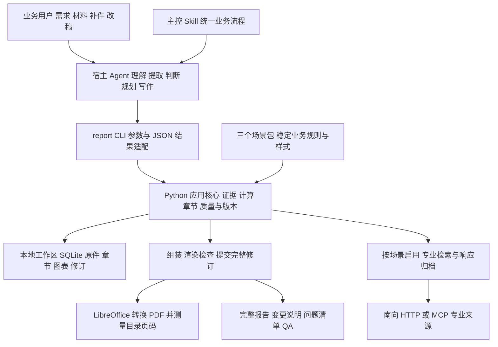

# 长报告分析工作台技术方案设计

本文用于介绍长报告分析工作台的建设目标、总体架构、业务执行机制和实施边界，供技术路线与下一阶段验证安排评审。方案沿用项目已经确认的架构与业务规则；文中标为“建议”的验收安排、职责分工及后续工作，提交本次评审讨论，不代表已经批准或完成。

## 1. 评审摘要

### 1.1 建议评审结论

建议沿用“一个主控 Skill、多个场景配置包、一个 Python 核心、首期 CLI 入口”的技术路线，在单用户本地工作区内完成可追溯的报告生成与多轮修订。当前阶段以预算办快报分析业务样例验证和工程边界收敛为重点，进入部门试用前应完成实际材料、宿主自主执行、独立审阅及最终文件的联合验收。〔S01、S03、S05、S11〕

系统将模型适合承担的材料理解、候选提取、分析判断和写作，与程序应承担的状态管理、数值计算、来源校验、依赖传播和版本发布分开。材料、证据、章节和交付版本在工作区持续保存，宿主更换或对话中断后，可从已保存状态继续处理。〔S01、S02、S11〕

### 1.2 建设价值与验证方式

| 建设价值 | 实现机制 | 建议验证方式 |
|---|---|---|
| 同一套能力支持多类报告 | 共用引擎，按场景加载业务规则与样式 | 同一发行包加载预算办经营管理、财务公司授信评估、人力薪酬分析三场景 |
| 关键数字能够解释和复算 | 原件定位、冻结证据、注册计算、正文引用绑定 | 从报告数字回查原件并独立重算 |
| 补件与改稿能够保持一致 | 新运行固定依据，按依赖更新关联章节 | 更正事实后检查正文、表图、摘要及历史版本 |
| 减少重复生成与人工拼接 | 分章写作、未受影响章节复用、完整报告组装 | 比较两轮重写章节及实际耗时和用量 |
| 输出质量能够检查 | 内容硬检查、独立语义审阅、渲染检查分别执行 | 注入坏引用、缺章、丢图和审阅失败，验证阻断 |

降低耗时和模型用量属于预期收益。当前不承诺固定节省比例、报告页数或生产吞吐量，相关指标随试用样例实测建立。

### 1.3 本次评审需形成的意见

| 评审事项 | 本稿建议 | 需形成的结果 |
|---|---|---|
| 架构与部署边界 | 延续模块化单体、单用户本地工作区和 CLI 入口 | 确认下一阶段仍按该范围推进 |
| 试点范围 | 预算办快报场景先完成真实或脱敏样例闭环，财务公司授信评审与人力部分薪酬分析验证共用机制和差异规则 | 指定样例范围及业务接口岗位 |
| 业务口径 | 由业务岗位确认预算、授信与薪酬的必要定义 | 形成有版本的口径及正式交付要求 |
| 数据处理范围 | 按项目明确宿主模型可处理材料与外部查询信息 | 确认可用模型、允许材料及必要隔离条件 |
| 试用准入 | 先完成第10节验收，再决定部门试用范围 | 指定业务与技术验收责任人 |
| 后续优先级 | 优先解决自主执行、审阅独立性、发布恢复和实际版式 | 确认里程碑与依赖，不以界面建设替代闭环验收 |

## 2. 建设背景与范围

### 2.1 需要解决的问题

企业长报告通常同时涉及多份表格与文档、多个经营单位、跨期间比较和多轮补件。仅保存聊天正文，会使事实依据、计算过程、章节依赖和历史版本难以核对；整篇重写也容易造成未修改章节漂移、表图遗漏或新旧口径混用。

本项目将“一份报告的持续生成与修订”组织为报告项目。每个项目绑定一个分析场景、明确对象范围以及报告期或评价基准，围绕该项目保存原件、证据、计算、章节、审阅和交付版本。〔S01、S04〕

### 2.2 首期业务范围

| 分析场景 | 分析对象与业务目标 | 关键边界 |
|---|---|---|
| 预算办经营快报分析 | 企业、板块及本次范围内单位；解释经营表现、预算差距与管理关注 | 当月、累计、年度目标分开；单位汇总与集团合并分开；范围内单位逐一覆盖 |
| 财务公司授信评审 | 财务公司对业务单位的具体授信事项开展风险审查 | 形成风险评估与策略建议；额度、等级及期限依据来自外部既有流程 |
| 人力薪酬分析 | 按部门、岗位或职级等群体分析薪酬结构、差异、预算与人效 | 人员明细用于统计；主报告按群体呈现；小样本与未知公式显式处理 |

三场景的业务目标和必要约束分别以对应场景规格为依据。〔S07、S08〕

预算项目换报告期，或授信项目换申请事项、评价基准，应建立关联新项目。同一期的补件、纠错和改稿产生项目内新修订。外部编辑的 Word 作为人工修订参考材料吸收，不能直接覆盖权威版本。〔S04〕

### 2.3 首期技术边界

首期运行在单用户本地工作区，优先使用DeepSeek Harness 等宿主已配置的模型与执行环境，通过 Python CLI 调用同一核心。后续版本需要支持的 HTTP 服务、 MCP 服务、多用户权限平台、统一任务调度和分布式部署属于后续扩展范围。 HTTP/MCP 专业来源适配是作为信息接入的另一条接入方向，当前版本暂不做验证。

当前材料处理覆盖 CSV、XLSX、TXT、DOCX 和可提取文字的 PDF。扫描件 OCR、复杂版面的完整识别以及任意 Word 模板的自动导入，需按实际需要另行验证。Excel 公式核验只支持实现明确覆盖的子集，不能按完整 Excel 计算引擎对外承诺。〔S03、S14〕

## 3. 总体架构设计

### 3.1 架构组成

主架构由通用报告引擎、场景配置包和 Agent 适配层组成；主控 Skill 为宿主提供贯穿各阶段的业务操作指引。工程采用一个 Python 发行包和一套本地项目存储，不要求将逻辑模块拆成独立服务。〔S01、S05〕



图中展示逻辑职责和调用方向。完整组件图及含异常、修订回路的流程图见[项目框架图](../.archify/architecture-project-framework-20261026-132709/project-framework.html)与[业务执行流程图](../.archify/architecture-project-framework-20261026-132709/business-workflow.html)。

### 3.2 四层执行职责

| 执行层 | 主要职责 | 主要产物 | 当前代码落点 |
|---|---|---|---|
| 场景配置层 | 加载版本化规则，校验引用与允许覆盖项 | 场景定义、有效配置与指纹 | scenario.py、scenarios/ |
| 解析与事实层 | 解析定位、候选事实接收、证据裁决、注册计算 | 来源片段、证据快照、计算及图表 | application.py、operators.py、formula_verification.py、compensation.py、charts.py |
| 章节状态机层 | 固定运行依据，校验动态计划，展开任务及更新影响 | 章节 DAG、上下文、章节正文与复用记录 | application.py |
| 拼装与交付层 | 生成全文，检查内容与文件，提交报告修订 | MD、DOCX、PDF、清单和 QA | application.py、rendering.py |

四层是责任划分，当前并未分别部署。状态和资产管理贯穿多层，CLI 负责入口映射，不重复实现计算与业务规则。当前应用核心仍包含预算、薪酬等专用分支；“配置驱动”是共用流程与规则管理方式，不能据此宣称全部业务差异已完全配置化。〔S02、S13〕

### 3.3 模型与程序的职责边界

宿主负责识别用户要求、解释材料含义、提出候选事实及关联、规划章节、组织分析和进行语义审阅。不能确定的来源、对象、口径和因果关系，应保留歧义及影响说明。

程序负责能够通过规则明确回答的事项，包括格式与引用检查、来源原值比对、注册算子计算、任务就绪判断、依赖传播和文件写入。候选内容能否进入当前运行，由运行状态、输入指纹、来源定位和适用规则约束；不能仅依赖模型的自信或对话记忆。〔S01、S02、S11〕

### 3.4 主要技术选择

| 选择 | 当前采用方式 | 适用理由与代价 |
|---|---|---|
| 运行与交付 | Python 3.12及以上，一个发行包，CLI 作为首期入口 | 复用宿主工具执行能力；需要管理本地运行依赖 |
| 规则管理 | YAML 四文件及版本化 Word 模板 | 便于业务规则审阅；新增算法仍需开发和测试 |
| 状态与资产 | 项目级 SQLite 保存结构化状态，文件系统保存原件和产物 | 适合本地单用户；备份和恢复需要同时覆盖两部分 |
| 数值处理 | Decimal 与注册算子，先核对可比维度 | 计算可追溯；不能自动补全企业口径和缺失基准 |
| 文档处理 | 已安装的表格、Word、PDF与图像依赖；LibreOffice 渲染 | 表格可编辑、图表可嵌入；字体和转换环境必须验收 |

以上为仓库当前选型对照，不构成对依赖最新版本或完整协议兼容性的证明。依赖声明见 pyproject.toml。〔S13、S14〕

## 4. 场景配置与运行时计划

### 4.1 场景四文件契约

| 文件 | 保存的稳定内容 | 校验重点 |
|---|---|---|
| scenario.yaml | 场景身份、主体与期间模型、材料角色、检索开关、模板及交付要求、可覆盖字段 | 场景版本、材料类型、资源引用和覆盖白名单 |
| outline.yaml | 稳定的规划与呈现要点 | 不预置单位名单和固定章节 DAG |
| analysis.yaml | 证据选择、注册指标、分析与写作要点、检索任务 | 算子、输入及任务引用有效 |
| quality.yaml | 证据、覆盖、表图、审阅和交付要求 | 不通过项目覆盖关闭基础硬检查 |

当前三个场景均为 0.2.0。项目创建时固定场景身份与有效配置，允许的项目覆盖经过类型和白名单校验，保存在项目内，不写回共享场景包。没有填写的必要业务定义保持显式缺口，不由模型猜测。〔S05、S10、S13〕

### 4.2 每轮生成的内容

单位范围、材料的本轮用途、当前工作簿行列映射，以及本轮章节、展示顺序和依赖，均根据用户要求与当前材料形成。场景包只保存稳定规则；历史报告和参考模板用于核对要求，不能直接充当当前项目证据。〔S10、S11〕

首次 draft plan 提交 report_request 与 outline。预算场景另需 material_uses，对全部当前材料逐份说明用于分析、仅作背景或排除及其原因；已有接受证据的材料应进入分析。单位章节须覆盖项目范围内全部单位，不能通过缩小目录隐藏缺材料单位。

章节展示顺序与执行顺序分开。管理摘要可以排在报告前部，但依赖主体分析完成后再写。计划生成章节任务后固定；新增要求需要改变已冻结计划时，应重开未发布运行或在已发布版本上启动修订运行。

### 4.3 扩展与升级

已有解析格式、算子和契约能够表达的新场景，可通过新增配置包接入；新的数据格式、算法或未覆盖的业务能力，应在核心中增加实现与验证。场景升级、模板变更和项目要求调整分别留痕，不静默改变既有运行及历史修订。〔S05、S10〕

## 5. 业务执行流程设计

### 5.1 六阶段闭环

| 阶段 | 业务动作与 CLI 对应 | 输出与进入下一阶段的条件 |
|---|---|---|
| 1 建项与归档 | scenarios/scenario；project create；material add；run start | 项目身份、原件与解析结果、本轮材料及配置；项目身份和期间明确 |
| 2 取证与封存 | task list/context；submit 或 auto-submit；evidence decide/freeze | 有定位的候选、可用证据及快照；任务已提交，来源冲突已解决 |
| 3 计算与规划 | calculate；chart create；draft plan | 注册计算、带来源图表、章节计划与 DAG；证据已冻结，计划引用有效 |
| 4 写作与合稿 | draft context/submit/build | 逐章正文及完整 Markdown 候选；章节依赖、引用及适用内容检查通过 |
| 5 审阅与校验 | review submit；validate | 独立审阅记录、硬检查和缺口；审阅绑定当前全文哈希 |
| 6 渲染与发布 | publish；revision latest | 完整文件、清单、问题和变更说明；渲染检查成功后登记修订并切换当前版本 |

### 5.2 取证的处理方式

材料归档保留原件、内容指纹和来源定位。宿主从当前任务上下文提交候选事实；结构稳定的表格可以提交本轮核对过的映射，由程序提取。系统比对来源定位和原值，核对对象、期间及适用口径，再接受、拒绝或有理由地替代证据。发现同一业务身份的冲突时，不按文件上传顺序自动覆盖。〔S11、S13〕

专业检索由场景配置启用，核心通过已计划的提供者执行。原始响应先归档，再核对被查主体、时点和出处；取得的记录进入同一材料与取证链。失败、未命中、部分结果和主体不匹配分别留痕，不能表述为没有风险。符合场景时效与完整性条件的结果可以在项目内复用；证据冻结后取得的新结果进入后续运行。〔S09〕

### 5.3 计算与分析的处理方式

预算比较先匹配主体、指标、期间、当月或累计、单位及适用预算版本，再计算差额和比率。零或负基期、转亏和缺少可比基准时返回明确状态，不能机械生成百分比。集团合并数据、单位汇总、板块合计和专项分别保持其口径。

图表使用冻结证据，并关联已计算的指标和来源定位；跨期间比较还需对应可比计算。薪酬计算通过工资与人员归属记录形成群体结果，按已配置口径和小样本阈值决定是否展示。缺少参数时停止对应统计或展示并说明限制。〔S11、S13、S14〕

### 5.4 补件与改稿的处理方式

同一期新增材料、事实更正或要求变化进入新运行。系统比较材料、证据、计算及章节依赖，标记需要更新的章节，并向依赖章节传播；未受影响章节按规则复用。被锁定章节与新依据冲突时显式报错，由用户决定解锁或调整要求，不能保留已失效结论。

示例：用户更正某矿山的累计利润，新运行接受替代证据并重新计算，更新该矿山分析及依赖的汇总和摘要；其他单位只有在依赖或证据范围受影响时才更新。最终仍交付完整报告，上一修订保留。该示例说明预期机制，实际更新集合须由依赖与验收记录证明。

## 6. 数据与状态设计

### 6.1 关键业务对象

| 对象 | 主要内容与关联 | 保存目的 |
|---|---|---|
| 报告项目 Project | 场景及版本、对象范围、报告期或评价基准、允许覆盖项 | 固定一份报告的业务边界 |
| 上传材料 Material | 原件路径、内容指纹、输入角色、解析定位、明确替代关系 | 保留事实依据及材料历史 |
| 更新运行 Run | 基础修订、本轮材料与配置、证据快照、报告计划、活动状态 | 隔离一轮更新的输入与提交资格 |
| 提取或检索任务 Task | 运行、输入来源或查询、输入指纹、提交状态 | 可恢复地领取与提交工作 |
| 候选事实与可用证据 | 对象、指标、期间、值、定位、采用或替代依据 | 区分提取结果与已采用事实 |
| 证据快照 | 本轮采用证据 ID、材料及定义缺口、检索缺口 | 固定计算与写作依据 |
| 计算与图表 | 算子及结果、输入证据、资产路径和哈希 | 复算数字并验证图表来源 |
| 章节任务与正文 | 章节身份、依赖、展示顺序、作者、正文及复用记录 | 分章生成和关联更新 |
| 审阅记录与报告修订 | 全文哈希、审阅人及结论、文件清单、QA、当前指针 | 验证交付依据并保留历史 |

上述是领域对象视图。当前主要采用 SQLite 表中的结构化 JSON 保存状态，不能将该表理解为已独立建成的领域服务或完整数据库迁移体系。〔S02、S13〕

### 6.2 工作区与文件组织

```text
<workspace>/<project_id>/
  state.sqlite                  项目、运行、任务、证据、章节、审阅、修订及当前指针
  sources/<material_id>/        归档原件
  assets/                       已登记图表
  runs/<run_id>/
    retrieval/                  原始专业来源响应及派生材料
    draft/                      本轮候选全文与引用图表
  revisions/<revision_id>/
    manifest.json               修订身份、输入指纹、文件哈希及关联
    snapshot/                   有效配置及 Word 模板副本
    qa/                         内容与渲染检查结果
    dist/                       完整报告、图表、问题清单、变更说明
```

结构化状态是操作的权威依据，文件资产通过路径和内容哈希关联。修订中的 snapshot 不等于完整项目备份；恢复必须同时具备状态库、原件和所依赖的文件资产。

### 6.3 三类状态必须分开

| 状态维度 | 当前主要值 | 含义 |
|---|---|---|
| 运行生命周期 | active、canceled、published | 当前运行是否仍具有提交和发布资格 |
| 章节任务执行 | ready、blocked、submitted | 是否已满足前置依赖，是否已提交正文 |
| 报告校验与交付身份 | blocked、pending_review、formal | 是否存在硬失败，以及必要证据和定义是否仍有记录缺口 |

章节的 blocked 表示依赖未就绪；报告校验的 blocked 表示硬检查未通过，两者不能混为一个项目总状态。published 说明运行已经产生交付修订，该修订仍可以是 pending_review。formal 不自动代表业务负责人已经批准。〔S04、S13〕

### 6.4 固定依据与提交检查

运行开始时固定材料集合、指纹及有效配置，证据封存后计算和写作读取该快照。当前提交接口检查运行资格、任务输入指纹、来源原值或正文哈希等条件，减少旧依据结果混入新运行的风险。

单活动运行、过期基础修订检查和发布重试校验已有实现；取消与发布竞争、跨进程并发、统一幂等和中断恢复仍需专门验证，不能将顺序执行通过等同于并发正确。〔S02、S06、S13〕

## 7. 质量门禁与完整交付

### 7.1 三类质量检查

| 检查类型 | 主要检查内容 | 执行责任及边界 |
|---|---|---|
| 数据和内容硬检查 | 来源与资产完整性、证据冻结、章节完成、注册引用、材料和对象覆盖、适用隐私规则 | 程序执行；通过只证明已实现检查满足 |
| 独立语义审阅 | 结论是否受证据支持、因果是否过度解释、建议是否有前提、限制是否充分披露 | 独立于作者的审阅任务；需要实际独立上下文及业务判断 |
| 渲染与文件检查 | DOCX 标题、表格、嵌图与全文一致；PDF 生成及图像存在；目录实际页码稳定 | 程序检查加最终逐页人工复核；不能只检查文件存在 |

当前 review submit 校验审阅人 ID 不同于作者、审阅结论与当前全文哈希一致等条件；它没有提供审阅人身份认证或上下文隔离。真正的审阅独立性必须在宿主执行与业务验收中落实。〔S12、S13〕

### 7.2 缺口与技术失败的不同处理

| 情况 | 流程处理 | 交付结果 |
|---|---|---|
| 缺少预算、业务定义或部分专业检索结果 | 完成有依据部分，在相关章节说明影响和待补项 | 硬检查通过后可交付 pending_review |
| 来源冲突尚未裁决 | 记录冲突并按明确依据处理 | 冲突未解决时不能封存证据 |
| 缺章、坏引用、审阅未通过或资产被修改 | 修复内容、依据或执行流程后重验 | 阻止发布，不能用 pending_review 绕过 |
| Word/PDF 转换、图像或目录检查失败 | 修复渲染环境或文件后重试 | 不切换最新版本 |
| 硬检查通过且无记录的必要缺口 | 完成渲染与版本提交 | 可标记 formal；仍不等于业务签认 |

证据充分性与程序检查覆盖范围也要分开。程序没有识别到的业务问题仍可能存在，正式交付要求需要通过企业样例和专业审阅进一步校准。

### 7.3 发布顺序与当前实现限制

发布先校验当前候选和场景指纹，再在暂存目录复制全文、图表与模板，生成 DOCX 和 PDF，核对标题、表格与嵌图，测量并收敛目录页码，最后写入清单、QA、问题与变更说明。成功后将暂存目录变为新修订目录，登记修订并切换 latest；旧修订不覆盖。〔S13、S14〕

设计目标是“检查全部通过后切换当前交付”。当前目录 rename 与 SQLite 写入分步执行，尚未证明断电、中断或并发情况下具有跨文件系统与数据库的事务一致性。该边界应通过故障注入与恢复验收收敛，不能据此宣称已具备生产级原子发布保证。

当前预算配置要求 MD、DOCX、PDF，授信和薪酬配置将 PDF 列为可选；但发布实现统一调用 LibreOffice 生成 PDF，以测量 Word 目录页码。下一阶段需明确“PDF 是否对外交付”与“内部测页是否依赖 PDF”的关系，并使配置、执行和错误提示一致。

已提交审阅的正文当前不允许直接替换，审阅记录也不能任意覆盖。审阅失败或冻结依据需要修正时，演示与验收应覆盖取消未发布运行后重开等实际可执行路径，避免在流程说明中承诺不存在的原地修复能力。

## 8. 部署 运行与数据保护

### 8.1 本地运行拓扑

宿主通过本地进程启动 report CLI，CLI 在同一 Python 进程内调用应用核心，核心读写项目工作区，并按需启动 LibreOffice 子进程。启用专业来源后，核心的南向适配器访问指定 HTTP/MCP 服务。模型推理使用宿主已有环境，当前 Python 核心不承担独立的模型调度服务。〔S03、S05、S13、S14〕

运行准备包括 Python 环境和依赖、三个场景及模板、可访问项目目录、中文字体、LibreOffice，以及启用检索时的实际服务地址与权限。对外部服务的超时、失败、空结果和部分结果应显式呈现，重试和切换不能由模型临时猜测。

### 8.2 数据可见范围

本地落盘不意味着材料不会被宿主发送至远端模型。试点前应按项目确认允许模型处理的材料范围、允许外发的查询字段、原件保存位置及必要隔离条件。当前工作区没有形成多用户访问控制边界，宿主若有文件权限仍可能读取原件。〔S04、S09〕

薪酬场景已有群体聚合、阈值隐藏和正文个人标识检查，但这些机制不能替代操作系统权限隔离，也不能证明已消除所有交叉表反推风险。需要强隔离的材料，应先满足相应运行条件再接入。

### 8.3 维护与恢复建议

建议按场景版本、项目 ID、运行 ID、修订 ID、证据快照 ID 和文件哈希组织排查，优先利用现有状态及 QA 文件，不另建重复的可写事实清单。

备份应覆盖 state.sqlite、归档原件、图表、运行和修订文件，并在停止写入或具有一致性措施时制作。下一阶段应实际演练恢复后读取最新修订、回查证据和继续补件。数据库迁移、崩溃残留目录处理和历史版本回退的完整操作方案，作为验证与维护工作交付；当前 CLI 没有直接的版本回退命令。

## 9. 当前实现状态与差距

### 9.1 证据分层

| 层次 | 已有证据 | 能说明什么 | 不能替代什么 |
|---|---|---|---|
| 当前代码与配置 | 一个 Python 核心、主控 Skill、三个 0.2.0 场景及 CLI；与本次架构图快照核对一致 | 当前职责、接口与实现路径可以追查 | 实际业务有效性及并发可靠性 |
| 当前本地回归 | 2026年10月26日同会话 43 项单元测试通过，三场景加载成功 | 已覆盖样例和契约的自动回归 | 所有未知材料、开放式写作及视觉验收 |
| 历史脚本与产物 | 0.1.0 三宿主同 wheel 脚本化回归和四轮修订；旧预算参考工作稿 | 当时输入与操作下的工程链路可运行 | 当前 0.2.0 自主规划、取数、写作及业务签认 |
| 0.2.0 增量记录 | 动态章节、运行时映射及相关指标的增量记录 | 部分新能力有独立验证证据 | 全部参考报告重做、三宿主开放式流程和逐页审查 |

验收应保留输入、场景与模板指纹、实际执行记录和完整产物，不把“存在配置”“能够导出文件”或“历史样例通过”写成当前业务验收通过。〔S03、S10、S12、S15〕

### 9.2 优先收敛的问题

| 问题 | 当前影响 | 建议处理及验证 |
|---|---|---|
| 企业必要口径尚未全部确认 | 部分计算、风险判断及正式版身份受限 | 业务岗位确认口径、适用范围及版本；检查允许覆盖字段是否足够 |
| 宿主开放式执行与独立审阅待验 | 固定测试正文通过不能证明自主报告质量 | 使用未预制正文的材料，观察取证、规划、写作和独立审阅全过程 |
| 发布与取消的并发、中断边界待验 | 可能出现目录、运行资格与状态索引不一致 | 双进程和故障注入验证，明确恢复操作及不重复提交条件 |
| 专业服务仅完成合成提供者验证 | 真实认证、返回形态、SSE和覆盖语义未知 | 按实际供应商契约联调并保存原始响应 |
| PDF 配置与统一测页执行存在差异 | 部署依赖及失败预期不清晰 | 明确交付策略并验证所有场景的缺依赖行为 |
| 业务分支集中于应用核心 | 新增场景时可能继续扩大专用分支 | 按实际扩展需要收敛重复规则，保持同一操作入口；不先建空模块 |
| 实际规模与最终版式待验 | 长文档、大表、字体与图表可读性存在不确定性 | 用代表性大材料和四份参考报告逐页验收，并记录性能 |

## 10. 实施安排与验收设计

### 10.1 建议里程碑

以下为工作顺序建议，不代表工期、人员投入或预算承诺。各阶段以可复核产物作为出口，具体计划由负责人结合材料和环境到位情况确定。

| 阶段 | 主要工作 | 交付物与完成条件 |
|---|---|---|
| A 口径与样例准备 | 确认试点范围、必要业务定义、材料可见范围、模板与实际样例 | 经业务确认的口径表、样例清单和验收预期；未知项逐项保留 |
| B 当前工程边界收敛 | 处理发布恢复与取消竞态、PDF策略、审阅失败路径和关键配置差异 | 对应失败用例、恢复记录及一致的接口与文档 |
| C 业务完整闭环 | 预算参考报告重做；授信与薪酬实际或脱敏样例；自主取证、规划、写作与独立审阅 | 完整报告、来源与计算复核、逐页版式检查、业务问题闭环 |
| D 跨宿主及试用准入 | 按实际使用宿主复测相同契约；验证部署、权限、备份恢复和实际用量 | 可重现安装与操作指引、验收记录和明确的试用范围 |

真实供应商接入依赖服务与权限到位；可以与其他样例验证并行准备，但未完成部分必须在验收记录中明确，不将其默认视为通过。

### 10.2 建议验收矩阵

| 场景或测试 | 关键操作 | 通过标准 |
|---|---|---|
| 预算首次生成 | 当前原件提取、逐户计算、动态规划、表图与摘要 | 关键数字可复算；范围内单位和材料用途完整；全文及表图可访问 |
| 补件与更正 | 替代原材料或证据，启动新运行 | 受影响内容及依赖同步更新；未受影响内容按规则复用；历史保留 |
| 来源冲突与锁定 | 提交矛盾来源、触发锁定章节冲突 | 冲突显式呈现，未裁决不封存；不静默覆盖或沿用失效结论 |
| 计划变化 | 在新轮追加专题或变更章节依赖 | 新计划与本轮需求一致；循环或无效引用拒绝；已开始计划变更走新运行 |
| 授信与专业来源 | 核对外部结果，执行成功、失败、部分及不匹配查询 | 主体和时点可查；调用状态与证据充分性分开；不自行生成额度或等级 |
| 薪酬与小样本 | 按已确认口径聚合，测试小样本及未知阈值 | 展示符合群体及隐藏规则；正文不暴露测试中的个人标识；未知公式不补算 |
| 审阅失败 | 独立审阅提出问题并重新形成候选 | 失败候选不发布；修复与重开路径可执行；最终审阅绑定当前全文 |
| 文件与渲染 | 检查标题、表格、图像和实际目录页码 | 无丢章、丢图、明显截断、错页码及乱码；逐页人工记录可读性 |
| 中断与竞争 | 在渲染、目录提交、状态写入附近中断，并测试取消与重复发布 | 已交付版保持可查；不发布已取消候选；无重复切换或无法解释的残留状态 |
| 恢复与跨宿主 | 恢复备份，换会话或在拟使用宿主继续更新 | 输入身份、计算及版本链一致；无须依靠旧聊天补造状态 |

数据、引用、覆盖和文件检查按用例确定通过标准；性能验收建议记录材料规模、证据量、章节数、产物页数、各阶段耗时、峰值内存、模型实际用量及重写比例，再由小组确定可接受阈值。

### 10.3 建议职责分工

| 角色 | 主要责任 | 交付与确认内容 |
|---|---|---|
| 部门业务负责人 | 确认试点目标、使用边界和业务准入 | 场景优先级、口径责任岗位、业务验收意见 |
| 小组技术负责人 | 维护架构边界，协调实施与验收 | 技术任务、接口一致性、发布与恢复检查 |
| 场景业务岗位 | 提供原件、解释口径、复核分析价值 | 样例预期、指标与风险规则、待确认事项处理 |
| 实施开发岗位 | 维护核心、配置、模板和运行环境 | 可安装版本、变更记录、对应测试及操作指引 |
| 独立审阅与验收岗位 | 审阅专业结论与最终文件 | 与作者分离的审阅记录、逐页检查和问题清单 |

角色可按现有人力兼任，但同一候选报告的作者与独立审阅任务需要分开。人员姓名、投入和排期由评审后指定。

## 11. 主要风险与评审后的处理

| 风险 | 业务或技术后果 | 控制安排与责任接口 |
|---|---|---|
| 未确认口径被当作默认事实 | 形成不可比指标或无依据结论 | 业务岗位确认必要定义；系统保留缺口；审阅检查适用条件 |
| 模型解释超出证据 | 原因、风险或建议表述过度确定 | 冻结来源、引用绑定、事实与假设分开、独立语义审阅 |
| 本地材料被宿主超范围处理 | 原件或查询信息超出允许可见范围 | 部门确认模型与材料范围；技术负责人验证实际权限与运行环境 |
| 已取消或旧依据结果迟到提交 | 报告包含过期结论或切换错误修订 | 校验运行资格与输入；补齐并发及中断验收 |
| 历史成功被当作当前就绪证明 | 试用条件和质量预期失真 | 每次记录实际版本、输入与执行范围，分开列示历史和当前证据 |
| 渲染环境与原件规模差异 | 乱码、截表、丢图、耗时不可接受 | 明确字体与转换依赖，用代表性材料逐页和性能验收 |

评审后的建议输出是一份明确的行动记录：确认的技术路线与边界、首批样例及责任岗位、仍待提供的企业定义和服务条件、优先整改项，以及进入部门试用的验收条件。该记录应与现有 ADR 和场景规格关联；如果评审改变已接受规则，再补充新的 ADR 并同步相关契约。

## 12. 评审汇报顺序建议

面向部门领导，可先用第1节说明建设价值和需要形成的意见，再用第3节架构图解释宿主、Skill、核心和场景的分工。随后沿第5节六阶段流程，讲清一次报告如何从材料变为完整版本，并用“某单位利润更正”的例子说明多轮更新。

面向小组负责人，重点展开第4、6、7节的配置、状态和交付机制，说明当前实现限制。最后共同查看第9、10节，以已有证据、未验证项和建议里程碑讨论下一步，避免把评审变成仅介绍模块名称。

## 附录 A 术语与阅读约定

Skill 指宿主可加载的业务流程指引；CLI 指命令行执行入口；DAG 指没有循环的章节依赖关系。报告项目、候选事实、可用证据、完整报告、报告版本、待复核版和正式版的业务含义统一遵循 [GLOSSARY.md](../GLOSSARY.md)。

本稿为评审用汇总文档，不替代架构基线、模块契约和已接受 ADR。设计要求、当前实现、已执行验证与本稿建议分开陈述。当前内容基于2026年10月26日工作区及前轮梳理快照，原仓库含未提交变更；对照清单见[工作区变更清单](../.archify/architecture-project-framework-20261026-132709/workspace-status.txt)，源码快照身份见[快照记录](../.archify/architecture-project-framework-20261026-132709/snapshot.json)。

## 附录 B 主要依据与追溯索引

| 编号 | 资料或实现 | 本稿采用的主要内容 |
|---|---|---|
| S01 | [统一架构与业务流程](通用长报告项目-统一架构与业务流程.md) | 系统定位、四层职责、项目与执行边界、已确认决策 |
| S02 | [模块数据与执行契约](模块设计-数据与执行契约.md) | 对象、来源、任务、章节、发布及失败边界 |
| S03 | [项目 README](../README.md) | 当前 CLI 路径、0.2.0能力及待验边界 |
| S04 | [项目边界 ADR](adr/0001-report-project-boundary.md)、[完整交付 ADR](adr/0002-full-document-delivery.md)、[本地运行 ADR](adr/0003-local-workspace-host-model.md)、[缺口与失败 ADR](adr/0004-evidence-gaps-and-delivery-failures.md) | 项目与版本、宿主模型、待复核及正式版含义 |
| S05 | [场景扩展 ADR](adr/0005-scenario-composition-and-operators.md)、[工程布局 ADR](adr/0008-engine-layout-and-scenario-config.md)、[工程结构与配置设计](工程结构与场景配置设计.md) | 一个发行包、场景四文件、薄适配及扩展原则 |
| S06 | [单活动运行 ADR](adr/0006-frozen-inputs-single-active-run.md) | 固定输入、提交资格、取消与发布的目标约束 |
| S07 | [预算场景规格](scenarios/预算经营分析-场景规格.md) | 单位覆盖、期间口径、分析深度与表图要求 |
| S08 | [授信场景规格](scenarios/财务公司授信评审-场景规格.md)、[薪酬场景规格](scenarios/人力薪酬分析-场景规格.md) | 授信职责、群体分析与必要业务定义 |
| S09 | [共享检索 ADR](adr/0007-shared-retrieval-scenario-policy.md)、[外部服务与证据契约](外部服务接入与证据契约.md) | 北向与南向区别、来源归档、缺口和复用 |
| S10 | [本轮来源与章节规划 ADR](adr/0011-per-run-source-and-report-plan.md) | 动态目录、运行时映射及历史验收适用边界 |
| S11 | [主控 Skill](../.agents/skills/long-report/SKILL.md) | 当前业务操作、材料用途、写作与审阅要求 |
| S12 | [首期工程验收记录](../.scratch/long-report-first-release/acceptance-2026-10-23.md) | 历史脚本验收、0.2.0增量及未验证事项 |
| S13 | [应用核心](../src/long_report/application.py)、[CLI](../src/long_report/adapters/cli.py)、[场景加载器](../src/long_report/scenario.py)、[发行配置](../pyproject.toml) | 当前状态写入、接口、配置校验、计算、章节与发布路径 |
| S14 | [注册算子](../src/long_report/operators.py)、[公式核验](../src/long_report/formula_verification.py)、[群体统计](../src/long_report/compensation.py)、[图表](../src/long_report/charts.py)、[渲染](../src/long_report/rendering.py)、[检索适配](../src/long_report/retrieval.py) | 确定性实现及当前能力边界 |
| S15 | [本轮43项测试记录](../.archify/architecture-project-framework-20261026-132709/review-document-tests.log) | 2026年10月26日本次文档交付检查中的自动回归结果；不作为业务签认 |

对应决策主要为 Q1、Q2、Q6、Q11、Q20、Q22—Q30、Q37、Q38/C05、Q42—Q55、Q58—Q60。原始确认可在[决策树与访谈记录](架构细化-决策树与访谈记录.md)中按编号追查。后续评审如改变这些要求，应明确新旧规则及生效范围，不混用历史方案。
