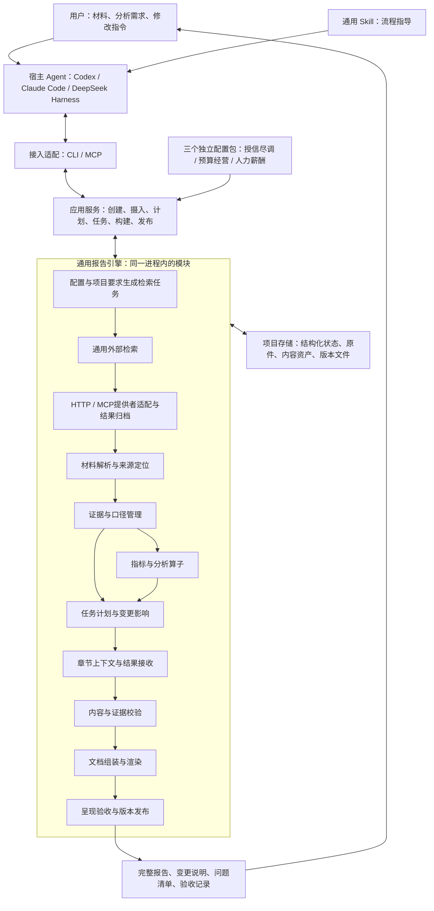
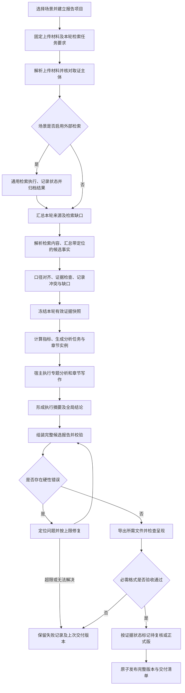

# 通用长报告项目：统一架构、业务流程与模块搭建

版本：设计建议 v2.5｜日期：2026-10-23｜状态：Q56—Q60已确认；首期北向仅 Python CLI。当前 `0.1.0` 已通过三场景四轮及三宿主同 wheel 的脚本化 CLI 验收，记录见[首期工程验收](../.scratch/long-report-first-release/acceptance-2026-10-23.md)；真实供应商、宿主自主写作和并发压力仍待验证。以下历史轮次保留当时状态。

细化入口：[决策树与访谈记录](架构细化-决策树与访谈记录.md)、[业务术语表](../GLOSSARY.md)。第1.2节为已确认边界，第1.3节列出仍待细化和验证的事项；具体实现仍需场景和样例验证。

v2.0审查时的待决工件见[架构审查与待决清单](架构审查-v2.0-待决与收敛清单.md)；其中场景四文件最小字段已由细化设计收敛，三个业务配置骨架已落地但仍待端到端业务验证。历史轮次记录保留当时状态，当前有效规则以第1.2节及最新细化设计为准。

## 1. 设计结论与边界

项目定位为一个**由宿主 Agent 驱动、以持久化证据和报告版本为基础的通用长报告工作台**。

主架构固定为**通用报告引擎＋场景配置包＋Agent适配层**，以模块化单体落地。交付采用**Skill＋状态化工具**双层解耦：Skill指导宿主完成语义任务和工具操作，工具持久化事实与章节状态，执行确定性计算、变更影响、验证和文档发布。预算办经营分析、财务公司尽调、人力薪酬分析是三个独立配置包，共用同一引擎、工具契约和通用Skill。

核心产品原则：**每轮报告交付提供完整文档，内部只更新受影响内容；报告事实、章节、表图和最终文件共同属于同一版本。**

### 1.1 已明确的需求

- 输入为用户上传的业务文档，当前三个配置场景是财务公司尽调、预算办经营分析、人力薪酬分析；风险审查属于授信场景的分析内容，不另设当前第四个场景包。
- 财务公司是评审方，业务单位是被评审对象；本项目报告侧重风险评估、审查和风险策略建议。具体额度由授信模型得出，等级由专门流程确定，期限随等级确定（C01—C03）。
- 外部检索是所有场景可复用的通用模块，由场景配置是否使用及信息需求；通过HTTP/MCP访问专业信息与搜索等提供者，不与授信或预算场景绑定（C02、C04）。
- 不同场景加载不同分析要求、章节结构、指标口径、业务规则和报告模板。
- 支持首次生成、后续材料补充、数据更正、指定章节修改、多轮交付。
- 每次交付得到完整长报告，不能只交付本轮修改片段。
- 以 Skill、插件或外部工具交付，在 Codex、Claude Code、DeepSeek Harness 上验证。

### 1.2 已确认的产品与执行边界

用户在前4轮确认Q1—Q30，后续确认Q37、Q42—Q55及C01—C05；Q38按C05重新明确架构。以下记录当前生效边界，接受业务边界不代表确认所有字段名、状态枚举、特定行业规则或实现细节。

| 决策 | 已确认内容 | 设计影响 |
|---|---|---|
| Q1 报告项目 | 一个场景、明确的分析对象范围和报告期对应一个报告项目；同一期补件、纠错、改稿产生项目内版本；换场景/报告期建立关联新项目 | 项目关系与报告版本分开；跨期比较材料可用于当前项目 |
| Q2 完整交付 | 生成/修改轮次交付完整可访问文件；首期Markdown＋DOCX必需，PDF按场景启用；普通问答提供当前完整版本，无内容变化不新建版本 | 以文件可访问和内容完整验收，不强制聊天全文；参见ADR-0002 |
| Q3 自动执行 | 正常解析、分析、写作、校验、交付自动连续执行；无法裁决的来源/口径、人工锁定或范围问题交给用户；其余独立工作继续 | 不在每阶段增加确认；未决分支显式记录，不擅自代替用户决定 |
| Q4 场景顺序 | 首先细化预算经营分析，再以风险尽调检验通用性；后续C05明确当前交付范围为三个独立配置场景 | 验证顺序保留，授信结构按Q48—Q51、人力范围按Q37落实，不把另外两个场景视为仅有规划而无需验收 |
| Q5 人工改稿 | 对话指定修改是首期标准入口；外部Word作为人工修订参考材料，结合用户指令吸收，不自动覆盖当前报告 | 不承诺任意Word版式和修订痕迹无损回灌 |
| Q6 使用与模型 | 单用户本地工作区，使用宿主已配置模型；项目明确允许模型处理的材料范围；实际全离线/强隔离要求作为场景硬约束 | 不默认所有原件允许外发，也不要求所有场景全离线；参见ADR-0003 |
| Q7 预算经营用途 | 财务/经营分析人员编制，面向企业管理层与经营会议，回答经营表现、预算差距、原因及行动建议 | 以管理决策用途评价分析，不默认审计鉴证用途 |
| Q8 对象覆盖 | 企业/集团整体及本次范围内所有经营单位逐一覆盖，重要单位加深，单体视为一个对象 | 缺材料的单位也要披露，不按排名截断覆盖 |
| Q9 报告期间 | 首个具体版本为月报，当月与年初累计分别评价，对照同口径上年同期和相应预算；年度/进度预算分开，无月度预算不平均分摊，环比按材料启用 | 预算版本和具体指标定义仍待细化 |
| Q10 分析深度 | 表现→差距/变化→有证据支持的原因→问题/风险→行动建议；原因不足时区分已证实与待核实 | 预测/情景测算为后续可选专题 |
| Q11 缺材料交付 | 交付完整待复核报告，正文说明缺口、影响、不能作出的判断并提供补件清单；未满足必要证据要求不得标正式版 | 错算、丢章、坏引用、导出失败必须修复，不能用待复核绕过；参见ADR-0004 |
| Q12 来源冲突 | 按明确更正/替代声明或已确认的来源规则在适用范围内选择并保留历史；否则请求用户裁决 | 不按上传时间或模型置信度自动覆盖 |
| Q13 改稿联动 | 表达修改局部生效；事实、口径、方法、结论变化更新依赖处并说明；明确锁定发生冲突时等待解锁决定 | 未锁定不等于无需更新，锁定不等于旧结论继续有效 |
| Q14 跨期复用 | 沿用已确认的场景/模板版本及对象结构；上期材料按明确用途作比较或持续有效参考 | 不把上期事实当成本期事实，不自动升级配置 |
| Q15 输入格式 | 首期XLSX/CSV、DOCX、可提取文字的PDF；扫描页/复杂版面标明待处理范围，OCR按实际需要接入 | 不把识别失败当作没有内容；未承诺通吃任意版面 |
| Q16 指标范围 | 核心为收入、明确类型的利润、成本费用及其实际/预算/同比、差额和完成率；其他财务专题按材料及场景启用 | 利润类型、口径及具体公式需明确，缺失不当零 |
| Q17 集团口径 | 集团报表、单位数据、计算汇总分别保存；集团分析用明确适用的集团口径数据，合并结果需要明确范围与抵销规则 | 单位汇总不能冒充集团合并数据 |
| Q18 报告章节 | 六部分和七部分是历史参考结构；现按当轮需求与材料生成章节及依赖，见 ADR 0011 | 场景只固定分析要点和呈现规则，关键限制仍需就地披露 |
| Q19 预算版本 | 保留版本及生效期间，明确本轮比较版本；局部调整仅作用于声明范围，无指定或规则时请求裁决 | 不默认较晚文件全面覆盖原预算 |
| Q20 配置扩展 | 实施人员维护版本化场景包，业务用户自然语言调整项目要求并留痕；已有能力组合用配置，新算法允许测试后注册 | 场景包与项目覆盖分开，不承诺绝对零代码；见ADR-0005 |
| Q21 材料映射 | 稳定映射由程序执行，未知表头/叙述由宿主提取候选事实，再核对来源、结构和口径 | 歧义/冲突才请求用户，不逐字段统一人工确认 |
| Q22 正式版身份 | 满足场景必要证据、数据/内容/呈现检查及语义审阅且无阻断冲突，可自动标正式版；有专项人工确认要求时才启用 | 正式版不自动代表业务负责人已批准；具体证据清单仍需场景声明 |
| Q23 数值规则 | 同口径检查后计算差额；正基数按声明公式计算比率，零/负基数默认展示差额与明确状态；特殊百分率和有利方向由场景声明，计算使用未舍入值 | 不用一套比率或“越高越好”判断全部指标 |
| Q24 单位身份/顺序 | 稳定身份、明确组织关系、别名映射；重名/更名歧义裁决；分类节点不重复汇总；显示依用户指定/模板、组织及稳定缺省顺序 | 单位覆盖、显示顺序、分析深度各自独立 |
| Q25 表图/篇幅 | 每单位有核心比较表或缺口说明，图按可比性/分析价值/场景生成；用户模板优先，缺省简洁Word，表可编辑、图嵌入、来源可追溯 | 不凑固定页数/字数，具体企业模板和呈现仍须验证 |
| Q26 执行快照 | 每项目一个活动更新运行，固定本轮依据；独立任务可并行，统一提交，无并行能力可顺序；新材料先登记供下一轮使用，过期输入结果拒收 | 不让新旧依据混入同轮，见ADR-0006 |
| Q27 版本/回退 | 正文、表图、有效依据、口径或交付身份变化产生新版本；重复请求不重复生效，候选验收后切换；回退形成新修订并重验依据 | 文字相同但依据/身份变化也算报告变化，历史不抹除 |
| Q28 独立审阅 | 关键结论以独立任务审阅，可同模型不同上下文；计算/资产硬检查与语义审阅分开；修复有上限，缺证据则披露待复核 | 必需审阅未执行不得标正式，不以写作者自评分代替 |
| Q29 事实来源 | 上传材料和标明来源/版本的场景资料为首期依据；外部信息仅通过明确任务引入并登记来源与时间 | 不自行联网补事实，模型记忆不能代替证据 |
| Q30 三端验收 | 合成/脱敏样例可人工核对，三宿主同材料/场景/操作，完成四轮及缺预算/冲突/新增单位/锁定/恢复等异常 | 比较事实、计算、覆盖、版本和完整文件，措辞可不同，耗时/用量以实测记录 |
| C01 授信场景澄清 | 财务公司对业务单位开展授信金额/期限或不授信评审，综合单位材料及外部专业软件检索结果 | 修正“对财务公司自身尽调”的理解；报告职责进一步按C02—C03划分 |
| C02 报告与外部评估 | 具体额度来自授信模型，等级来自专门授信评估流程；报告侧重风险评估、审查及风险策略建议；专业信息通过HTTP/MCP取得 | 不在报告引擎重建额度/等级模型；企查查类、Google类是来源示例，不代表已选供应商或连通接口 |
| C03 期限依据 | 授信期限随授信等级确定 | 引用已确认等级及期限关系，不猜定期限；具体映射、版本和传递方式待细化 |
| C04 通用检索 | 预算经营、授信等场景共用外部检索模块，场景配置控制是否使用 | 检索执行与提供者接入通用化，业务需求和质量条件放在场景配置，见ADR-0007 |
| Q42 检索缺口 | 必查证据不足可能来自检索失败或方式问题，不阻塞报告进程，补充说明或请求用户补件 | 保留查询状态、限制及补件要求，继续完整交付；是否满足必要证据与流程能否继续分开，沿用Q11/Q22 |
| Q43 检索复用 | 按场景时效复用项目内归档结果；主体/查询条件/时间范围变化、过期或用户要求时刷新相关任务，单纯措辞修改不重查 | 保留检索和数据时点，冻结后新结果进入后续更新，不预设统一有效天数或跨项目敏感缓存 |
| Q44 来源采用 | 搜索命中/摘要先作为线索；关键事实需核对可追溯原文或专业记录的主体、时点、上下文；专业软件结论也需核对适用范围 | 无法核实时保留待核实及影响说明并继续报告，不把线索写成确定事实 |
| Q45 授信项目与时间 | 一个授信事项/申请、明确业务单位及评价时间范围对应一个项目；补件/修订留在原项目，新申请或新评价基准建立关联项目 | 分开记录基准日、材料覆盖期间和事项发生日，基准日后信息明确纳入方式；预算仍按报告期 |
| Q46 外部结果补充 | 可先完成风险报告，缺少的额度/等级/期限明确披露；后续按补件核对主体、版本、时点及期限关系，更新关联审查与策略 | 首期接收既有结果，不自动发起或重跑授信模型/评级；结果是否为正式版必需输入由场景声明 |
| Q47 风险策略 | 建议可涵盖补件、准入/交易条件、缓释、监测、复评及有政策依据时的暂缓/不授信，说明依据、适用条件和待核实项 | 既有措施与建议分开；不重算额度或擅改等级/期限，需要调整时建议外部复评，不直接执行业务动作 |
| Q48 授信章节 | 摘要；事项/范围/基准与限制；单位及业务概况；财务与专题风险审查；外部授信结果核对；风险事项与策略；证据及补件附录 | 外部结果缺失不删章或阻塞，关键限制就地披露，摘要最后生成，企业模板可调整 |
| Q49 授信专题 | 经营财务、偿债现金流、担保/或有事项、诉讼与外部负面事件、关联交易/资金占用、增信及控制措施；用户补充有在建项目时需说明并纳入考虑，词义已确认 | 按适用性展开，适用但缺材料保留缺口；在建项目是单位下的业务对象，复用证据/分析/章节机制，具体分析字段为工程建议 |
| Q50 风险程度 | 按适用场景/企业政策定性分级，独立于授信等级；规则或依据不足时待判定，影响/证据充分性/核验状态分开 | 不把缺材料当低风险，不编造通用评分或授信评级映射 |
| Q51 风险事项 | 稳定事项身份，关联主体、证据及反向证据、时点、影响、措施及落实证据、建议和待核实项；跨材料关联同一事项 | 歧义待核对，不按关键词合并或按次数累计；补件重评相关事项、章节和策略 |
| Q37 薪酬范围 | 按部门/岗位/职级群体分析结构、差异、预算及人效；人员明细用于统计，主报告不默认展示个人薪资/排名，小样本按场景规则汇总或隐藏并披露限制 | 薪酬口径、群体及小样本参数由薪酬配置包声明，见薪酬场景规格 |
| Q38 / C05 通用框架 | 用户重新明确三个业务场景均由配置文件驱动，主干是通用报告引擎、场景配置包、Agent适配层，采用Skill＋状态化工具 | 用四层职责组织共用能力，不把某场景或“主场景＋专题”作为引擎中心；场景内部组织分析任务，不强制跨场景拼成一份报告 |
| Q52 章节保护 | 用户明确更新受影响的关联章节，其余章节正文哈希保持不变 | 表达修改仅目标，事实/口径/结论变化按DAG更新受影响集合；工具限制提交并检查哈希，明确锁定冲突仍按Q13处理 |
| Q53 运行替代 | 改变本轮要求时安全停止旧未发布运行，保留已交付版和候选记录，以新要求创建固定输入的新运行；明确取消停止推进，普通补件仍进入下一轮 | 先撤销旧运行提交/发布资格，再处理安全停止及新运行；迟到结果拒收，不发布已被替代的候选 |
| Q54 配置覆盖 | 场景声明可覆盖字段及类型，支持已有确认的项目调整；合成固定的有效配置并记录来源/版本，越界和未知字段明确拒绝 | 上下文、计算、计划及验收读取同一有效配置，不覆盖硬检查或静默修改共享场景包 |
| Q55 未配置业务定义 | 坏结构/引用、未知算子或循环依赖拒绝运行；合法但未填的业务参数只使相关计算/展示不可执行，说明缺口，其他明确部分继续完整交付 | 不猜口径、公式或展示阈值；必要要求不足待复核，项目身份/期间不明仍须先明确；缺定义、缺材料与零值分开 |
| Q56 首版验收 | 第一版本按工程验收版交付，三个场景用可核对的合成或脱敏样例跑通完整交付及多轮修改 | 未取得真实企业政策和参数时，不宣称可以正式业务投用；业务可用性需另用实际样例验收 |
| Q57 首版模板 | 每场景先提供一套版本化内置模板；用户 Word 可作改稿或样式参考 | 第一版本不承诺自动导入任意 Word 形成可用模板；项目级允许的模板调整仍按 Q54 校验 |
| Q58 第一版入口 | 用户明确第一版本只以 Python CLI 执行 | 北向不交付 HTTP 接口或 MCP 服务；该答复未决定南向专业来源是否实时接入，见访谈记录第17节 |

项目边界见[ADR-0001](adr/0001-report-project-boundary.md)，完整交付见[ADR-0002](adr/0002-full-document-delivery.md)，运行方式见[ADR-0003](adr/0003-local-workspace-host-model.md)。

缺口与失败的交付区别见[ADR-0004](adr/0004-evidence-gaps-and-delivery-failures.md)；预算经营的已确认业务要求集中于[预算经营分析场景规格](scenarios/预算经营分析-场景规格.md)。

配置扩展见[ADR-0005](adr/0005-scenario-composition-and-operators.md)；已确认执行规则及由其推导的字段、模块输入输出建议见[模块数据与执行契约](模块设计-数据与执行契约.md)。

单运行及依据边界见[ADR-0006](adr/0006-frozen-inputs-single-active-run.md)；版本变化的含义已补入ADR-0002。

授信职责见[财务公司授信风险审查场景规格](scenarios/财务公司授信评审-场景规格.md)。通用检索的配置、接入和证据流程见[外部检索契约](外部服务接入与证据契约.md)及[ADR-0007](adr/0007-shared-retrieval-scenario-policy.md)。Q29的明确任务原则适用于所有场景；模块存在不代表每个场景默认启用，实际服务、权限及必查要求仍需明确。

### 1.3 仍需细化和验证的边界

- 各场景具体必查信息、覆盖要求、有效期及专业来源的适用性；HTTP/MCP具体服务和权限。缺口处理、复用和关键事实来源核验原则已由Q42—Q44确认。
- 授信具体事项标识、外部结果字段、等级与期限关系来源、企业政策与在建项目材料；薪酬具体组成、统计口径、报告期间、群体及小样本参数。三个场景独立配置的边界已由C05明确，不再询问是否采用通用架构。
- Q52已明确采用关联更新＋无关正文哈希保护；尚需在实现时验证影响选择范围、提交限制和资产复用，不以文档承诺代替执行证据。
- 三场景具体业务配置实例、工具输入输出字段、宿主分发格式、实际运行依赖与适配版本；工程目录和场景四文件最小字段见第6、11节的细化设计。
- Q53—Q55已确认；仍需为替代/发布竞态、可覆盖字段、参数依赖及展示缺口准备契约和样例，不把接受策略视为实现已通过。
- 真实材料规模、企业模板、明确的敏感数据访问边界，以及解析、呈现、性能与跨宿主实测。

首期不建设在线协作编辑器、微服务集群、通用工作流设计器、独立模型计费平台或向量数据库。预留清晰模块边界即可，不提前实现这些产品。

## 2. 三份方案的取舍与整合

原始文档：[需求分析1](需求分析1.md)、[需求分析2](需求分析2.md)、[需求分析3](需求分析3.md)。保留三份原文作为设计来源，本文件作为后续拆解工作的统一底稿。

### 2.1 各自值得保留的优点

| 来源 | 优点 | 在统一设计中的落点 |
|---|---|---|
| 文档1 | 证据与口径模型完整；区分完整报告与正式版；考虑失败、版本、并行汇总、最终呈现 | 领域模型、证据快照、发布规则、质量门禁 |
| 文档2 | 明确统一Python引擎＋Skill/MCP适配壳；章节上下文切片；局部更新与全量拼装路径清晰 | 宿主执行契约、任务读取与提交、章节复用及跨宿主包装 |
| 文档3 | 明确核心库＋CLI＋MCP＋Skill的分层交付；提出跨宿主评测及阶段交付 | 单体模块、统一接口、评测矩阵、实施里程碑 |

### 2.2 冲突和不足的明确裁决

| 原方案中的问题 | 本方案采用的规则 | 原因 |
|---|---|---|
| “任何新场景零代码”与场景专属算法并存 | 配置表达已有能力的组合；复杂计算通过注册算子扩展 | 避免把配置发展为另一种通用编程语言 |
| 工具返回全文、终端打印全文被视为完整交付保证 | 工具默认返回版本、文件位置及状态；完整正文按需读取 | 终端打印不等于最终回复交付，也没有端到端零 Token 或无截断保证 |
| 非目标章节绝对不变，同时摘要又必须联动 | 表达修改局部生效；事实/方法/结论修改沿依赖传播；明确锁定冲突进入待复核 | 局部性与一致性需要有优先规则 |
| clean 被当成 locked | 更新状态与用户锁定分开存储 | 未受影响不等于禁止未来修改 |
| 数字扫描被描述成能消灭数值错误 | 关键数值采用结构化绑定；单位、期间、主体和计算一起校验 | 相同数值可能来自不同指标，扫描数字不能判断语义正确性 |
| 文件解析被等同于理解事实 | 分开保存解析片段、候选事实、有效证据和分析判断 | OCR 正确不代表口径映射正确；有引用也不代表结论受支持 |
| 仅依靠已引用事实和 required_facts 判断增量影响 | 同时追踪实际引用、证据选择范围、材料类型、对象集合及未满足要求 | 新证据可能推翻“未发现风险”，新增单位也需要新增章节 |
| 各章节随写随改全局 brief | 本轮共享固定事实快照；摘要在主体分析后生成 | 避免并行写作读到不同版本的全局结论 |
| manifest、事实 JSON、章节元数据都可独立更新 | 结构化状态统一存储；清单和摘要从状态导出 | 避免多个可写真相来源互相矛盾 |
| 拼接章节被视为完成交付 | 内容验收、渲染验收、原子发布分别完成 | Word/PDF 可能丢图、截表、目录未刷新或导出失败 |
| 先写死场景，第三阶段才抽象配置 | 从第一天保留最小场景契约，用第二场景检验抽象 | 少量真实契约优于后期大范围改造，也优于提前设计万能配置 |
| 脱敏与边界全部放到最后 | 首期就明确模型可见范围和原件隔离；企业权限系统后置 | 工具返回脱敏内容不能阻止宿主直接读取同目录原件 |
| 文档2声称提供交互图，但文件末尾没有实际图 | 本文件给出可阅读的架构图和流程图 | 不将描述中的设想算作已有交付物 |

这些裁决替代相应旧建议；后续实现不同时兼容相互冲突的规则。

## 3. 总体架构框架



此图表达逻辑职责，不要求每个框都是服务。初始工程只需一个 Python 包、一套本地存储和若干适配入口。

### 3.1 主干与四层职责

“三个主干”表达系统边界，“四层”表达通用执行职责，不是两套架构，也不要求部署四个服务。

| 通用执行层 | 对应组件 | 输入与输出 | 职责约束 |
|---|---|---|---|
| 场景配置层 | scenarios配置、目录/指标/方法论、提示词及模板；scenario加载器 | 固定版本配置→经过校验的材料、分析、章节和质量要求 | 三个场景分别加载；不得在引擎中按预算/授信/薪酬名称分支 |
| 解析与事实层 | ingest_engine职责：retrieval、ingest、evidence、analysis；Fact Ledger | 上传/检索来源→候选事实→有效事实与确定性指标 | 解析器不裁决口径；程序计算，事实及结果带稳定引用和来源 |
| 章节状态机层 | workspace_state职责：project、planning、composition及storage | 事实差异/改稿指令→Section DAG、脏标记、任务和章节候选 | 分章节保存，固定任务依据，按允许变更集合接收结果，不在聊天中流式重写整篇报告 |
| 拼装与交付层 | report_assembler职责：validation、rendering及原子发布 | 更新章节＋复用章节＋表图/模板→完整MD/DOCX及适用PDF | 组装不重新创作复用章节；验收后发布完整产物，CLI/MCP只是同一服务的入口 |

Agent适配层在四层之外连接宿主，负责统一工具调用、结果提交与产物呈现。通用Skill制定长报告分析与交付流程，并按本轮需求和原件生成章节及依赖；场景配置只提供稳定的计算口径、分析要点、格式与质量规则。第一版本宿主通过Python CLI指定场景ID/版本，运行时把当前来源映射与报告计划交给核心校验并冻结；CLI参数层不复制业务规则。外部检索仍是共享来源能力，按场景配置启用，不能绑定授信。见 [ADR 0011](adr/0011-per-run-source-and-report-plan.md)。

四层是职责视图，不是互斥的代码目录；storage、project和validation可服务多个阶段，应用服务协调同一套状态与提交，不按层复制数据库或工作流。

### 3.2 Skill与状态化工具为何分开

模型只接收当前任务需要的证据、指标、旧章节和前置发现，提交受约束的候选结果；每次读取和提交均绑定运行/任务版本。核心工具保存Fact Ledger、Section DAG、章节资产和完整版本，完成任务就绪判断、重试、计算、影响传播与发布，宿主更换或上下文丢失时从状态恢复。Skill规定流程，CLI提供执行入口，场景配置规定各场景的分析内容与规则。

长报告按章生成、按需更新、全量组装，避免要求模型每轮从聊天重写几万字。减少重复生成是设计目的，具体Token与耗时需实测；章节隔离、数值绑定和校验降低漂移风险，不等于解析或判断永不出错，也不突破宿主单次上下文限制。

### 3.3 Fact Ledger与章节保护的工程契约

Fact Ledger是现有证据和指标记录的逻辑视图，不另建与权威状态竞争的事实数据库。保存来源片段、原值、主体/期间/口径、有效身份、计算输入及算子版本；缺口、更正、替代和冲突保留历史。确定性指标及表图引用同一结果，不由模型复制计算数值。

章节按稳定ID保存独立内容资产，已交付版本不可就地改写；本轮允许变更的章节集合由任务计划显式给出，提交集合之外的章节结果拒收。发布前比较被保护正文的内容哈希，不一致则失败；DOCX分页/目录变化与正文内容变化分别验收。基于工具提交边界的保护不能声称宿主拥有原件写权限时仍实现了操作系统级绝对隔离。

Q52已确认受事实/口径/结论变化影响的关联章节进入允许变更集合，其余正文哈希保持不变。纯表达修改集合仅含目标章节；事实变更集合由目标及反向依赖、证据选择范围和对象变化展开。显式人工锁定与本轮无关章节保护不同：锁定冲突保留原文并按Q13请求裁决，其余独立工作继续。交付清单列出实际变更章节、联动原因及未变正文的哈希验证结果。

哈希保护必须覆盖引用解析后的正文：内部`metric_id`标记没变、输出金额变化，仍属于内容变化。另校验表格/图表等关联资产，防止正文未改而图表换值；整份DOCX的文件哈希只验证文件完整性，不用于要求页码、目录及容器字节不变。字段及反例见[模块契约第2.6节](模块设计-数据与执行契约.md)。

### 3.4 三个边界

**场景包回答“分析什么、按什么口径、做到什么程度”。** 定义对象、材料要求、章节、分析问题、指标、规则、模板、验收条件，不直接控制数据库和文件提交。

外部检索同样属于通用能力：场景声明是否启用、查什么及业务质量要求；planning生成任务，retrieval管理执行与结果，adapters连接实际提供者，ingest/evidence负责解析和核验。服务地址和认证引用属于部署配置，不复制到场景中。

**引擎回答“如何可靠地完成并保存”。** 接受明确操作，生成待执行任务，校验结果，计算影响范围和发布完整版本。场景选择由显式场景 ID 或确定性映射完成；描述含糊时让用户选择。模型可提取需求字段，但不承担程序路由、重试和状态迁移。

**宿主回答“如何完成需要理解和判断的任务”。** 读取任务材料，提取候选事实、形成发现、写章节、审阅推理。模型结果必须提交到引擎，通过契约验证后才能进入下一阶段，不能直接修改已发布版本。

### 3.5 执行责任分工

| 工作 | 执行主体 | 必须保留的结果 |
|---|---|---|
| 哈希、文件读取、结构化表格处理、单位转换、公式计算 | 程序 | 原值、转换规则、算子版本、输入引用 |
| 按配置生成检索任务、调用HTTP/MCP、归档与有限重试 | 程序及提供者适配 | 查询条件、实际结果、来源/时间、失败及覆盖限制；语义查询词可由宿主提取后校验 |
| 扫描识别、复杂版面恢复 | 专门解析/OCR 能力 | 位置锚点、识别状态和失败页；不得视为必然正确 |
| 无规则可用的字段映射、条款含义提取 | 宿主模型或人工 | 候选事实、来源片段、映射依据及不确定项 |
| 对比、排序、分组、汇总、依赖传播 | 程序 | 有类型的计算结果和影响列表 |
| 原因分析、风险判断、建议、章节表达 | 宿主模型 | 发现、证据、限制条件、正文 |
| 任务派发规则、重试、版本比较、文件合并 | 程序 | 任务记录、错误和提交状态 |
| 关键结论语义审阅 | 独立审阅任务，必要时人工 | 有定位和证据的审阅意见；不以模型自评替代硬检查 |

## 4. 模块化组件及其契约

| 模块 | 输入 → 输出 | 负责的核心行为 | 不应承担的职责 |
|---|---|---|---|
| `scenario` 场景加载 | 场景包 → 校验后的场景定义 | 版本锁定、引用检查、章节规则、循环依赖检查 | 任意执行配置中的代码 |
| `project` 项目与修订 | 项目参数、操作 → 工作区、运行、候选修订 | 生命周期、幂等、基础版本校验、提交记录 | 分析业务含义 |
| `retrieval` 外部检索 | 标准检索任务、提供者配置 → 检索结果、状态、归档引用 | 通用执行、覆盖/失败/时效记录、按规则复用与刷新 | 按场景名称分支、生成业务结论、计算授信额度/等级 |
| `ingest` 材料摄入 | 上传文件、检索返回内容 → 来源登记、解析片段、解析问题 | 去重、格式识别、来源定位、解析器适配 | 自动把最新文件当作正确答案 |
| `evidence` 证据管理 | 片段、候选事实、用户更正 → 证据快照、冲突 | 主体/期间/单位映射、来源选择记录、证据撤回 | 静默覆盖冲突、凭置信分数选事实 |
| `analysis` 分析算子 | 证据快照、分析定义 → 指标、对比表、规则结果 | 确定性计算、口径校验、图表数据集 | 模型心算、无依据的因果结论 |
| `planning` 更新计划 | 操作、场景检索要求、快照差异、依赖 → 任务图、影响说明 | 生成检索等任务、增删章节、反向依赖、锁定冲突、任务就绪状态 | 依赖模型记忆决定是否完成 |
| `composition` 章节内容 | 任务上下文、模型提交 → 章节候选、发现、引用关系 | 按章取证、结构契约、引用绑定、内容哈希 | 直接提交正式版、代替数值计算 |
| `validation` 质量验证 | 候选修订、规则 → 阻断项、警告、审阅任务 | 数据、覆盖、跨章一致、缺口披露、任务闭合 | 用字数或自评分替代分析质量 |
| `rendering` 文档生成 | 完整章节、表图资产、模板 → MD/DOCX/PDF 候选 | 图表嵌入、目录引用、版式、格式完整性检查 | 重新分析或改写正文事实 |
| `storage` 存储 | 各模块提交 → 事务状态及不可变内容文件 | 单一事实来源、索引、快照、版本文件可达性 | 自行决定业务优先级 |
| `adapters` 接入 | 北向CLI/MCP/插件请求、南向HTTP/MCP提供者调用 ↔ 应用服务/检索模块 | 协议转换、提供者结果映射、错误呈现、产物访问、平台打包 | 复制检索调度、场景流程、授信规则和计算逻辑 |

数据边界检查、日志和发布协调作为上述模块内的职责实现，不单独创建额外服务。

## 5. 业务对象与状态模型

### 5.1 最小领域对象

| 对象 | 关键内容 | 作用 |
|---|---|---|
| Project | 项目 ID、报告对象范围、报告期或评价时间、适用的业务事项引用、场景及版本、关联项目、输出配置、当前交付版本 | 一个项目对应一份持续修订的报告；换报告期/评价基准、场景或授信事项建立关联新项目 |
| SourceDocument | 文件 ID、内容哈希、原件路径、材料类别、替代关系、解析版本/状态 | 原始证据可定位，重复上传可识别 |
| RetrievalResult | 任务/提供者、查询、实际返回内容及归档引用、主体/时间、覆盖与执行状态 | 各场景共用的外部来源记录，不把调用成功视为事实核实；任务仍沿用Task/Run |
| SourceFragment | 片段 ID、文档版本、文字/表格、页/段/单元格定位 | 保留“材料实际写了什么” |
| Evidence | 证据 ID、片段引用、事实内容或数值、口径、有效状态、来源选择依据 | 区分有效、候选、争议、撤回证据 |
| MetricResult | 指标 ID、数值/不可计算状态、输入证据、算子版本、精度和口径 | 正文、表格、图表使用同一计算结果 |
| Finding | 判断 ID、结论、支持/反对证据、限制、类型、审阅状态 | 将事实、推断、建议、待核实事项分开 |
| SectionVersion | 稳定章节 ID、正文资产、表图引用、发现引用、依赖、人工编辑记录 | 保存可复用的章节内容 |
| Task / Run | 操作、任务类型、输入快照、状态、尝试次数、输出、错误 | 中断后继续，不依赖原聊天 |
| Revision | 基础版本、输入快照、章节版本集合、质量结果、交付文件、版本身份 | 精确描述一份完整报告由什么组成 |

初期这些可以是表和结构化记录，不必各自建立复杂对象框架。

数值口径至少包含主体、期间、指标、实际/预算/预测、币种、单位、合并范围；必要时增加岗位/职级/样本范围。口径不兼容时拒绝直接比较。未知、不适用、零值必须是不同状态。

文本证据同样带版本和适用范围。DOCX 定位优先用段落/表格标识；只有经过固定渲染的文档才有稳定页码，不伪造 Word 页码。

授信评价基准日、材料覆盖期间、事项发生日、检索时间分别表达，不将月报日期规则强加给所有场景。搜索线索与可用证据分开，关键事实核对可追溯原文或专业记录后才能按适用范围引用；来源未核实仍可披露为待核实事项，不能伪装成已确认事实。

### 5.2 三种状态不要混在一起

- 任务执行状态：`pending / running / succeeded / failed / blocked`。
- 章节更新状态：`clean / dirty`；独立字段 `locked` 表示用户是否禁止覆盖。
- 修订身份：候选、已交付；业务状态：草稿、待复核、正式版。质量结果使用 `pass / fail / not_run`，跳过检查不能算通过。

`dirty` 只表示需要重新评估；如果验证后输出与原章节完全一致，可以复用原内容。被锁定章节仍可变为 dirty，此时形成显式冲突。

### 5.3 一个权威状态源

建议以 SQLite 保存项目、证据元数据、依赖和版本索引，以文件保存原件、解析块、章节、图表和报告。`manifest.json`、`brief.md`、变更清单均由权威状态生成，不作为独立可编辑数据库。

原件和已发布资产不覆盖；正文编辑形成新章节版本。人工通过对话改稿纳入操作记录；直接在导出的 Word 里改稿不会自动写回状态，首期应重新导入为“人工修订参考材料”，差异由明确编辑任务吸收，不承诺任意 Word 修订无损回灌。

项目边界、对话改稿与Word参考材料规则已由第1轮确认。第2轮进一步确认：新报告期复用已确认的场景/模板版本及对象结构，上期材料按明确用途作比较或持续有效参考，不能自动成为当期事实；具体材料有效期与字段映射仍待细化。

## 6. 场景包规范

先采用四个核心YAML配置文件，提示词、模板和fixtures是配套资源目录，不是另三套独立配置。每个场景应提供其实际引用的资源及最小验收样例，不创建没有用途的空目录。指标和分析任务放在 `analysis.yaml`；以后变大再拆分。

目录归属、四文件的最小字段与引用校验、有效/无效配置示例统一见[工程结构与场景配置设计](工程结构与场景配置设计.md)；最终取舍记录在[ADR-0008](adr/0008-engine-layout-and-scenario-config.md)。该细化设计不表示场景加载器或配置包已经实现。

本次设计采用的三个场景目录 ID 分别为`credit_review`、`budget_operations`、`compensation_analysis`。每个包都使用下述同一结构，不存在某个“主业务场景”拥有引擎、另外两个挂靠其流程的关系。见[薪酬场景规格](scenarios/人力薪酬分析-场景规格.md)、[预算场景规格](scenarios/预算经营分析-场景规格.md)及[授信场景规格](scenarios/财务公司授信评审-场景规格.md)。

```text
scenarios/<scenario_id>/
  scenario.yaml          # 标识、版本、适用范围、材料/对象定义、输出要求
  outline.yaml           # 稳定分析要点和展示规则；不预置章节或单位名单
  analysis.yaml          # 证据选择条件、指标算子、分析任务和依赖
  quality.yaml           # 完整性、证据、计算、分析质量及正式版门槛
  prompts/               # 任务级提取、分析、写作、审阅指令
  templates/             # 文档样式资源
  fixtures/              # 脱敏/合成材料和预期结果
```

场景包还可包含带来源、适用日期的业务参考资料；不把模型记忆中的监管口径作为已验证规则。

检索启用及任务引用放在`scenario.yaml`，业务信息需求及依赖放在`analysis.yaml`，证据与交付要求放在`quality.yaml`；不为每个场景复制检索代码。提供者协议、地址和认证引用单独由部署配置维护。配置示例见[通用检索契约](外部服务接入与证据契约.md)。

四文件字段关系及可判定有效/无效的最小 YAML 示例见[工程结构与场景配置设计第3节](工程结构与场景配置设计.md#3-场景配置包-v1)。旧版预算单文件片段缺少对象/期间模型、检索及覆盖声明，不再作为完整配置示例；实际预算包仍需按已确认业务规格填写。

每轮 `report draft plan` 提交的章节需要定义：分析目标、要回答的问题、证据选择器、分析结果引用、必需表图、展示顺序及内容依赖。`outline.yaml` 仅给 Skill 稳定规划提示。`depends_on` 表示“本章读取哪些前置章节的结果”；更新沿反向索引传播。展示顺序与生成顺序分开，摘要可以排第一但最后生成。

重复章节使用 `unit_analysis/<entity_id>` 一类稳定 ID。增加/移除单位时重新展开章节集合；不以章号识别对象。不直接使用 `depends_on: ["*"]`，由引擎明确展开为不含自身的前置章节集合，并检查循环。

指标使用注册算子及结构化参数，例如 `budget_completion(actual, budget)`。约定分母为零、负基数、缺期间、精度和四舍五入行为；不对配置字符串执行 `eval`，不允许任意导入场景内脚本。

### 6.1 场景差异如何映射

| 场景 | 对象与证据 | 分析能力 | 主要验收重点 |
|---|---|---|---|
| 预算经营 | 集团、单位、产品、实际/预算、多期间报表 | 差额、完成率、可比趋势、结构分析；有证据时做归因 | 单位覆盖、合并去重、口径一致、表图一致 |
| 财务公司授信风险审查 | 评审方财务公司、被评审业务单位、单位材料、通用检索结果及已提供的外部额度/等级/期限结果 | 风险评估、审查及风险策略建议，核对外部结果的一致性 | 内外部来源、主体与时点可追溯；不代替额度模型/等级流程；期限随等级确定 |
| 薪酬管理 | 部门、岗位、职级、人员群体、薪酬样本 | 分组统计、分位数、结构差异、人效、预算比较 | 样本口径、可比性、小样本披露、敏感字段展示 |

用户已澄清“财务公司尽调”指财务公司对业务单位开展授信评审，而非对财务公司自身尽调；普通企业财务尽调并未因此自动成为新增交付范围。具体专题与章节已按Q48—Q51落入授信规格，政策参数和字段仍待样例验证。

Q45—Q47进一步确认授信风险报告可先于外部额度/等级结果交付，后续结果按补件更新；项目按授信事项及评价时间划分，策略建议与外部评估及实际业务执行分开。具体专题、分级和章节按Q48—Q51落实，原未接受的普通风险提案不自动生效。

Q48—Q51已确认授信章节、首批专题、风险程度与事项关联规则，见[授信场景规格第6—9节](scenarios/财务公司授信评审-场景规格.md)。Q49特别补充在建项目：有项目时说明情况并纳入综合审查。它与报告工作区分开，作为单位下的业务对象，通过场景专题及通用证据、算子、发现和依赖机制表达，不另建授信专用生命周期。

上表所有场景均可使用同一个外部检索模块。预算可配置行业或市场背景检索，授信可配置企业信息或外部事件检索；这些是任务示例，是否启用及证据要求由对应场景声明，不由场景名称触发内置分支。

预算经营场景已确认月报、全范围单位覆盖、当月/累计分析、同口径预算与同比比较，以及有证据的原因和行动建议，详细要求见[场景规格](scenarios/预算经营分析-场景规格.md)。该规格不将原方案中的示例指标、章号、字数和排序视为已确认要求。

### 6.2 配置与代码扩展边界

新增章节、分析问题、输入材料、已有指标组合、规则阈值、模板：改场景包。新增文件格式：增加解析适配。新增统计/测算方法：增加算子及数值样例测试。新增宿主：增加接入包装和兼容性测试。以上均不要求复制整套报告引擎。

“新场景零代码接入”的验收定义：在已支持的解析格式、通用算子与配置表达范围内，只新增配置包，不改引擎流程或增加场景名判断，就能完成相同操作链。公式配置引用注册算子及受校验参数/组合，不执行任意Python。全新解析能力或算法属于通用引擎能力扩展，未知能力在加载时明确报错，不让模型暗中补算；这与Q20已确认边界一致。

场景加载时校验 schema、引用、重复 ID、循环、路径范围、算子存在性和版本兼容性。版本固定到项目；更新场景包不静默改变历史报告，升级通过一次显式更新运行处理。

### 6.3 三个配置包使用同一契约

下表为配置落点，不是三条引擎分支；实现时同一加载器解析、同一计划器展开，同一工具链执行。

| 配置项 | 财务公司尽调 | 预算办经营分析 | 人力薪酬分析 |
|---|---|---|---|
| 场景目录 ID（本次设计） | credit_review | budget_operations | compensation_analysis |
| 对象/时间 | 授信事项、单位、评价基准与材料期间 | 集团/单位、当月及累计、预算/同比期间 | 部门/岗位/职级群体、薪酬分析及比较期间 |
| 材料/事实 | 单位材料、外部检索、外部额度/等级/期限、在建项目 | 实际、预算版本、同比及原因说明 | 人员统计输入、薪酬组成、预算及人效数据（可用时） |
| 分析定义 | 风险专题、政策核对、外部结果核验与策略 | 同口径差额、完成率、结构、归因及行动 | 分组结构、差异、预算及人效；具体定义待场景参数 |
| 章节/方法论 | 稳定授信审查要点；本轮计划适用专题与依赖 | 稳定预算分析要点；本轮计划板块、单位与章节 | 稳定群体展示边界；本轮计划章节与依赖 |
| 质量条件 | 证据支持、待核实、风险程度与授信等级分开 | 对象覆盖、预算/集团口径、关键数值一致 | 群体口径、小样本规则、个人字段展示及可比性 |
| 共用可选能力 | 按配置启用retrieval | 按配置启用retrieval | 按配置启用retrieval |

所有场景共用：创建项目→固定输入及检索任务→摄入与事实核验→确定性计算→展开Section DAG→宿主分章分析/写作→独立审阅→复用与全量拼装→验收/发布。差异来自场景任务定义及参数，不在公共流程写`if scene == ...`。指标输出、章节结果、问题及交付清单采用相同外部契约；工具结果的具体字段schema仍需在实施前固定，场景四文件最小字段则以细化设计为准。

配置加载时能回答“需要哪些材料、哪些事实/算子、生成哪些章节、哪些变化影响哪些结果、怎样验收”，才算一个完整场景包；仅替换提示词或Word模板不足以表示场景接入完成。

### 6.4 最小配置契约的设计骨架

以下是同一schema应校验的信息组，不是新增任意工作流语言或已经可运行的配置。四文件的最小字段名以[工程结构与场景配置设计第3节](工程结构与场景配置设计.md#3-场景配置包-v1)为目标契约；三个场景的具体业务参数仍需用样例填写。按已确认Q54声明可覆盖字段及类型，按Q55区分非法配置和可表达的未配置业务定义。

| 配置位置 | 信息组 | 必需校验 |
|---|---|---|
| scenario.yaml | schema/场景版本、对象及时间模型、输入要求、检索启用、资源引用 | 身份/版本、输入类型、对象/期间结构、路径和资源可达性 |
| analysis.yaml | 事实要求/来源选择、算子引用及参数、分析问题、查询任务和输出定义 | 算子签名、参数类型、单位/期间约束、来源要求、输入/输出引用与缺失策略 |
| outline.yaml 与本轮计划 | 场景存稳定分析要点；运行存章节ID、对象重复、证据/指标引用和前置依赖 | 本轮计划检查唯一身份、引用有效、重复范围、依赖无环；场景不得预置固定目录 |
| quality.yaml | 必需证据/覆盖、数值/语义/呈现检查、可见字段、正式版条件 | 条件可执行、检查存在、未执行/失败的处理、展示约束及场景适用性 |
| 配套资源 | 提示词、模板、合成/脱敏输入和人工可核对答案 | 版本/内容哈希、资源完整、样例来源身份及预期结果 |

实现时将四份配置解析成一个固定版本的有效定义，计划器、任务上下文和校验器读取同一结果，不能各自拼接不同覆盖规则。已有项目保持原场景版本，显式升级产生新运行并列出影响，沿用Q14/Q20；不再将“是否静默升级”列为待决问题。

### 6.5 已确认的项目覆盖与配置缺口（Q54—Q55）

场景包显式声明可覆盖字段、类型及允许范围，项目要求只修改这些字段，保留原值、用户指令及覆盖来源。既有允许的表达、模板、比较预算、显示顺序等调整纳入声明；不能因采用白名单就撤销已确认的项目操作，也不能据此绕过项目身份边界。换报告期、场景或授信事项仍按Q1/Q45建立关联项目。

程序先验证全部覆盖，再形成固定的有效配置及内容指纹；不部分接受有效字段却静默跳过无效字段。原场景版本和共享包不变，运行使用的有效配置不可被后续项目要求就地改写；新算子/共享能力仍走已确认扩展或显式升级机制。数值正确、引用有效、必需文件等硬约束不能覆盖。

| 情况 | 执行与交付 |
|---|---|
| 配置结构/引用错误、未知算子、依赖循环或越界覆盖 | 明确报错，不能启动基于该无效配置的更新；保留已有交付及错误位置，不伪称本轮报告已完成 |
| 结构合法且允许表达未配置值，但缺业务口径/公式/展示规则 | 记录缺失定义及依赖影响，不执行相应计算/展示；其他已满足规则的部分继续，完整章节说明不能作出的判断；必要要求不足标待复核 |
| 已有定义，但缺相应材料 | 按Q11/Q42记录证据缺口并继续适用分析，不当零、不编造结果；必要证据不足待复核 |
| 项目身份、对象或期间等创建条件不明 | 按Q1/Q3先明确必要条件，不用缺口策略生成对象或期间不明的报告 |

业务定义未配置必须有可校验的表示，不把必填结构缺失一律当作可跳过。外部服务运行时失败继续按检索契约处理，不能混成场景结构错误；错算、坏引用、丢章及必需格式导出失败仍属必须修复的硬错误。

## 7. 业务执行流程

### 7.1 首次生成



1. 明确对象、期间、场景和输出要求，创建项目，不从文件名猜定关键口径。
2. 固定上传材料及配置生成的检索任务要求；原件登记、哈希去重、解析。启用检索时由通用模块调用已配置HTTP/MCP提供者并归档实际结果；关闭时不创建检索任务。记录文件/页面处理和检索覆盖状态。
3. 结构化文件按映射读取；复杂文字由宿主执行提取任务，提交带原文位置的候选事实。
4. 检查主体、期间、单位及来源冲突；无法确定的事实保持争议状态，不进入已确认计算。
5. 形成不可变证据快照；据此计算指标、展开重复章节、建立分析任务依赖。
6. 独立专题可并行，汇总与执行摘要等待前置结果；每章提交正文、发现、来源和未解决问题。
7. 形成完整候选报告，运行确定性检查和语义审阅，再渲染必需文件。
8. 通过交付门槛后发布；业务证据不足时明确交付待复核版。首次生成失败且没有旧版时，返回失败及恢复位置，不宣称已有完整报告。

材料快照与证据快照是两个阶段：前者固定本轮上传材料及取证任务要求，计划内检索结果和缺口记录绑定到本轮来源清单，后者固定计算和写作依据。取证尝试按有上限的规则结束后即可带缺口继续，不等待检索全部成功或用户补齐材料；正文说明影响并按需提出补件要求。必要证据不足时沿用待复核身份，不取消Q11/Q22。封存后不混入刷新结果；提取结果修订需要新证据快照并使旧输入上的相关任务失效。

检索实例绑定已核对的主体/条件及本轮输入；结果先归档，再连同失败、覆盖及未核实记录汇入来源清单。证据快照只引用已持久化的具体来源版本，不读取提供者的实时“最新结果”。上传解析可提前执行，写作只能读取已封存证据与缺口，不能绕过来源汇总点；具体持久化边界见模块契约6.3。

### 7.2 补充材料


相同内容重复上传通常不产生新报告版本；文件哈希相同但用户提供了新的适用期间或材料身份时，需处理元数据变化，不能仅凭哈希跳过。新版本材料与旧版的替代关系由用户指令、材料中的明确版本标识或已配置规则决定，不能仅按上传时间决定。

补充材料可能：填补缺口、支持原判断、推翻原判断、引入新对象、形成新冲突。每一种都进入影响分析；不能只做事实库追加。原缺口只有在对应要求实际满足时才能消除。

补件、新主体及明确检索刷新同样进入任务影响分析。按Q43，场景有效期内的项目归档结果可复用；主体、查询条件/时间范围变化、过期或用户要求刷新时重查相关任务，单纯措辞改稿不重查全部。检索与数据时点保留，未知明确标记；具体有效期由场景配置。

### 7.3 更正数据或分析口径

用户更正先形成带来源的更正记录，保留“用户提供”身份；未获得文件佐证时不伪装成审计确认数据。按场景规则决定能否用于待复核计算。

示例：“A 单位利润由 1 亿元改为 8000 万元”需要检查单位利润指标、比较表、图表、单位分析、引用该值的摘要与建议。集团合并利润只有在其计算明确依赖该单位数据时重算；如果采用独立合并报表，则生成核对任务，不能机械减去 2000 万元。

期间、币种、合并范围、实际/预算等口径变化可能影响全局。系统明确列出批量重算范围，不把它当成文字替换。

### 7.4 指定章节修改与人工锁定

| 修改类型 | 执行动作 | 交付与一致性规则 |
|---|---|---|
| 语气、压缩、措辞、局部格式 | 仅改目标正文，保持事实绑定与关键判断 | 其他章节正文哈希不变；目录页码允许随排版变化 |
| 新分析方法或改变结论 | 重跑目标分析，更新依赖该结论的章节 | 变更摘要列出联动章节及原因 |
| 更正事实 | 先更新证据/指标，再更新所有使用处 | 正文、表格、图表与摘要共同校验 |
| 明确“其他章节不得修改”且产生冲突 | 保留锁定原文，记录受影响位置及旧版本身份 | 只能形成显著披露冲突的待复核版，禁止正式版 |
| 全局版式 | 重新渲染，复用正文 | 仍执行目录、分页、表图检查 |

锁定章节中的旧数字不得被模板静默替换。若锁定内容与当前快照冲突，应在报告首页及相关章节旁显示复核说明，关联原快照，避免读者误认为其仍是本轮有效结论。是否解锁属于业务决定。

### 7.5 跨会话、跨宿主与失败恢复

新会话通过项目 ID 和状态接口读取：当前交付版、未完成运行、材料快照、待执行任务、锁定/冲突、交付文件。无需复述完整聊天历史。

更换宿主但使用同一工作区时，接续同一任务契约；更换机器时须迁移完整项目包并验证资产哈希与版本兼容。只复制最后一个 Word 文件不能恢复工作状态。

失败任务保留输入快照、错误和已成功的前置结果。瞬时错误按有上限的程序规则重试；数据冲突进入待处理状态；内容检查失败生成定位明确的修复任务。超限后显式失败，不无限循环、不切换到未经批准的模型或数据处理路径。

### 7.6 已确认的运行中改令与取消（Q53）

明确替代本轮要求时，先登记用户操作并撤销旧未发布运行的提交/发布资格，再在安全点结束其工作，保留已交付版本及可审计候选/错误记录。旧运行退出活动资格后，用新要求及明确的输入集合启动新运行，旧任务迟到结果拒收。已有结果只能在新运行核对输入指纹后按复用规则使用，不能直接发布旧候选。

明确取消立即停止继续派发和推进，已发出的不可即时中断调用即使稍后返回也不能改变交付版本；安全点用于结束在途工作，不用于继续发布。普通新增材料仍按Q26登记下一轮，不自动替代当前运行；若同时明确要求本轮改用新材料，则作为替代操作形成新运行，旧快照不变。

发布与替代/取消在同一项目提交边界检查活动运行身份及发布资格。若发布已在新操作被接受之前完成，该修订作为已交付历史保留，新要求进入后续运行，不能追认成“从未发布”。具体请求字段、终止状态名称和竞态用例见模块契约6.4，均尚未实现。

## 8. 增量更新与长文档一致性

### 8.1 依赖需要覆盖“已引用”与“应该重新检查”

维护两类关系：

1. 实际引用：证据 → 指标 → 发现 → 章节 → 表图及汇总章节。
2. 选择范围：某章依赖“某主体、某期间、某类材料/事项的全部相关证据”，以及对象集合与材料缺口。

例如风险章原来写“在已提供材料中未发现担保事项”，并没有引用一个不存在的担保证据。新合同出现担保条款时，必须通过材料类型/主题选择范围触发重新检查。新增经营单位时，必须通过对象集合变化创建对应章节。

授信场景新增在建项目，或补充其投资、融资、进度材料时，按对象集合和专题选择范围重新评估；若影响单位资金/偿债判断，更新相关发现、策略与摘要。是否联动由实际依赖决定，不将计划投入、实际支出和其他口径金额重复汇总。

不确定影响范围时，扩大到相关主题或材料类型的章节重评估；无法可靠分类的新材料至少触发一次项目级覆盖评估。此处允许多检查，不允许静默漏掉影响。

工程上由planning持久化每个变更的命中原因：实际引用变化、选择范围变化、对象集合变化、未满足要求变化取并集，沿指标/发现/章节依赖反复展开至集合不再增长，再分出锁定冲突及允许提交集合。`dirty`表示需重评，不表示一定重写；输入指纹、分析和内容均未变时复用原资产。不以章节DAG代替对新材料覆盖范围的检查。

### 8.2 复用条件

章节复用至少要求：证据选择结果及其范围变化评估完成、前置分析版本一致、场景/提示词版本一致、用户编辑要求一致、相关问题状态一致。记录实际输入指纹；不能只凭“文件名没变”或“章节标为 clean”复用。

分析依赖与渲染依赖分开。字体、页边距等纯样式变化只使渲染及呈现验收失效；模板若改变章节结构、表格列口径或引用绑定，按实际内容/分析依赖重评，不能一律视为纯渲染。有效依据或资产改变按Q27形成新修订，重复同一请求不重复生效；指标口径变化使计算、结论、引用章节和渲染一起失效。

### 8.3 上下文组织

每个任务上下文包含：任务目标、场景分析要求、项目口径摘要、相关原文/表格、有效指标、支持和反对证据、当前章节、前置发现、锁定约束及已知缺口。

大材料按章节/主题/主体切片，提供分页与按来源展开能力；摘要帮助定位，但关键判断必须能回到原文。超出上下文预算时切分任务，不静默截断材料。优先使用结构化筛选与全文检索，真实样例证明有必要后再引入语义检索。

共享 brief 由本轮快照生成，带版本；执行摘要读取本轮主体分析结果。禁止子任务任意改写共享 brief 或共同写最终文件。

### 8.4 章节提交契约

每次模型提交至少包含 `task_id`、输入快照/任务版本、章节 ID、正文、关键发现、证据与指标引用、表图引用、未解决问题。发现区分事实陈述、计算解释、分析推断和建议。

关键数值在内部正文用受约束的引用标记绑定到 `metric_id`，引擎在组装时输出相应数值和单位；标记语法仅表达引用，不支持任意代码执行。章节依然需要重新判断“增长/下降、改善/恶化”等语义，不能只替换数值。

表格和图表直接读取指标数据集，避免让模型另写一份数字。日期、章号等普通数字不强求指标引用；关键业务数字和量化结论必须可追溯。引用存在性由程序检查，引用是否支持论断由审阅任务或人工检查。

## 9. 版本发布与质量门槛

### 9.1 发布流程

首期每个项目仅允许一个活动更新运行；多个宿主可以读取状态，但不能同时开启互相覆盖的修改。必要的章节任务可并行，提交由核心服务串行协调。

1. 更新运行固定 `base_revision`，文件与证据快照都持久化。
2. 候选章节和资产写入独立暂存位置，记录内容哈希；不改当前交付版。
3. 形成候选修订清单，完整组装并验证所有必需格式。
4. 将已验证资产安置到不可变版本目录，确认文件存在、可读、哈希正确。
5. 在一次数据库事务中核对基础版本、活动运行身份及提交/发布资格，再登记修订与当前交付指针；版本已变化、运行被替代/取消或资格过期则拒绝提交，不能仅检查base_revision。
6. 对外返回已提交修订的文件清单。数据库中的当前版本是权威，`latest` 快捷文件仅是可重建副本。

这样文件写完但数据库提交前崩溃，只会产生未引用候选文件；不会发布半套文件。幂等键与请求内容哈希一起保存：相同请求重复调用返回已有结果，相同键不同内容明确报错。恢复时可识别已完成提交，不重复产生版本。

### 9.2 两道门槛

**可交付门槛**要求所有必要章节有实质内容或明确的不可分析说明，关键引用可解析，计算一致，缺口/冲突已显著披露，所需文件生成且通过适用检查。损坏引用、错算、丢章、必需格式导出失败不能降级成“待复核”绕过。

**正式版门槛**在可交付基础上，要求场景规定的必要证据、数据/内容/呈现检查、关键语义审阅及专项人工确认项已满足，没有阻断性的未决冲突。按第3轮Q22，满足条件可自动标记正式版，不统一增加人工签发；正式版不自动代表业务负责人已批准。

第2轮Q11已确认缺材料可交付待复核版、技术/内容硬性错误必须修复；第3轮Q22已确认正式版身份和默认自动标记方式。具体必需证据与专项人工确认项仍应在场景质量规则中明确，不由一次构建成功自动推定。

旧版本保留原始身份；当新证据已经表明旧版可能失效时，项目状态显示“存在待处理更新/当前版本可能过时”。本轮失败不能让用户误以为旧版仍覆盖最新材料。

Q42进一步确认：必查检索缺口不阻塞分析、写作和完整报告交付，需说明失败/方式或覆盖限制并按需请求补件。接口失败与必要证据不足分开；若其他有效来源满足证据要求，可正常评定正式版，仍不足则完整交付待复核版，不等待用户补件才继续。

### 9.3 验收职责

| 维度 | 程序检查 | 模型/人工检查 |
|---|---|---|
| 材料与证据 | 文件解析覆盖、定位有效、版本一致、必需材料状态 | 原文含义、主体映射、证据充分性 |
| 数值与口径 | 公式、精度、零值、单位、期间、汇总规则 | 异常值解释、可比性是否合理 |
| 分析质量 | 必答问题/发现/引用字段覆盖 | 是否回答业务问题，因果是否有依据，建议是否具体 |
| 多轮一致性 | 依赖闭合、旧指标引用、未改章节哈希、锁定状态 | 跨章判断矛盾、结论与新数据是否匹配 |
| 最终呈现 | 资产嵌入、表格结构、引用、必需文件完整 | 截表、字体、图注、可读性、目录页码 |

字数只作为防止明显过短的辅助约束，不把凑字数视为分析达标。数据只能支持相关性时，不把模型推测写成确定原因。

DOCX 目录和交叉引用必须验证实际展示效果；若交付要求准确页码，应包含刷新并保存的渲染步骤。PDF 从已确认的 DOCX 路线派生时仍需独立检查丢图、截表与中文字体。检查未执行必须显示 `not_run`，阻断规则由交付配置决定。

每轮交付包包含完整报告、变更说明、问题/缺口清单、质量结果、版本清单。关键限制应同时出现在报告正文中，不能只藏在附件日志。

## 10. 统一工具接口与宿主交付

下表是拟设计的领域接口，不是可直接运行的已有命令。CLI 与 MCP 调用同一应用服务；不在两个适配器里分别维护业务逻辑。

| 接口 | 主要输入 | 主要返回 |
|---|---|---|
| `create_project` | 场景 ID/版本、对象、期间、工作区、输出要求 | 项目 ID、所需材料、场景校验结果 |
| `add_materials` | 项目 ID、文件、材料身份/替代声明 | 文件 ID、登记状态、重复/异常信息 |
| `start_update` | 项目 ID、基础修订、类型化操作、材料集合 | 运行 ID、当前阶段、影响范围及待解决项 |
| `replace_update` / `cancel_update`（建议名） | 项目/活动运行、幂等操作、替代要求及明确输入集合（替代时） | 旧运行提交资格、停止/替代记录及新运行或取消结果 |
| `list_tasks` | 运行 ID、任务状态筛选 | 当前可执行任务、前置条件、阻断原因 |
| `get_context` | 任务 ID、分页/展开请求 | 版本化证据切片、分析要求、输出契约 |
| `submit_result` | 任务 ID、任务版本、结构化结果 | 接收状态、校验问题、后续就绪任务 |
| `build_revision` | 运行 ID | 完整候选修订、文件列表、构建结果 |
| `validate_revision` | 候选修订 ID | 检查结果、修复/审阅任务、是否满足发布条件 |
| `publish_revision` | 候选修订 ID、基础版本、发布身份 | 已交付版本、完整文件、变更与问题清单 |
| `get_status` | 项目/运行 ID | 当前版、未完成阶段、恢复位置、问题和交付路径 |

所有变更接口按语义携带幂等标识，项目内容修改还要检查相关运行/基础版本。输出采用结构化错误，至少区分输入不合法、版本冲突、证据冲突、解析失败、质量不通过和渲染失败。

`start_update` 接受生成、补充、更正、章节编辑、口径调整、锁定/解锁、来源冲突裁决、场景升级等明确操作；宿主可从自然语言提取字段，程序按操作类型执行。冲突裁决需保留用户决定或配置规则的来源。摄入已封存运行之后的新材料进入下一轮，不能改变正在写作的输入快照。

`add_materials` 只登记原件及材料关系，不提前改变有效事实。`start_update` 固定本轮材料集合后，才创建解析、提取和后续分析任务；阶段推进由程序检查前置结果完成情况。这样每个模型提取结果都归属于明确运行，不会出现先修改事实库、再决定报告版本的倒序操作。

恢复通过读取已有运行并领取未完成任务实现，不需要重新创建运行。构建自动执行必需的确定性检查；发布只接受与候选内容哈希匹配且未过期的验收结果。只调用 `build` 不能绕过 `publish` 的门槛。

### 10.1 Skill、插件、外部工具分别交付什么

- **外部工具包**：引擎、CLI、场景包、模板及运行依赖是实际能力载体；第一版本只交付 Python CLI 作为北向入口，北向 MCP 包装留待后续版本按需要实施。
- **通用 Skill**：说明何时使用、如何恢复项目、如何执行待办、如何提交章节、如何解释冲突及返回完整产物；不复制计算或状态机逻辑。
- **平台插件**：按各宿主格式打包 Skill、工具连接和必要入口。源仓库保持一份通用工作流，生成/包装各平台入口，避免三套流程漂移。

Skill 本身不能强制宿主每轮正确调用工具；硬约束落实在接口和发布检查。若宿主提前结束，本轮记为未完成，由状态接口支持继续，不能宣称仅靠提示词就能百分之百保证交付。

### 10.2 平台能力核验与适配策略

核验日期为 2026-10-21，仅核验资料层面，不代表本项目已经完成三端集成。

| 平台 | 已核验依据 | 本项目采用的策略 |
|---|---|---|
| Codex | 本机 `codex --help` 包含 MCP 与插件管理入口；官方介绍区分工作流 Skill 与可组合工具的插件 | 通用 Skill＋CLI 先跑通，MCP/插件作为同一服务的分发包装 |
| Claude Code | 官方插件文档列出 skills、agents、hooks、MCP servers 等组件 | 包装 Skill 与 CLI/MCP；子任务并行可选，不依赖特定 hook 保证发布 |
| DeepSeek Harness | 官方仓库说明插件架构，并提示开发预览与兼容性变化 | 固定版本，实测工具连接、文件访问和产物显示；不可验证的 hook 不作为主流程前提 |

依据：[OpenAI Skills & Plugins](https://learn.chatgpt.com/docs/skills-and-plugins)、[Claude Code Plugins](https://code.claude.com/docs/en/plugins)、[DeepSeek Harness 官方仓库](https://github.com/deepseek-ai/deepseek-harness)。上述能力支持分层交付方向，具体安装格式和版本兼容需在实施时验证。

完整文件是跨宿主交付契约。宿主能展示附件则展示附件，否则返回可访问的绝对路径；远程运行须验证下载/转存路径，不能把远端不可访问路径当作完成交付。不要求修改宿主回复流，不采用“cat 全文等于可靠交付”的做法。

### 10.3 数据边界

场景配置明确模型允许访问哪些材料字段和细节；敏感薪酬尽量在受控解析端聚合/脱敏。上传文档中的指令只作为材料内容，不能改变工具权限、发布流程或触发任意代码执行。

如果要求技术上禁止原件进入远端模型，必须把原件放在宿主不可直接读取的存储/权限边界，宿主只访问受控工具输出。仅写 Skill 规则或在同一可读目录提供脱敏副本不足以保证这一点。首期用合成/脱敏材料做兼容验证；真实材料接入前确定实际部署的数据边界。

## 11. 工程目录与组件搭建

以下结构承接[需求分析1](需求分析1.md)的“通用引擎＋场景配置包＋Agent适配层”、[需求分析2](需求分析2.md)的“Python引擎＋Skill/MCP适配壳”和[需求分析3](需求分析3.md)的“CLI＋MCP＋Skill”交付分层。原方案中的聊天全文输出、单一全局工作区和场景内任意脚本等建议，按第2.2节及后续确认裁决；当前交付契约按Q2提供完整可访问MD/DOCX文件，PDF按场景启用。以下是待实现目标，不表示本检出中已有可运行代码。

本节是总体归属；[工程结构与场景配置设计](工程结构与场景配置设计.md)给出完整目录、场景配置字段及校验反例，作为后续实现的具体设计契约。目录图表示文件责任，不要求本轮创建空产品目录。

```text
long-report/
  AGENTS.md                      # Codex/DeepSeek项目入口，指向通用Skill及工具
  pyproject.toml                  # 一个 Python 发行包；声明 CLI 与 MCP 两个入口
  src/long_report/
    application.py               # 唯一领域操作入口，协调下列共用模块
    scenario.py                  # 场景加载和配置校验
    project.py                   # 项目、运行、修订与发布协调
    ingest/                      # 按文件类型接入解析器
    retrieval.py                 # 通用检索执行、状态、归档及规则驱动的复用/刷新
    evidence.py                  # 来源、口径、冲突、证据快照
    analysis/                    # 已注册的确定性分析算子
    planning.py                  # 依赖、对象展开、更新范围、任务就绪
    composition.py               # 上下文、章节结果与引用绑定
    validation/                  # 证据、内容、计算、版本和呈现检查
    rendering/                   # MD、DOCX、PDF 与表图
    storage.py                   # 状态存储与内容文件读写
    adapters/
      cli.py                     # 命令参数与结果映射
      mcp_server.py              # stdio MCP 工具与结果映射
      providers/                 # 南向 HTTP/MCP 来源接入，按需增加
  scenarios/                     # 配置中心：三个场景各自的四类配置及资源
  .agents/skills/long-report/
    SKILL.md                     # 唯一维护的跨宿主工作流源文件
  packaging/
    codex/config.toml            # 项目 MCP 配置模板
    claude/                      # 插件清单与 .mcp.json 模板；发布时装入同一 Skill
    deepseek/cordis.patch.yml    # MCP 客户端配置模板
  tests/                         # 领域契约、计算、版本与恢复测试
  evals/                         # 合成材料、人工答案及三宿主运行记录
  docs/
```

此树表达文件归属，不要求先创建空目录。初始模块较小时用单文件，实际增长后再拆目录。核心不导入宿主 SDK 或 MCP SDK；宿主差异集中在接入与打包层。解析器、渲染器先各选择满足真实样例的一条实现路线，不同时引入多个替代库。

三个版本化场景包及其提示词、模板在源码中保持独立配置中心；构建发布物时将它们作为Python包资源收录，引擎按已安装包和固定场景版本读取，不依赖当前工作目录；业务用户的项目覆盖仍写入项目状态，不改安装包。发布物由同一源树构建Python包及宿主适配壳，装包时复制并核对通用Skill，第一版本安装时确认CLI入口在各宿主启动环境中可解析；MCP入口属于后续目标。若宿主环境不能从`PATH`启动入口，由安装步骤写入该环境的实际可执行路径；源仓库不保存开发机器路径。三个宿主可分别安装同版本的Python包，访问同一项目时仍须指向同一工作区并核对版本。

### 11.1 统一接口与适配壳

`application.py`承接第10节的类型化操作，CLI和MCP仅转换输入、调用同一应用服务、返回同一结构化结果或错误。项目状态、场景路由、幂等、重试、计算、影响传播和发布资格只在共用层实现；CLI与MCP不得各保存一套状态或根据场景名称分支。MCP服务先采用本地stdio，按需再验证远程传输；南向HTTP/MCP提供者与北向报告工具连接分别配置。两种入口使用同一个项目工作区和不可变资产，不允许各自选用不同的当前版本。

通用Skill只描述读取状态、领取任务、提交结果、恢复运行及交付完整文件的操作顺序，不保存事实或执行数值计算。平台包从同一`SKILL.md`生成或复制并核对内容，宿主专有清单仅负责发现Skill、启动第一版本CLI或后续MCP服务及呈现文件；业务提示词仍随场景包版本管理。一个宿主没有并行任务能力时顺序执行，应用服务的任务和发布契约不变。

根`AGENTS.md`在产品工作区只保留入口与边界，引用同一Skill和工具契约，不另写一份会漂移的业务SOP；本检出当前的`AGENTS.md`仍是仓库工作说明，产品入口须在实施时补齐。

| 宿主 | Skill装载 | 后续MCP接入壳 | 第一版本CLI验收重点 |
|---|---|---|---|
| Codex | 项目`.agents/skills/long-report/SKILL.md` | 项目`.codex/config.toml`或显式MCP注册，启动同一`long-report-mcp`入口 | Skill可发现、CLI可执行、报告文件路径可访问 |
| Claude Code | 本地项目`.claude/skills/long-report/SKILL.md`或插件根目录`skills/long-report/SKILL.md`，均由共用源文件装包 | 插件`.mcp.json`启动同一入口，路径使用`${CLAUDE_PLUGIN_ROOT}` | Skill可发现、CLI可执行、文件可打开 |
| DeepSeek Harness | 项目`.agents/skills/long-report/SKILL.md` | 配置补丁挂载`@deepseek-ai/dsh-mcp-client`，以stdio连接同一入口 | Skill可发现、CLI可执行、工作区和产物可达 |

上表的MCP接入壳是后续目标，平台模板不提交密钥。第一版本以同一项目、场景版本、材料和操作验证三个宿主通过 Skill 调用 Python CLI 并取得完整产物；未通过实测前不宣称三端已适配。后续若实施MCP包装，再单独验证MCP连接及产物。平台目录约定参考[Codex Skill发现](https://github.com/openai/codex/blob/main/codex-rs/ext/skills/src/loader/discovery.rs)与[配置加载](https://github.com/openai/codex/blob/main/codex-rs/config/src/loader/README.md)、[Claude Code插件结构](https://github.com/anthropics/claude-code/blob/main/plugins/plugin-dev/skills/plugin-structure/SKILL.md)、[DeepSeek Harness本地Skill](https://github.com/deepseek-ai/deepseek-harness/blob/master/packages/skill/skill-filesystem/README.md)及[MCP客户端](https://github.com/deepseek-ai/deepseek-harness/blob/master/packages/mcp/mcp-client/README.md)。

### 11.2 运行项目目录

运行项目目录独立于引擎源码：

```text
projects/<project_id>/
  state.sqlite                 # 权威结构化状态
  sources/                     # 原件版本；敏感模式可改为受控外部引用
  parsed/                      # 解析结果与原文位置
  objects/                     # 不可变章节、图表及其他内容资产
  runs/<run_id>/               # 输入快照、候选输出、错误及恢复记录
  revisions/<revision_id>/     # 完整报告、变更、问题、验收和版本清单
```

不把 `.report_workspace` 固定为唯一全局目录，避免多份报告互相污染；不同项目不默认共享事实。可共享无敏感内容的场景资源和经过验证的公共算子。

## 12. 分阶段搭建与验收

| 阶段 | 必须交付的组件 | 退出标准 |
|---|---|---|
| M0：配置骨架（当前`0.1.0`） | 唯一Skill、三场景四文件及模板、可安装CLI、核心加载与结构校验 | 场景可从安装包读取，版本、引用、算子ID与章节DAG可校验；不宣称报告交付 |
| M1：首次完整报告 | 项目存储、摄入、证据、计算、章节提交、组装、发布、CLI＋Skill | 经营分析完整 MD/DOCX；关键数字与样例一致；每个输入文件都有处理结果 |
| M2：多轮与恢复 | 版本差异、选择范围依赖、锁定、幂等、恢复、变更说明 | 首次→补充→更正→改章四轮；新增证据不漏触发，非影响正文不变，失败不损坏旧版 |
| M3：三场景通用性验证 | 加载授信及薪酬配置，复用预算验证过的核心；验证文本证据、外部结果及群体统计 | 三个场景通过同一接口完成四轮；检索启用/关闭、薪酬展示范围及章节保护通过；新增配置不改引擎业务流程 |
| M4：首版跨宿主分发 | 三端 Skill 与 CLI 启动入口、安装及兼容清单、统一评测 | 同材料、同场景版本、同操作在三端通过业务与完整产物验收 |
| M5：按实际需要增强 | 北向 HTTP/MCP 包装、扫描/OCR、复杂版式、PDF、性能优化或企业部署 | 每项新增能力都有对应样例、失败路径与明确验收标准 |

M1 起即具备原件版本、稳定章节 ID、最小场景契约和安全的数据处理边界，并以可核对的样例验证关键数字；M2 完善变更传播。若首批材料以扫描件为主，OCR 必须前移；若 PDF 是必需交付，渲染能力必须前移。这里是依赖顺序，不是未经测量的工期承诺。

通用检索契约纳入场景配置；Q59确认首期以合成服务验证南向HTTP/MCP提供者契约、来源归档及证据处理，真实供应商联调另行验收，不因最初由授信使用而归属于授信模块。M0尚无检索执行器；M3验证三个配置场景共用与关闭路径，M4以CLI验证三个场景在三宿主上的相同契约。未承诺未经测量的全矩阵耗时和成本。

### 12.1 最小验收矩阵

| 场景/操作 | 要验证的意图 | 通过证据 |
|---|---|---|
| 完整材料首轮生成 | 业务问题被回答而非只填满章节 | 必需章节/对象/表图覆盖，关键计算对照答案，发现有证据 |
| 缺少必要材料 | 不编造、不把空白当零 | 对应限制出现在正文和问题清单，正式版被阻断 |
| 补充材料 | 新材料能改变原判断 | 缺口正确关闭，受影响发现和摘要更新 |
| 新增风险/新增单位 | 不依赖旧引用才能触发 | 原未引用的新证据触发专题重评估，单位章节正确新增 |
| 重复上传/重复提交 | 用户重试不制造多份版本 | 相同请求复用结果，异常幂等键使用被拒绝 |
| 文件更正/证据撤回 | 不沿用失效事实 | 旧引用不再作为当前有效依据，历史版本仍可追溯 |
| 文字修改 | 局部改稿不扩散 | 非目标正文哈希不变，事实与指标绑定保持 |
| 事实或方法修改 | 全文结论跟随依据变化 | 所有依赖处同步或产生明确锁定冲突 |
| 锁定冲突 | 不悄悄覆盖人工结果 | 原文保留、冲突显著披露、正式版阻断 |
| 生成/渲染中断 | 可恢复且不破坏已交付文件 | 当前版本指针不变，恢复后只做未完成任务 |
| 旧任务迟到提交 | 过期结果不覆盖新状态 | 输入版本不匹配被拒绝 |
| 跨宿主续作 | 项目状态不依赖聊天历史 | 第二宿主能读取同一任务和证据并完成下一轮 |
| 导出与交付 | 用户确实拿到完整产物 | 文件可访问、可打开、表图存在、适用页面检查完成 |

固定样例的关键确定性计算、必需章节覆盖、引用可解析性应达到全部通过。语义质量另用“回答问题、证据支持、限制披露、建议可执行”评分，并由业务样例校准门槛；不承诺普遍零幻觉。

三端评测记录宿主/模型版本、引擎/场景/模板版本、材料哈希、操作、耗时、可获取的用量、失败与恢复次数。比较事实和验收结果，不要求措辞相同。业务评测结果与通过固定返回值验证的工具契约测试分别报告。

## 13. 仍需用样例收敛的设计参数

这些事项不阻塞架构交付，但会决定解析、模板和验收的具体实现：

- 各场景真实章节模板、分析深度及参考优秀报告；尤其授信风险审查政策、外部额度/等级结果契约、等级与期限关系来源，以及通用检索的实际提供者接入。
- 文件类型、扫描件占比、单项目页数/表格行数、典型报告长度、目标等待时间。
- 正式 DOCX/PDF 的封面、目录、页眉页脚、图表和引用要求。
- 同指标多来源的优先级规则、人工确认节点、外部标准的来源和有效日期。
- 真实材料的模型可见范围、运行机器及宿主的确定版本。

在这些信息明确前，不给出“毫秒拼装即完成长报告”“零成本全文交付”“全部新场景零代码”“自动百分之百验证语义正确”之类承诺。

### 13.1 用户给出的解析路线与资料核验

按用户提出的Docling/Pandas方向设计首期解析适配。Context7查阅的官方Docling文档说明`DocumentConverter`处理PDF、DOCX等格式，并返回携带转换状态、元数据及DoclingDocument的结果；这支持作为解析候选，不代表业务事实或财务计算已核验。[Docling DocumentConverter](https://docling-project.github.io/docling/reference/document_converter)。

Pandas用于表格读取和结构化处理。官方`read_excel`文档说明默认可推断列类型，也可声明`dtype`或`converters`，后者优先于dtype转换；因此本项目需显式保留原值、解析/转换规则和异常，金额等字段由注册算子采用明确数值策略计算，不能把DataFrame可读取视为数值天然准确。[pandas.read_excel](https://pandas.pydata.org/docs/reference/api/pandas.read_excel.html)。

以上是资料核验与工程分工，不是固定版本依赖清单或实际样例通过记录。实际解析器版本、工作簿公式值、复杂表格、来源定位、数值精度及模板渲染均需业务样例验证；本轮未安装依赖或创建可运行解析工具。

## 14. 交付与验证记录

### 14.1 初始整合记录（v1.0）

- 已完整审阅三份原始分析文档，并把优点、冲突裁决、领域对象、业务流程、模块契约、搭建顺序和验收标准整合到本文件。
- 未改动三份原文；本次仅新增设计文档，未创建产品代码、空工程或安装依赖。
- 文档检查已确认章节编号连续、代码围栏闭合、本地来源链接存在；三份原始文档的 SHA-256 与编辑前一致。这些检查不等同于 Mermaid 实际渲染或系统功能验证。
- Context7 的文档请求因连接缺少 `link_id` 未返回资料；平台能力改用本机帮助及官方资料核验，不能将这次请求描述为 Context7 查询成功。
- 本文的接口、配置和目录均为待实现设计；未完成三宿主集成测试、真实材料测试、文档渲染或性能测量。

### 14.2 第1轮确认（v1.1）

- 用户以“全部接受”确认Q1—Q6；已将六项根决策写入第1.2节，并将尚未确认的假设单列到第1.3节。
- 新增项目边界、完整文件交付、本地工作区及宿主模型三份ADR；更新业务术语与决策树。
- 下一轮讨论预算经营场景的业务用途、对象、期间、分析深度，以及缺口、来源冲突、改稿联动、跨期复用；这些推荐在用户答复前不视为已确认。

### 14.3 第2轮确认（v1.2）

- 用户以“全部接受”确认Q7—Q14，已写回第1.2节；材料不足策略从假设转为确认规则。
- 新增预算经营分析场景规格与ADR-0004，补充预算、待复核版、来源冲突等术语；ADR-0001追加已确认的跨期复用边界。
- 第3轮继续裁决材料格式、指标范围、集团口径、章节结构、预算版本、配置扩展、材料映射及正式版条件；这些推荐在答复前不生效。

### 14.4 第3轮确认（v1.3）

- 用户明确接受Q15—Q22，已将八项内容写入第1.2节，配置扩展从假设转为确认规则。
- 预算经营场景规格更新为v0.2，写入输入范围、核心指标族、集团口径、六部分章节和预算版本策略；补充业务术语与ADR-0005，并在ADR-0004中补记正式版身份。
- 新增模块设计草案，区分已确认业务约束、工程表达建议与第4轮待决策略；未生成可运行产品代码或配置。

### 14.5 第4轮确认（v1.4）

- 用户明确接受Q23—Q30，已更新数值规则、对象与排序、表图、运行快照、版本、独立审阅、事实来源及三端验收边界。
- 模块契约更新为v0.2、预算经营场景规格更新为v0.3；新增ADR-0006，补记ADR-0002与版本术语。
- 第5轮以风险尽调检验通用性，明确财务公司术语、风险场景范围/时间/事项/分级/章节、薪酬范围与场景组合；尚未把这些推荐作为生效要求。

### 14.6 授信场景澄清（v1.5）

- 用户纠正Q31的角色理解：财务公司是评审方，被评审对象是提供材料的业务单位；评审目标包括授信金额、期限或不授信，并结合外部专业软件检索信息。
- 新增授信场景规格，更新业务术语和专业来源边界；未把Q32—Q38自动视为已接受，未设定具体软件、授信公式、评级阈值或审批权限。
- 以Q39—Q41重组当前授信根问题，原普通风险尽调建议保留历史并标为未确认/被替代讨论，薪酬与场景组合问题继续保留。
- 模块契约更新为v0.3，增加专业来源接入与封存前取证的工程建议；未选定实际软件或调用外部检索。

### 14.7 外部评估职责与通用检索（v1.6）

- 用户C02修正Q39—Q41：额度由授信模型得出，等级由专门流程确定，报告负责风险评估、审查及策略建议；C03明确期限随等级确定，不在报告层重建授信模型。
- 用户C04明确检索是通用模块，场景控制使用。新增通用检索契约和ADR-0007，同步架构、业务流程、模块契约v0.4、授信规格v0.2与术语；未将预算默认设为必须检索。
- 预算规格更新为v0.4，仅增加C04共用检索边界；检索示例不替代已确认预算事实和比较口径，默认启用及具体检索任务仍需配置。
- 本轮Context7已返回官方MCP工具结果及schema资料，核验文本/结构化内容、资源引用与错误边界；这是资料核验，不是供应商联调。
- 后续Q42—Q43讨论必需程度/失败交付和复用/刷新；原未答分支保留，不将工程字段建议当作用户已确认策略。

### 14.8 检索缺口与复用策略（v1.7）

- 用户Q42修正：必查证据不足可能源于检索失败或方式问题，不阻塞报告进程，补充说明或请求用户补件。Q43接受场景时效范围内复用及按需刷新。
- 更新通用检索契约v0.2、模块契约v0.5及两份场景规格；区分任务结束、证据充分与交付身份，未取消既有必要证据门槛，未实现重试或检索程序。
- 后续细化证据采用、授信事项/时间、外部结果及策略边界；Q37—Q38及旧未确认提案仍保留待决，不自动接受。

### 14.9 来源采用与授信业务边界（v1.8）

- 用户明确接受Q44—Q47：核验搜索线索，按授信事项和评价时间划分项目，允许风险报告先行及外部结果后补，明确风险策略建议范围与外部复评边界。
- 更新通用检索契约v0.3、模块契约v0.6、授信规格v0.4、业务术语及ADR-0001；时间和事项字段为工程建议，未实现接口或新增自动授信动作。
- Q48—Q51继续讨论授信章节、专题、风险分级和事项记录；Q37—Q38及具体样例、政策、供应商、期限映射和宿主验证仍未完成。

### 14.10 授信结构与在建项目（v1.9）

- 用户接受Q48、Q50、Q51，Q49在原推荐上补充存在在建项目时需说明并考虑；已通过答复“是”确认词义为在建项目，未自动扩大到全部拟建项目。
- 更新授信规格v0.5、模块契约v0.7、术语及访谈记录。已确认要求与在建项目的字段/分析维度建议分别标注，不重建授信模型、不新增专用业务服务或审批动作。
- 下一轮回到Q37薪酬范围和Q38主场景/专题组合；具体政策、材料、配置/接口及三宿主样例仍待收敛和验证。

### 14.11 通用框架纠正与三配置场景（v2.0）

- Q37按推荐确认群体薪酬分析。Q38由用户C05重新明确：三个场景分别配置驱动，主架构为通用报告引擎、场景配置包、Agent适配层，交付为Skill＋状态化工具；原“主场景＋专题”表述不再作为架构中心。
- Q52已明确采用关联更新、其余正文哈希不变，收敛C05中“非目标章节零篡改”与原Q13联动的冲突；未声称所有非目标章节自动物理锁定或系统可实现无条件百分之百正确。
- 主框架写入四层映射、Fact Ledger、Section DAG与三个配置包的共同执行契约；新增薪酬规格v0.1，更新模块契约v0.8、ADR-0005及访谈记录，保留既有授信与预算规则。
- Docling与Pandas官方资料已通过Context7核验，未安装依赖或进行三场景/三宿主运行。具体业务参数与工具schema仍待工程样例收敛。

### 14.12 v2.0交叉审查（v2.1）

- 修正授信已确认状态、预算章节示例的作用范围及关联文档入口，保留历史轮次原状态并标识当前基线。
- 补强来源归档/封存顺序、引用解析后正文及表图保护、影响闭包、样式与语义模板变更区别、最小配置契约和检索判定矩阵；这些是已有决定的工程表达，不代表实现或验收已完成。
- 新增[审查与收敛清单](架构审查-v2.0-待决与收敛清单.md)，记录剩余schema、工具字段、薪酬/授信/预算参数和样例工件；Q53—Q55为新待答决策，不自动采用推荐，不新增待确认ADR。

### 14.13 Q53—Q55策略确认（v2.2）

- 用户明确“Q53-Q55:按照推荐实施”，三项策略已生效：替代/取消旧未发布运行、受声明约束的项目覆盖、非法配置与未配置业务定义分开处理。
- 更新模块契约v0.10、薪酬规格v0.3、审查清单及访谈，补记ADR-0004/0005/0006。字段、终止状态和接口名称仍为工程建议，未创建运行工具或可执行schema。
- 本轮不再把三项列作待答；后续工件为同一schema、三个配置实例及可人工核对的fixture，实际企业口径、政策和提供者数据仍不能据本次接受推定。

### 14.14 工程目录与场景配置设计（v2.3）

- 用户本轮选择先定目录结构与通用场景配置设计，保留顶层`scenarios/`；[细化设计](工程结构与场景配置设计.md)和[ADR-0008](adr/0008-engine-layout-and-scenario-config.md)确定单发行包、四文件字段、项目级工作区与三宿主壳的归属。
- 第6节旧预算单文件YAML片段已移除，以新四文件示例作为最小字段目标契约；三个场景的业务参数和真实配置实例仍需样例验证。此轮未实现报告引擎或执行三宿主集成。

### 14.15 第一版本范围收敛（v2.4）

- 用户再次确认一个主控Skill、三个场景包、一个Python核心引擎；Q56—Q57按推荐，第一版本按合成/脱敏样例做工程验收，每场景一套版本化内置模板，不承诺自动导入任意Word成为模板。
- Q58答复第一版本只以Python CLI执行，因此M4改为三宿主通过同一CLI验收；北向HTTP/MCP包装移至后续按需增强。授信南向专业来源是否在第一版本实时接入仍待单独澄清，不因北向仅CLI而自动取消C02/C04。
- 用户进一步澄清分工：Skill用于制定长报告分析流程，Python CLI用于加载不同场景及其配置、分析要求、计算口径和章节依赖。工程实现按既有薄CLI与共用核心加载器契约落实，程序执行算子与DAG，宿主承担语义判断；未据此把业务规则移入CLI参数解析器。
- [首期实施蓝图](首期实施蓝图-主控Skill与CLI三场景.md)及[访谈第17节](架构细化-决策树与访谈记录.md)记录本轮范围。当前已有三场景四文件、模板实例及配置加载 CLI；尚无完整报告引擎、三宿主交付运行或真实供应商联调结果。

### 14.16 骨架与南向契约收敛（v2.5）

- 用户确认Q59—Q60按推荐实施。当前`0.1.0`列为M0配置骨架，不折抵Q56的首期工程验收；完整交付、多轮更新及三宿主实跑仍按M1—M4验证。
- 首期保留通用南向HTTP/MCP提供者契约并用合成服务验证；真实供应商联调单列。上传的专业记录可按来源材料处理，但不等于完成实时服务接入。当前场景检索开关关闭只描述M0能力状态。

