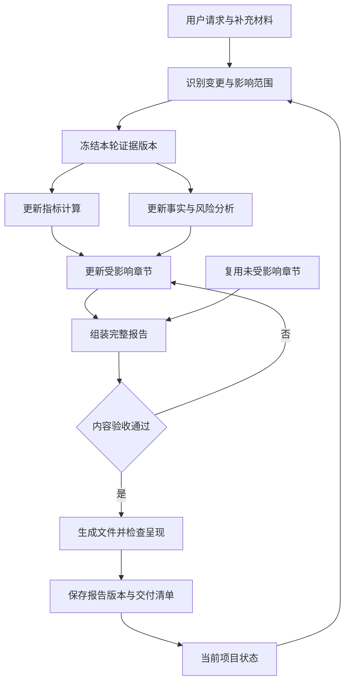

建议把这个项目设计成 **“通用报告引擎＋场景配置包＋Agent 适配层”**。

其中，报告引擎负责数据、版本、计算、完整性和文档生成；场景包定义分析要求；Codex、Claude Code、DeepSeek Harness 负责与用户交互、理解修改要求和执行分析任务。

最重要的一条产品原则是：

> **每轮交付一份完整报告；内部按影响范围增量更新。**

这样既能满足你“每次对话都输出完整长报告”的要求，也能控制生成时间、成本和多轮修改后的内容漂移。

下面是我建议采用的设计。

---

先把项目的边界分清楚，避免后续每增加一个场景，就复制一套程序。

| 层次 | 负责什么 | 是否随场景变化 |
|---|---|---|
| Agent 适配层 | 技能触发、用户交互、工具调用、子任务执行、文件交付 | 随宿主平台变化 |
| 项目与版本层 | 项目状态、材料版本、修改记录、恢复运行、报告版本 | 通用 |
| 数据与证据层 | 文档解析、来源定位、实体识别、指标与事实管理 | 通用机制＋场景字段 |
| 分析编排层 | 分析任务、依赖关系、并行执行、结果整合 | 通用机制＋场景规则 |
| 报告内容层 | 章节结构、段落、表格、图表、引用、缺口说明 | 场景配置 |
| 文档交付层 | Markdown、HTML、Word、PDF、目录、版式检查 | 通用引擎＋样式模板 |

**业务规则尽量放进场景包，可靠性要求放进引擎代码。**

例如，“经营单位必须有利润比较表”属于经营分析场景；“报告引用的每个图表必须实际存在并嵌入最终文件”属于所有场景共享的引擎能力。

---

**场景包应该包含结构、数据契约、分析方法和验收规则，而不只是一个 Prompt。**

你需要抽象的场景差异，大致如下：

| 场景 | 主要分析对象 | 典型分析要求 | 特有验收要求 |
|---|---|---|---|
| 预算及经营分析 | 集团、单位、产品、期间 | 预算执行、同比环比、量价成本、利润归因 | 单位覆盖、汇总去重、专项口径隔离 |
| 财务公司尽调 | 公司、业务、资产、负债、关联方 | 财务质量、流动性、关联交易、经营可持续性 | 财务勾稽、期间一致、证据充分性 |
| 风险尽调 | 风险事项、合同、主体、控制措施 | 风险识别、影响、缓释措施、待核实事项 | 风险依据、判断条件、材料缺口 |
| 薪酬管理分析 | 部门、岗位、职级、人员群体 | 薪酬结构、差异、预算、人效 | 样本范围、可比口径、敏感字段展示 |

建议一个场景包包含这些文件：

| 文件 | 用途 |
|---|---|
| `scenario.yaml` | 场景入口、版本、依赖和交付策略 |
| `inputs.yaml` | 所需材料及必要字段 |
| `entities.yaml` | 业务对象、层级和关联关系 |
| `metrics.yaml` | 指标定义、单位、计算口径 |
| `chapters.yaml` | 章节结构、重复章节、必备表图 |
| `analysis.yaml` | 分析任务、分析方法、依赖 |
| `quality.yaml` | 验收规则和失败处理 |
| `prompts/` | 各类分析及写作指令 |
| `templates/` | Word、HTML 等样式资源 |
| `fixtures/` | 验证该场景的样例材料与预期结果 |

下面是**拟设计的配置示例**，并非现有平台的配置语法：

```yaml
schema_version: 1
scenario_id: budget_operations
scenario_version: 1.0.0

inputs: inputs.yaml
entities: entities.yaml
metrics: metrics.yaml
analysis: analysis.yaml
quality: quality.yaml

chapters:
  - id: executive_summary
    title: 执行摘要
    depends_on: all_analysis_results

  - id: unit_analysis
    title: 二级单位经营分析
    repeat_over: entities.operating_units
    order_by: source_template_order
    required_tables:
      - profit_comparison
      - operating_metrics_or_gap
    required_charts:
      - type: profit_comparison
        when: has_comparable_data

delivery:
  every_turn: full_document
  update_strategy: dependency_based
  formats: [markdown, docx, pdf]
  render_profile: corporate_word

missing_data:
  action: disclose_in_report
  prohibit_fabrication: true

release:
  formal_requires: all_blocking_checks_passed
```

这里有一个扩展边界：**已有分析能力的组合用配置完成；新的复杂算法通过代码扩展完成。** 不建议为了实现“所有东西都可配置”，一开始就发明一套复杂编程语言。

---

**多轮交付必须围绕“报告项目”运行，不能依赖聊天记录保存全部状态。**

每个项目至少持久化以下对象：

| 对象 | 保存内容 |
|---|---|
| `Project` | 项目 ID、场景版本、报告对象、期间、交付要求 |
| `SourceDocument` | 原文件、内容哈希、版本、替代关系、解析状态 |
| `Evidence` | 原文或原值、文件位置、适用对象和期间、可信状态 |
| `Metric / Finding` | 计算结果、分析发现、依据、公式、限制条件 |
| `Section` | 稳定章节 ID、正文、引用、表图、依赖、人工修改记录 |
| `Revision` | 本次材料快照、章节版本、生成文件、验收结果、变更说明 |

数值证据和文字证据要同时支持。例如：

- 经营分析：某工作表某单元格中的累计利润。
- 尽调分析：某合同第几页的担保条款。
- 薪酬分析：某期间、某职级样本的薪酬统计结果。

对于数字，至少同时记录**主体、期间、实际/预算、币种、单位、合并范围等口径**。同名指标不代表可直接比较。

对于结论，要区分**材料记载、计算结果、分析判断和待核实事项**。关键计算由程序执行，文字、表格和图表引用同一个计算结果。

新上传的文件也不能简单地“后来的覆盖前面的”。系统应识别它属于新增材料、更正版本、重复上传，还是存在冲突的另一份材料，并保留处理记录。

---

**每轮对话先生成“变更计划”，再决定哪些内容需要更新。**

建议至少支持这些操作：

| 用户请求 | 内部处理 | 本轮交付 |
|---|---|---|
| 首次上传材料 | 建立证据、执行分析、生成全部章节 | 完整 V1 |
| 补充一份材料 | 识别新增证据，更新受影响的分析及章节 | 完整 V2 |
| 更正某个数据 | 重算相关指标，更新引用该指标的全部位置 | 完整 V3 |
| 修改指定章节 | 修改目标章节，检查摘要和关联结论 | 完整 V4 |
| 调整报告语气或样式 | 更新对应表达或渲染，不重复分析数据 | 完整 V5 |
| 只询问报告情况 | 回答问题，并提供当前完整报告 | 当前版本 |

例如，用户要求“把第四章 A 单位利润更正为 1.2 亿元”，影响范围可能包括：

- A 单位利润表和对比图；
- 单位经营分析；
- 使用该指标的集团分析；
- 执行摘要；
- 建议和风险提示。

是否影响集团总量，还要根据集团数据来源及合并规则判断，不能直接机械加减。

运行过程可以设计成：



每个章节使用稳定 ID，例如 `unit_analysis/unit_023`，不要只靠“第四章第二节”定位，否则插入章节后很容易修改错位置。

人工修订的文字应保存为明确的编辑记录。若后续材料与人工确认内容冲突，应生成冲突事项，不能悄悄覆盖，也不能继续把过时结论当成有效结论。

---

**“完整报告”与“正式报告”需要分别管理。**

建议把完整性、证据状态、发布状态分开记录：

- **完整性**：要求的章节、表格和图表是否全部交付。
- **证据状态**：哪些已核实，哪些缺失或存在冲突。
- **发布状态**：草稿、待复核、正式版。

材料不足时，仍然可以交付章节完整的报告，但相关章节必须说明“缺少什么、能分析到哪里、哪些判断暂时无法作出”。不能为了凑齐长文档补造事实。

每轮返回的交付包建议包含：

| 交付物 | 内容 |
|---|---|
| 完整报告 | 本轮完整的 Word/PDF，以及需要时的 Markdown/HTML |
| 变更说明 | 修改了哪些章节、数字和结论 |
| 待确认清单 | 冲突、缺失材料及其影响 |
| 验收结果 | 内容、计算、覆盖率、最终呈现检查 |
| 版本清单 | 报告版本、材料快照、场景版本、生成时间 |

如果一次运行失败，保留上一份成功版本并说明失败位置；不能把旧报告标成新版本。长任务需要支持断点恢复、重复调用去重和有限次数重试。

---

**多 Agent 应当由依赖关系驱动，并由一个地方统一提交结果。**

适合并行的工作包括独立文件解析、不同经营单位分析、独立风险专题和章节初稿。统一口径、集团汇总、执行摘要、全文一致性检查和最终发布则有明显先后依赖。

| 任务 | 推荐执行方式 |
|---|---|
| 多份材料解析 | 按文件并行 |
| 指标和主体口径统一 | 汇总处理，形成固定版本 |
| 不同单位或专题分析 | 依据同一证据快照并行 |
| 表图制作 | 数据确认后并行 |
| 执行摘要 | 主体分析完成后生成 |
| 全文整合与发布 | 单一协调者提交 |

子 Agent 返回的应该是结构化结果，例如：

`发现＋证据 ID＋计算 ID＋章节内容＋限制条件`

不要让多个 Agent 同时修改同一个最终 Word 或整篇 Markdown。各自提交结果，由报告引擎检查基础版本、合并内容并创建新版本。

同时，**并行数量应可配置，缺少子 Agent 能力时允许顺序执行**。正确性不能依赖某个平台特有的多 Agent 功能。

---

**跨平台交付时，Skill、插件和外部工具各有明确职责。**

OpenAI 官方将 Skill 定位为可复用的工作流指导，插件可以封装 Skill 和 MCP 服务；这支持你采用“技能指导流程、工具负责执行”的分层方式。[ChatGPT Learn](https://developers.openai.com/codex/skills-and-plugins?utm_source=chatgpt.com)

Claude Code 的插件也可以封装 skills、agents、hooks 和 MCP servers。DeepSeek Harness 官方仓库则提供技能体系和 MCP 接入能力，因此可以共享外部报告工具，同时分别适配安装和调用方式。[Claude Code Docs](https://code.claude.com/docs/en/plugins/create?utm_source=chatgpt.com)

建议这样交付：

| 组成 | 职责 |
|---|---|
| 通用报告引擎 | 状态、证据、计算、任务依赖、内容组装、验收 |
| CLI | 本地调试、自动化测试、可重复执行 |
| MCP Server | 向不同 Agent 暴露统一工具接口 |
| Skill | 教 Agent 如何创建项目、补充材料、修改章节和交付 |
| 平台插件包 | 封装各平台所需的技能、工具连接及配置 |

第一版可以让**宿主 Agent 执行模型分析和写作，报告引擎负责确定性处理与状态管理**。这样不必同时自建一套完整的模型调用平台。

工具接口可以控制在以下范围：

```text
create_project
add_materials
plan_update
get_pending_tasks
submit_task_result
build_revision
validate_revision
get_deliverables
```

这些是你项目自己的接口设计。修改类接口应携带 `project_id`、`base_revision` 和幂等标识，避免重试导致重复生成或覆盖较新版本。

MCP 工具应主要返回任务摘要、结果 ID 和文件位置；按需读取证据和章节，避免每次调用都把整份长报告送回模型上下文。

DeepSeek Harness 当前官方仓库仍提示开发预览及兼容性变化，因此适配时应固定版本并维护兼容测试。[GitHub](https://github.com/deepseek-ai/deepseek-harness?utm_source=chatgpt.com)

---

**文档生成与验收应作为独立工程模块。**

第一版可以采用：

> 结构化事实和计算结果 → 分章节 Markdown 与图表资产 → 完整 Markdown 内容验收 → DOCX → PDF → 最终呈现验收

内部保留章节树、引用和依赖关系，但暂时不用开发复杂的富文本编辑器。Markdown 用于正文审阅和内容组装，结构化数据用于计算与溯源。

如果以 Word 为正式交付载体，推荐固定 DOCX 到 PDF 的渲染路线；如果某个场景要求 HTML 为主载体，则通过独立渲染配置实现，并明确跨格式验收规则。

验收至少分为四类：

| 类别 | 必须检查的内容 |
|---|---|
| 数据与证据 | 计算正确、口径一致、关键事实可定位、冲突已披露 |
| 内容与覆盖 | 必备章节、逐对象表图、分析要求、缺口说明 |
| 多轮一致性 | 旧数据是否残留，摘要是否同步，人工修改是否保留 |
| 最终呈现 | 图片真实嵌入、表格完整、中文字体、目录、页码、引用 |

你特别关注的目录问题要单独设检查项：Pandoc 的 DOCX 目录选项可以写入生成目录的指令，这不等于最终目录已刷新并显示正确页码。生成后仍需要文档引擎刷新、保存并验证。[pandoc.org](https://pandoc.org/demo/example33/3.3-general-writer-options.html?utm_source=chatgpt.com)

**代码规则检查覆盖率、金额和资产存在性；模型检查分析质量；渲染检查最终页面。** 不要让生成正文的模型仅凭自己的判断宣布全部验收通过。

---

落地时，我建议先采用一个模块化项目，核心目录职责如下：

| 目录 | 内容 |
|---|---|
| `core/` | 项目状态、证据、任务编排、依赖、版本 |
| `parsers/` | Excel、Word、PDF、OCR 等解析适配 |
| `operators/` | 指标计算、对比、归因、风险分析组件 |
| `renderers/` | Markdown、HTML、Word、PDF |
| `scenarios/` | 各业务场景包 |
| `adapters/` | CLI、MCP、各宿主平台适配 |
| `skills/` | 通用报告工作流及场景入口 |
| `tests/` | 样例材料、预期结果、多轮测试、渲染检查 |

本地验证阶段用文件存储原始材料和产物，用轻量数据库保存结构化状态即可。企业部署时再增加集中存储、任务队列、访问控制。薪酬及尽调材料的数据隔离、敏感字段展示和模型发送范围，应由工具层执行。

开发顺序建议按四个可验收的里程碑推进：

1. **跑通经营分析单场景。** 完成材料读取、逐单位分析、完整 Markdown、Word/PDF 和最终图表验收。
2. **跑通多轮更新。** 验证补充材料、更正数字、指定章节修改、摘要联动、人工内容保留及断点恢复。
3. **加入差异明显的第二场景。** 推荐风险尽调，用文字证据、合同条款和风险事项检验通用性，找出仍写死在引擎里的经营分析逻辑。
4. **完成三平台适配。** 用同一批材料、同一套场景配置、同一组修改指令验证 Codex、Claude Code 和 DeepSeek Harness；比较计算结果、覆盖率和证据质量，不要求措辞逐字一致。

**第一版最有价值的验收任务是：同一项目连续完成“首次生成 → 补充材料 → 更正数据 → 修改指定章节”四轮操作，每轮都交付完整报告，且数字、摘要、表图、来源与版本始终一致。** 这个闭环稳定后，再扩大场景数量和并行规模。
