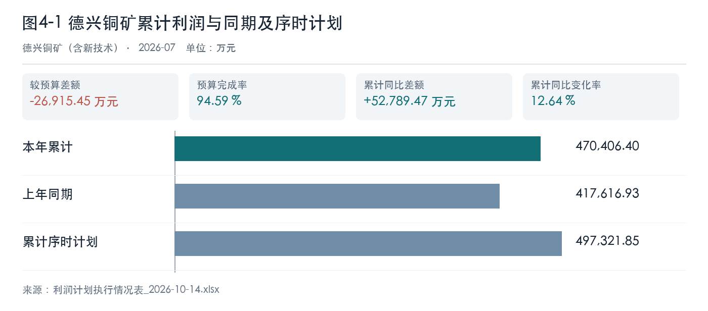

# 资料与口径

本稿只使用本轮上传的利润计划执行原表。集团合并规则、成本和产销台账未获确认，相关原因仅列为核查事项。

# 矿山单位分析

## 德兴铜矿（含新技术）

经营综述：本月较上月增加 4288.49 万元。累计利润同比增长 12.64% ，但较序时计划差额为 -26915.45 万元；年度计划完成率为 55.18% 。同比改善与计划缺口同时存在，需核对成本、产销和结算明细，不能仅凭利润表判断成因。

表4-1 德兴铜矿利润比较情况表

| 利润比较项目 | 本期或累计实际 | 比较基准 | 差额或完成率 |
| --- | ---: | ---: | ---: |
| 本月与上月（万元） | 66893.48 | 62605.00 | 4288.49 |
| 累计同比利润（万元） | 470406.40 | 417616.93 | 52789.47；12.64% |
| 累计序时计划（万元） | 470406.40 | 497321.85 | -26915.45 |
| 年度计划完成率 | 470406.40 | 852551.74 | 55.18% |

图表数据来源：利润计划执行情况表_2026-10-14.xlsx（Sheet1!F7、Sheet1!G7、Sheet1!I7）。

经营变化分析：吨矿成本同比增加 7.27 元/吨，金属成本同比增加 1037.57 元/吨，两者分母不同，不得相加；处理量和回收率资料需进一步核对。

表4-2 德兴铜矿主要经营指标表

| 经营指标 | 本期 | 同期 | 同比差额 |
| --- | ---: | ---: | ---: |
| 吨矿成本（元/吨） | 111.35 | 104.07 | 7.27 |
| 金属成本（元/吨） | 23446.53 | 22408.96 | 1037.57 |
| 吨矿成本同比率 | — | — | 6.99% |
| 金属成本同比率 | — | — | 4.63% |
| 变动吨矿成本同比差额 | — | — | 1.99 |
| 变动金属成本同比差额 | — | — | 46.86 |

管理关注：成本上升可能影响后续目标，先核对生产量和成本归集，再形成降本措施。

人工确认：请财务与生产岗位确认利润和成本统计范围。利润来源 〔来源：利润计划执行情况表_2026-10-14.xlsx，sheet:Sheet1/cell:F7〕；成本来源 〔来源：矿山成本指标完成情况_2026-10-14.xlsx，sheet:Sheet1/cell:C4〕。

# 结论与待核事项

该单位累计同比改善，但序时计划尚有缺口。请核对利润桥与生产成本资料，再讨论追赶措施。
