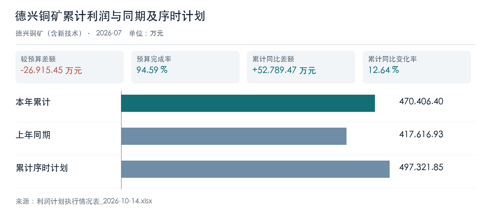

# 资料与口径

本稿只使用本轮上传的利润计划执行原表。集团合并规则、成本和产销台账未获确认，相关原因仅列为核查事项。

# 矿山单位分析

## 德兴铜矿（含新技术）

累计利润同比增长 12.64% ，但较序时计划差额为 -26915.45 万元；年度计划完成率为 55.18% 。同比改善与计划缺口同时存在，需核对成本、产销和结算明细，不能仅凭利润表判断成因。

| 利润比较项目 | 本期或累计实际 | 比较基准 | 差额或完成率 |
| --- | ---: | ---: | ---: |
| 累计同比利润（万元） | 470406.40 | 417616.93 | 52789.47 |
| 累计序时计划（万元） | 470406.40 | 497321.85 | -26915.45 |
| 年度计划完成率 | 470406.40 | 852551.74 | 55.18% |

图表数据来源：利润计划执行情况表_2026-10-14.xlsx（Sheet1!F7、Sheet1!G7、Sheet1!I7）。

| 经营指标或数据缺口 | 核查要求 |
| --- | --- |
| 矿山处理量、吨矿成本与产销 | 本次材料未提供同口径台账，需生产和成本岗位补充 |

# 结论与待核事项

该单位累计同比改善，但序时计划尚有缺口。请核对利润桥与生产成本资料，再讨论追赶措施。
