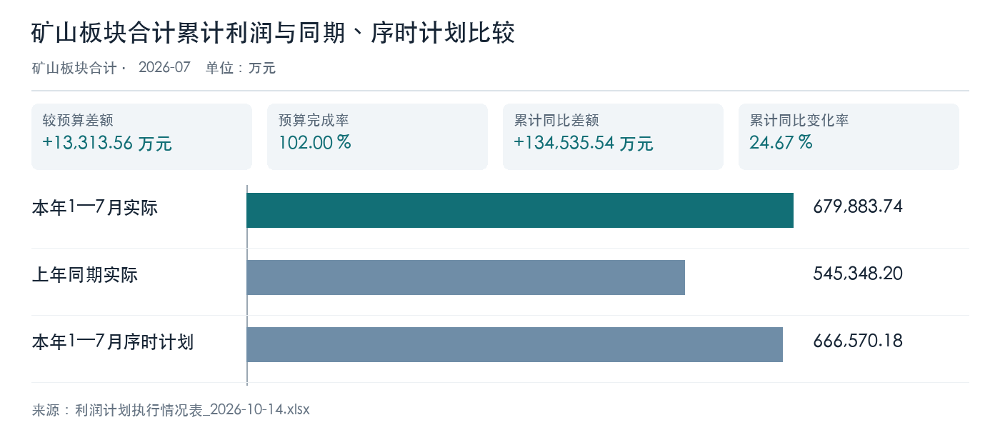
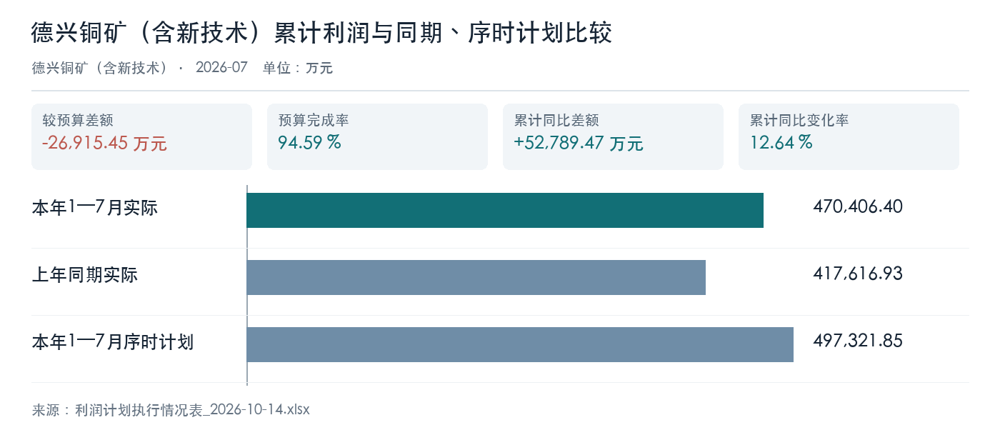
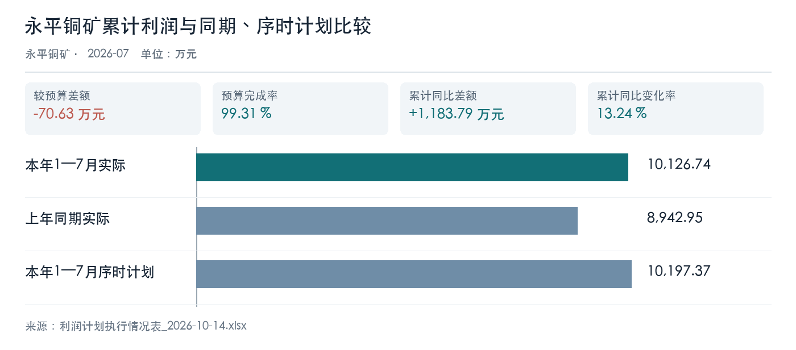
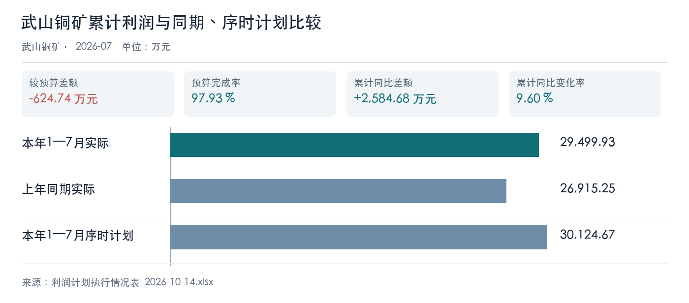
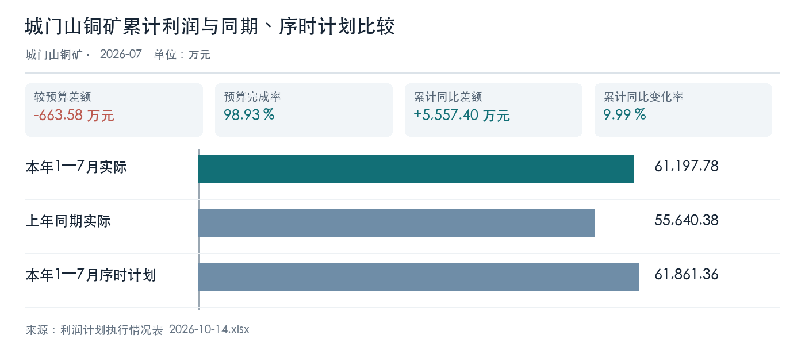
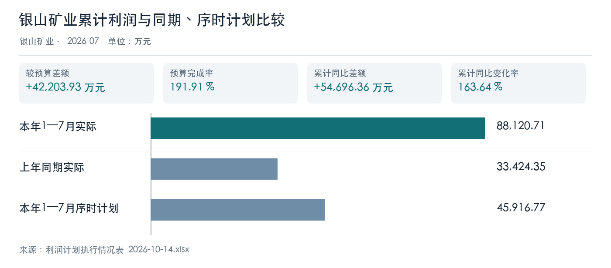
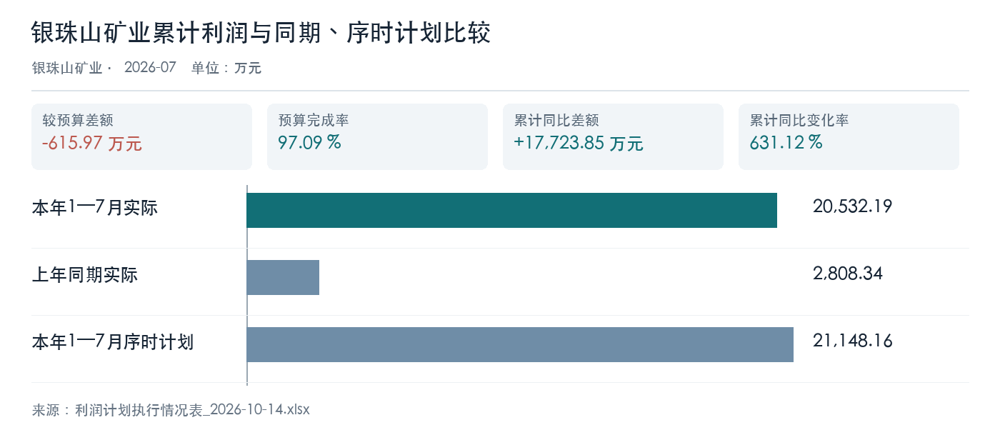

# 一、管理层摘要

**总体判断。** 原表矿山板块本年 1—7 月累计利润 679883.74 万元，同比增长 24.67%，高于序时计划 13313.56 万元。达标结构集中：银山矿业大幅超计划，德兴及其余四家有不同程度缺口。

**首要偏差。** 德兴铜矿较序时计划差额 -26915.45 万元，银山矿业差额 42203.93 万元；应优先核对这两家的利润桥和一次性因素，而非只看板块合计。

**经营信号。** 六矿成本及处理量走势分化；城门山金属量下降、武山增产伴随成本上升、银珠山改善受低基数影响。铜精矿与硫精矿价格走高不能直接等同于已确认利润贡献。

**交付边界。** 本稿使用 MOCK 来源，计划版本、合并规则及价量成本桥仍需业务复核。建议先完成高优先级台账核对，再形成正式经营判断。

# 二、分析范围、材料与口径

本稿围绕矿山板块及德兴铜矿（含新技术）、永平铜矿、武山铜矿、城门山铜矿、银山矿业、银珠山矿业六家单位，报告期为 2026 年 1—7 月。来源文件批次日期为 2026 年 10 月 14 日，不能据此把数据解释为 10 月经营结果。七宝山仅作为硫精矿专项原表中的独立行展示，不并入六矿单位分析。

本轮仅采用利润计划执行、矿山成本指标、四矿铜精矿产销增减利、硫精矿增减利四份原始工作簿。所有工作簿标有 **MOCK**，本稿是技术工作稿，数值与结论均不代表真实经营事实。《年度计划主要数据》包含矿山产品年产量计划，但本轮没有同范围的完整产量台账与计划版本核对，因此未据此推断年度产量完成率；其他材料没有用于矿山利润归因。

利润金额单位为万元；成本为元/吨；处理量、金属量、铜精矿销量按各原表单位展示。同比使用本年 1—7 月与上年同期，环比使用 7 月与 6 月；序时计划与年度计划分别比较，不能互代。板块合计使用利润原表的独立行，不把六矿结果解释为已确认的会计合并口径。集团合并规则尚未获业务确认，正式经营结论须复核。

# 三、矿山板块整体表现

矿山板块原表合计的累计利润为 679883.74 万元，同比增加 134535.54 万元，增幅 24.67%；较序时计划高 13313.56 万元，序时计划完成率 102.00%。7 月单月较 6 月增加 7977.93 万元。板块总量达标并不意味着单位普遍达标，结构主要由银山矿业的超计划抵补德兴铜矿等单位的缺口；不可据此直接确认利润增长的经营原因。

| 利润主体 | 本年累计实际（万元） | 上年同期（万元） | 累计同比（%） | 序时计划（万元） | 计划差额（万元） |
| --- | ---: | ---: | ---: | ---: | ---: |
| 矿山板块合计 | 679883.74 | 545348.20 | 24.67 | 666570.18 | 13313.56 |
| 德兴铜矿（含新技术） | 470406.40 | 417616.93 | 12.64 | 497321.85 | -26915.45 |
| 永平铜矿 | 10126.74 | 8942.95 | 13.24 | 10197.37 | -70.63 |
| 武山铜矿 | 29499.93 | 26915.25 | 9.60 | 30124.67 | -624.74 |
| 城门山铜矿 | 61197.78 | 55640.38 | 9.99 | 61861.36 | -663.58 |
| 银山矿业 | 88120.71 | 33424.35 | 163.64 | 45916.77 | 42203.93 |
| 银珠山矿业 | 20532.19 | 2808.34 | 631.12 | 21148.16 | -615.97 |

差额按实际减序时计划列示；六矿中银山矿业为正，其余五家为负。板块合计来源为利润表单列行，本次核对其单元格与六矿对应行的求和关系；来源定位：〔来源：利润计划执行情况表_2026-10-14.xlsx，sheet:Sheet1/cell:F13〕，序时计划 〔来源：利润计划执行情况表_2026-10-14.xlsx，sheet:Sheet1/cell:I13〕。

图表数据来源：利润计划执行情况表_2026-10-14.xlsx（Sheet1!F13、Sheet1!G13、Sheet1!I13）。

# 四、六家矿山单位经营与成本分析

## 德兴铜矿（含新技术）

**利润判断。** 累计利润同比改善，但序时计划缺口仍是六矿中最大的管理关注点。同期矿石处理量回落、吨矿及金属成本上升，说明需同步核查产量、品位、回收率和费用分摊；这些并非本稿已证实的利润因果链。铜精矿含铜销量基本持平、结算价格同比抬升，进一步说明应以单位级利润桥复核价量与成本的共同作用。本年累计利润同比变动率 12.64%，较序时计划差额 -26915.45 万元，年度计划完成率 55.18%。

**经营交叉检查。** 吨矿成本同比 6.99%，金属成本同比 4.63%；矿石处理量同比 -4.53%，金属量同比 -2.38%。管理动作应先把处理量下降和单位成本上升分开复算，再与含铜销量、售价及结算时点逐项勾稽。若原表利润桥无法闭合，先保留缺口，不用价格上涨作兜底解释。

| 利润比较项目 | 本年实际（万元） | 比较基准（万元） | 差额或完成率 |
| --- | ---: | ---: | ---: |
| 累计同比 | 470406.40 | 417616.93 | 52789.47 万元 |
| 累计与序时计划 | 470406.40 | 497321.85 | -26915.45 万元 |
| 累计与年度计划 | 470406.40 | 852551.74 | 55.18% |

| 经营指标 | 本年1—7月 | 上年同期 | 同比差额 | 同比率 |
| --- | ---: | ---: | ---: | ---: |
| 吨矿成本（元/吨） | 111.35 | 104.07 | 7.27 | 6.99% |
| 金属成本（元/吨） | 23446.53 | 22408.96 | 1037.57 | 4.63% |
| 矿石处理量（吨） | 25546040 | 26758711 | -1212672 | -4.53% |
| 金属量（吨） | 121318 | 124276 | -2958 | -2.38% |

来源定位：累计利润 〔来源：利润计划执行情况表_2026-10-14.xlsx，sheet:Sheet1/cell:F7〕、序时计划 〔来源：利润计划执行情况表_2026-10-14.xlsx，sheet:Sheet1/cell:I7〕；吨矿成本 〔来源：矿山成本指标完成情况_2026-10-14.xlsx，sheet:Sheet1/cell:C4〕、金属量 〔来源：矿山成本指标完成情况_2026-10-14.xlsx，sheet:Sheet1/cell:G16〕。利润、成本与产量表的单位和期间按各自原表保留；成本变化不是经验证的利润贡献额。

图表数据来源：利润计划执行情况表_2026-10-14.xlsx（Sheet1!F7、Sheet1!G7、Sheet1!I7）。

## 永平铜矿

**利润判断。** 累计利润同比增长且接近序时计划，但吨矿和金属成本同比抬升幅度较大。处理量与金属量均上升，仍不能据此断定成本上涨的原因；应核对变动成本、人工折旧及采选条件。铜精矿含铜销量略减，需与售价、库存及结算节奏共同复核。本年累计利润同比变动率 13.24%，较序时计划差额 -70.63 万元，年度计划完成率 57.93%。

**经营交叉检查。** 吨矿成本同比 25.78%，金属成本同比 24.72%；矿石处理量同比 3.40%，金属量同比 4.28%。变动成本与人工折旧应分别拆出，核对加工量增加时的单位成本变化。计划差额虽小，仍需确认本期利润是否受暂估结算或库存变化影响。

| 利润比较项目 | 本年实际（万元） | 比较基准（万元） | 差额或完成率 |
| --- | ---: | ---: | ---: |
| 累计同比 | 10126.74 | 8942.95 | 1183.79 万元 |
| 累计与序时计划 | 10126.74 | 10197.37 | -70.63 万元 |
| 累计与年度计划 | 10126.74 | 17481.20 | 57.93% |

| 经营指标 | 本年1—7月 | 上年同期 | 同比差额 | 同比率 |
| --- | ---: | ---: | ---: | ---: |
| 吨矿成本（元/吨） | 295.91 | 235.26 | 60.65 | 25.78% |
| 金属成本（元/吨） | 33524.31 | 26879.07 | 6645.24 | 24.72% |
| 矿石处理量（吨） | 1151883 | 1114009 | 37874 | 3.40% |
| 金属量（吨） | 10167 | 9750 | 417 | 4.28% |

来源定位：累计利润 〔来源：利润计划执行情况表_2026-10-14.xlsx，sheet:Sheet1/cell:F8〕、序时计划 〔来源：利润计划执行情况表_2026-10-14.xlsx，sheet:Sheet1/cell:I8〕；吨矿成本 〔来源：矿山成本指标完成情况_2026-10-14.xlsx，sheet:Sheet1/cell:C5〕、金属量 〔来源：矿山成本指标完成情况_2026-10-14.xlsx，sheet:Sheet1/cell:G17〕。利润、成本与产量表的单位和期间按各自原表保留；成本变化不是经验证的利润贡献额。

图表数据来源：利润计划执行情况表_2026-10-14.xlsx（Sheet1!F8、Sheet1!G8、Sheet1!I8）。

## 武山铜矿

**利润判断。** 处理量、金属量和铜精矿含铜销量均同比提升，累计利润亦增长，但尚有序时计划缺口。吨矿与金属成本同时上行，应核实增产对应的边际成本和结算口径；产销价量原表的增减利拆分只可作专项线索，不能直接替代利润归因。本年累计利润同比变动率 9.60%，较序时计划差额 -624.74 万元，年度计划完成率 57.12%。

**经营交叉检查。** 吨矿成本同比 13.97%，金属成本同比 9.63%；矿石处理量同比 38.53%，金属量同比 44.01%。增产与成本同升并存，建议核对矿石来源、品位、回收率和新增处理量的边际收益；含铜销量显著增长也需要与产品库存及发运记录勾稽。

| 利润比较项目 | 本年实际（万元） | 比较基准（万元） | 差额或完成率 |
| --- | ---: | ---: | ---: |
| 累计同比 | 29499.93 | 26915.25 | 2584.68 万元 |
| 累计与序时计划 | 29499.93 | 30124.67 | -624.74 万元 |
| 累计与年度计划 | 29499.93 | 51642.30 | 57.12% |

| 经营指标 | 本年1—7月 | 上年同期 | 同比差额 | 同比率 |
| --- | ---: | ---: | ---: | ---: |
| 吨矿成本（元/吨） | 457.36 | 401.31 | 56.05 | 13.97% |
| 金属成本（元/吨） | 54085.43 | 49334.56 | 4750.87 | 9.63% |
| 矿石处理量（吨） | 1691882 | 1221314 | 470568 | 38.53% |
| 金属量（吨） | 14307 | 9935 | 4372 | 44.01% |

来源定位：累计利润 〔来源：利润计划执行情况表_2026-10-14.xlsx，sheet:Sheet1/cell:F9〕、序时计划 〔来源：利润计划执行情况表_2026-10-14.xlsx，sheet:Sheet1/cell:I9〕；吨矿成本 〔来源：矿山成本指标完成情况_2026-10-14.xlsx，sheet:Sheet1/cell:C6〕、金属量 〔来源：矿山成本指标完成情况_2026-10-14.xlsx，sheet:Sheet1/cell:G18〕。利润、成本与产量表的单位和期间按各自原表保留；成本变化不是经验证的利润贡献额。

图表数据来源：利润计划执行情况表_2026-10-14.xlsx（Sheet1!F9、Sheet1!G9、Sheet1!I9）。

## 城门山铜矿

**利润判断。** 累计利润同比增长但未完成序时计划。处理量小幅增长而金属量同比回落、金属成本明显上升，经营质量需要重点核对；建议追查入选品位、回收率和产品结算明细，不能单凭处理量变化推断利润成因。铜精矿含铜销量同比下降，应与金属量数据对照核查。本年累计利润同比变动率 9.99%，较序时计划差额 -663.58 万元，年度计划完成率 57.71%。

**经营交叉检查。** 吨矿成本同比 10.17%，金属成本同比 20.11%；矿石处理量同比 5.16%，金属量同比 -3.55%。处理量与金属量背离是主要核查入口。先用生产台账复核品位和回收率，再对含铜销量下降与库存结转、销售确认时点建立交叉检查。

| 利润比较项目 | 本年实际（万元） | 比较基准（万元） | 差额或完成率 |
| --- | ---: | ---: | ---: |
| 累计同比 | 61197.78 | 55640.38 | 5557.40 万元 |
| 累计与序时计划 | 61197.78 | 61861.36 | -663.58 万元 |
| 累计与年度计划 | 61197.78 | 106048.04 | 57.71% |

| 经营指标 | 本年1—7月 | 上年同期 | 同比差额 | 同比率 |
| --- | ---: | ---: | ---: | ---: |
| 吨矿成本（元/吨） | 245.87 | 223.18 | 22.69 | 10.17% |
| 金属成本（元/吨） | 32437.07 | 27005.47 | 5431.61 | 20.11% |
| 矿石处理量（吨） | 1578623 | 1501213 | 77410 | 5.16% |
| 金属量（吨） | 11966 | 12406 | -441 | -3.55% |

来源定位：累计利润 〔来源：利润计划执行情况表_2026-10-14.xlsx，sheet:Sheet1/cell:F10〕、序时计划 〔来源：利润计划执行情况表_2026-10-14.xlsx，sheet:Sheet1/cell:I10〕；吨矿成本 〔来源：矿山成本指标完成情况_2026-10-14.xlsx，sheet:Sheet1/cell:C7〕、金属量 〔来源：矿山成本指标完成情况_2026-10-14.xlsx，sheet:Sheet1/cell:G19〕。利润、成本与产量表的单位和期间按各自原表保留；成本变化不是经验证的利润贡献额。

图表数据来源：利润计划执行情况表_2026-10-14.xlsx（Sheet1!F10、Sheet1!G10、Sheet1!I10）。

## 银山矿业

**利润判断。** 累计利润大幅超过同期和序时计划，并已超过年度计划；这是板块合计达标的主要结构性支撑。不过金属量略降、吨矿与金属成本上行，利润跃升不能简单解释为产量或成本效率改善。应优先核对价格、存货结算、一次性收益及内部交易抵销。本年累计利润同比变动率 163.64%，较序时计划差额 42203.93 万元，年度计划完成率 111.95%。

**经营交叉检查。** 吨矿成本同比 8.29%，金属成本同比 10.82%；矿石处理量同比 1.28%，金属量同比 -1.03%。优先拆分价格和一次性项目，并核对同一期间的成本、销售与内部抵销。只有利润桥闭合后，才可把超计划结果视为可持续经营改善。

| 利润比较项目 | 本年实际（万元） | 比较基准（万元） | 差额或完成率 |
| --- | ---: | ---: | ---: |
| 累计同比 | 88120.71 | 33424.35 | 54696.36 万元 |
| 累计与序时计划 | 88120.71 | 45916.77 | 42203.93 万元 |
| 累计与年度计划 | 88120.71 | 78714.47 | 111.95% |

| 经营指标 | 本年1—7月 | 上年同期 | 同比差额 | 同比率 |
| --- | ---: | ---: | ---: | ---: |
| 吨矿成本（元/吨） | 297.70 | 274.91 | 22.80 | 8.29% |
| 金属成本（元/吨） | 49328.60 | 44512.41 | 4816.19 | 10.82% |
| 矿石处理量（吨） | 2797328 | 2761939 | 35389 | 1.28% |
| 金属量（吨） | 16882 | 17058 | -175 | -1.03% |

来源定位：累计利润 〔来源：利润计划执行情况表_2026-10-14.xlsx，sheet:Sheet1/cell:F11〕、序时计划 〔来源：利润计划执行情况表_2026-10-14.xlsx，sheet:Sheet1/cell:I11〕；吨矿成本 〔来源：矿山成本指标完成情况_2026-10-14.xlsx，sheet:Sheet1/cell:C9〕、金属量 〔来源：矿山成本指标完成情况_2026-10-14.xlsx，sheet:Sheet1/cell:G21〕。利润、成本与产量表的单位和期间按各自原表保留；成本变化不是经验证的利润贡献额。

图表数据来源：利润计划执行情况表_2026-10-14.xlsx（Sheet1!F11、Sheet1!G11、Sheet1!I11）。

## 银珠山矿业

**利润判断。** 累计利润同比增幅较高，但上年同期基数较低，且本年仍低于序时计划。金属量上升、金属成本下降，与处理量下降并存；应复核品位、回收率、产品组合和成本分摊后再判断改善是否可持续。本年累计利润同比变动率 631.12%，较序时计划差额 -615.97 万元，年度计划完成率 56.63%。

**经营交叉检查。** 吨矿成本同比 4.98%，金属成本同比 -19.62%；矿石处理量同比 -4.08%，金属量同比 25.28%。应把低基数效应与实际采选改善分开；金属量增长和金属成本下降可作为复核线索，但处理量下降及计划缺口说明改善质量仍需验证。

| 利润比较项目 | 本年实际（万元） | 比较基准（万元） | 差额或完成率 |
| --- | ---: | ---: | ---: |
| 累计同比 | 20532.19 | 2808.34 | 17723.85 万元 |
| 累计与序时计划 | 20532.19 | 21148.16 | -615.97 万元 |
| 累计与年度计划 | 20532.19 | 36253.98 | 56.63% |

| 经营指标 | 本年1—7月 | 上年同期 | 同比差额 | 同比率 |
| --- | ---: | ---: | ---: | ---: |
| 吨矿成本（元/吨） | 141.25 | 134.55 | 6.71 | 4.98% |
| 金属成本（元/吨） | 8137.63 | 10124.13 | -1986.50 | -19.62% |
| 矿石处理量（吨） | 757933 | 790184 | -32251 | -4.08% |
| 金属量（吨） | 13156 | 10501 | 2655 | 25.28% |

来源定位：累计利润 〔来源：利润计划执行情况表_2026-10-14.xlsx，sheet:Sheet1/cell:F12〕、序时计划 〔来源：利润计划执行情况表_2026-10-14.xlsx，sheet:Sheet1/cell:I12〕；吨矿成本 〔来源：矿山成本指标完成情况_2026-10-14.xlsx，sheet:Sheet1/cell:C10〕、金属量 〔来源：矿山成本指标完成情况_2026-10-14.xlsx，sheet:Sheet1/cell:G22〕。利润、成本与产量表的单位和期间按各自原表保留；成本变化不是经验证的利润贡献额。

图表数据来源：利润计划执行情况表_2026-10-14.xlsx（Sheet1!F12、Sheet1!G12、Sheet1!I12）。

# 五、铜精矿与硫精矿专项

### 铜精矿含铜：价量变化与原表增减利线索

四矿铜精矿含铜采用各单位对应产品行。售价同比上升与销量变化方向并不一致；武山销量增加，德兴、永平和城门山下降。下表中的增减利为原表模拟拆分，不等同于矿山单位累计利润的已核实归因，且不能与其他产品未经去重直接相加。

| 单位 | 含铜销量同比（%） | 价格同比（%） | 原表销量增减利（万元） | 原表价格增减利（万元） |
| --- | ---: | ---: | ---: | ---: |
| 德兴铜矿（含新技术） | -0.14 | 29.93 | -425.06 | 163652.65 |
| 永平铜矿 | -1.11 | 29.93 | -143.74 | 7122.18 |
| 武山铜矿 | 49.28 | 29.93 | 11853.54 | 19960.11 |
| 城门山铜矿 | -9.42 | 29.93 | -2414.31 | 12904.12 |

德兴含铜销量来源 〔来源：四矿铜精矿产销增减利情况_2026-10-14.xlsx，sheet:Sheet1/cell:F4〕；武山原表销量增减利来源 〔来源：四矿铜精矿产销增减利情况_2026-10-14.xlsx，sheet:Sheet1/cell:J12〕。四矿金、银产品亦在原表中，本稿没有将不同计量单位的销量汇总。

### 硫精矿：销量分化、价格上行

原表七个主体中含七宝山专项行。德兴、武山、城门山、银珠山及七宝山销量同比增加，永平和银山下降；价格同比均上行。下表分别展示单位变化率与原表模拟拆分，不能直接加总为矿山板块利润贡献。

| 原表主体 | 销量同比（%） | 价格同比（%） | 原表销量增减利（万元） | 原表价格增减利（万元） |
| --- | ---: | ---: | ---: | ---: |
| 德兴铜矿（含新技术） | 25.24 | 16.78 | 1825.47 | 5890.60 |
| 永平铜矿 | -9.08 | 22.30 | -214.87 | 2497.81 |
| 武山铜矿 | 6.95 | 33.24 | 285.15 | 4527.73 |
| 城门山铜矿 | 5.44 | 32.46 | 357.62 | 6909.38 |
| 银山矿业 | -5.55 | 26.59 | -346.65 | 4331.93 |
| 七宝山（专项行） | 66.90 | 17.46 | 83.33 | 167.20 |
| 银珠山矿业 | 26.05 | 18.26 | 94.38 | 287.06 |

硫精矿销量和价格来源示例：德兴 〔来源：硫精矿增减利分析_2026-10-14.xlsx，sheet:Sheet1/cell:C4〕，七宝山 〔来源：硫精矿增减利分析_2026-10-14.xlsx，sheet:Sheet1/cell:C9〕。不同材料的金额与单位可能存在结算、库存及内部交易差异，需业务部门复核。

# 六、主要风险与待核事项

1. **板块达标的集中度。** 银山矿业超过序时计划，而其他五家单位仍有计划缺口；后续月份若银山收益不可持续，板块目标面临回落风险。需由预算办核对银山利润构成和是否含一次性项目。

2. **产量与成本变化不能自动解释利润。** 德兴处理量下降且成本上升；城门山处理量增而金属量降；武山增产伴随成本上升。原表没有完整的品位、回收率、存货、结算及内部抵销资料，现阶段仅能识别异常组合。

3. **计划和合并口径待签认。** 本稿使用利润表序时计划列作为预算比较、年度计划列作为年度完成率分母。业务部门需确认计划版本、矿山板块合计范围、六矿与七宝山的归属及内部交易抵销规则。

4. **模拟数据限制。** 原始表均标有 MOCK。铜精矿和硫精矿增减利为来源表的模拟桥接字段，不能作为真实财务披露或已审定的因果归因。

# 七、管理建议与复核清单

| 优先级 | 管理动作 | 负责复核材料 | 通过标准 |
| --- | --- | --- | --- |
| 高 | 对银山超计划、德兴缺口建立单位利润桥，逐项分离价格、销量、成本、一次性及内部交易影响 | 利润明细、结算与抵销台账 | 各项贡献与单位利润差额可勾稽；异常差额有书面说明 |
| 高 | 复核德兴、城门山、武山采选效率与单位成本，核实吨矿成本、金属成本分母与期间 | 生产日报、品位回收率、成本分配表 | 处理量、金属量及成本与财务期间一致 |
| 中 | 对四矿铜精矿、硫精矿价量拆分进行来源核验，查明销量与生产量差异 | 产品台账、库存、销售结算单 | 同口径价量桥可复算，且未重复计入利润桥 |
| 中 | 确认矿山板块计划版本与会计合并边界后重发正式稿 | 预算批复、组织口径、合并抵销表 | 计划分母、单位归属和合计范围获业务签认 |

在复核完成前，建议把本稿用于识别核查优先级，不用于绩效考核或对外披露。

# 八、计算方法与来源索引

**计算。** 同比差额＝本年 1—7 月实际－上年同期实际；同比率＝差额÷上年同期实际×100%。环比差额＝7 月实际－6 月实际。序时计划差额＝累计实际－累计序时计划，完成率＝累计实际÷累计序时计划×100%；年度计划完成率＝累计实际÷年度计划×100%。分母为零、负数或不可比时系统应显示状态，不强造增长率。报告中显示的百分比和差额均来自本轮冻结证据后的注册算子，金额按展示精度四舍五入。

**来源索引。** ①《利润计划执行情况表_2026-10-14.xlsx》Sheet1，矿山单位及板块合计行；②《矿山成本指标完成情况_2026-10-14.xlsx》Sheet1，六矿成本与成本形成量行；③《四矿铜精矿产销增减利情况_2026-10-14.xlsx》Sheet1，四矿含铜产品行；④《硫精矿增减利分析_2026-10-14.xlsx》Sheet1，六矿及七宝山行。各节保留关键单元格定位；完整证据 ID、计算输入及文件哈希保存在本轮项目版本清单。

**解释边界。** 板块合计、单位利润与产品增减利分属不同报表层次；未经计划版本、会计抵销与业务归因签认，不将专项拆分数求和为板块利润。
