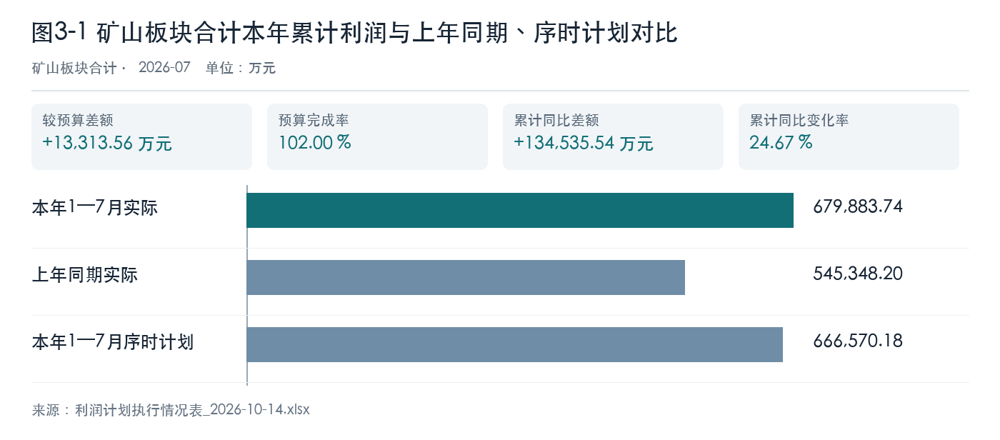
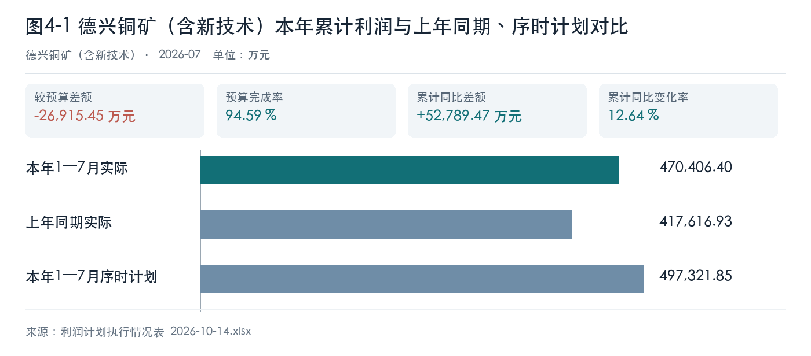
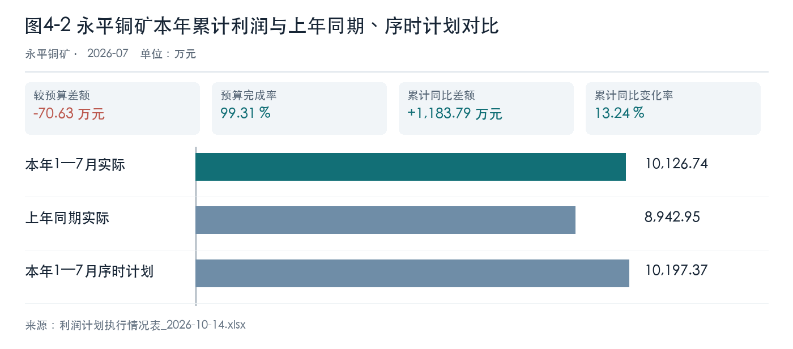
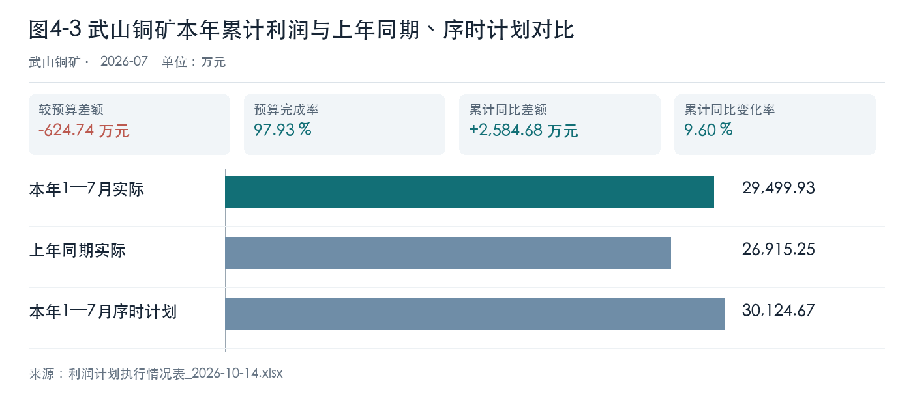
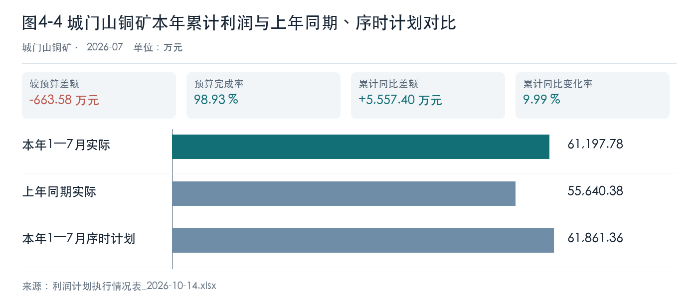
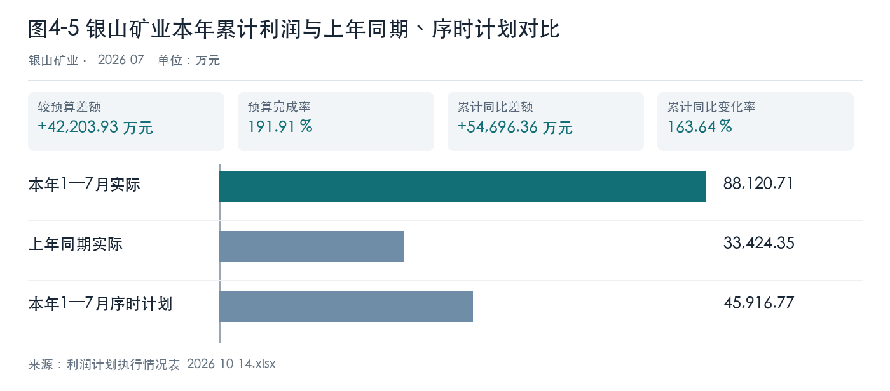
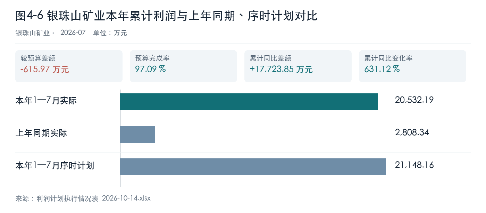

# 第一章 管理层执行摘要

**结论与决策。** 原表矿山板块本年1—7月利润 679883.74 万元，同比 24.67%，高于序时计划 13313.56 万元。板块达标由单位间的大额相反偏差抵补，并不代表六矿普遍达标。银山超序时 42203.93 万元且年度计划完成率 111.95%，德兴序时差额为 -26915.45 万元。管理层应先要求两家提交可勾稽的利润桥，再决定是否调整全年预测。

**经营变化。** 德兴矿石处理量下降而单位成本上升；武山增量伴随单位成本上行；城门山处理量增长但金属量下降；银珠山利润同比增幅受低基数影响。这些组合决定复核对象各不相同，不能用一个价格上涨解释六矿利润。铜精矿和硫精矿专项可说明价量方向，尚未与利润桥闭合。

**预算、采购和风险。** 先补齐计划版本、会计抵销、库存及结算资料。现有硬件报价与矿山采购需求未关联，暂无可支持的净采购量或采购金额结论。本稿基于MOCK模拟原件，业务口径尚待签认，只能作为技术工作稿和复核清单。

# 第二章 数据来源与分析范围

本报告分析对象为利润主表中的矿山板块独立合计行和六家矿山，顺序为德兴铜矿（含新技术）、永平铜矿、武山铜矿、城门山铜矿、银山矿业、银珠山矿业。统计期为本年1—7月，与上年同期、7月与6月、同期间序时计划及全年计划分别比较。七宝山只存在于硫精矿专项原表，在第五章独立展示，不并入六矿单位利润。集团合并和母公司口径未获确认，因此本稿不把矿山板块合计称为已审定集团合并利润。

**数据性质：MOCK技术工作稿。** 进入本轮数值分析的四份原始工作簿均有模拟数据标识；其他背景材料分别核查用途，不推断其均为模拟材料。文件名中的10月14日是材料批次日期，不是经营统计月份。本稿的金额、成本和产销量只供验证长报告流程，不能直接用于绩效考核、预算批复或对外披露。

本轮归档13份文件。利润、矿山成本、四矿铜精矿及硫精矿四份进入可追溯数值分析，其余九份逐份检查后作为背景或口径边界记录：

| 原始材料 | 本轮用途 | 判断依据 |
| --- | --- | --- |
| 江铜产融所持上市公司股权收益_2026-10-14.xlsx | 背景与边界 | 金融投资收益，不属于六矿采选经营。 |
| 主要单位效益同比分析_2026-10-14.xlsx | 背景与边界 | 列示集团与其他单位效益构成，未列六矿独立主体；不并入矿山利润。 |
| 当前国际与国内贵金属市场主要品种行情与价格走势如下.docx | 背景与边界 | 市场背景形成于报告期后，且未核实原始行情来源，仅作前瞻风险线索。 |
| TC增减利分析_2026-10-14.xlsx | 背景与边界 | 对应冶炼进口矿采购与TC，非六矿采选经营口径。 |
| 四矿铜精矿产销增减利情况_2026-10-14.xlsx | 分析 | 与本轮矿山利润、成本、产销或硫精矿主体对应，已逐行核验并抽取。 |
| 硬件报价明细.xlsx | 背景与边界 | 仅有设备报价，未给矿山采购需求、用量和预算授权，不推造采购决策。 |
| 铜加工板块加工费效益_2026-10-14.xlsx | 背景与边界 | 铜加工业务，不属于矿山板块六矿。 |
| 母公司原料效益完成情况_2026-10-14.xlsx | 背景与边界 | 对应母公司冶炼原料效益，非六矿利润桥。 |
| 矿山成本指标完成情况_2026-10-14.xlsx | 分析 | 与本轮矿山利润、成本、产销或硫精矿主体对应，已逐行核验并抽取。 |
| 硫酸增减利分析_2026-10-14.xlsx | 背景与边界 | 化工硫酸不同于本轮六矿硫精矿，主体与产品不能混并。 |
| 年度计划主要数据_2026-10-14.xlsx | 背景与边界 | 含产品年度计划，当前缺同范围产量台账，不能与六矿销量直接计算完成率；仅用于口径提示。 |
| 硫精矿增减利分析_2026-10-14.xlsx | 分析 | 与本轮矿山利润、成本、产销或硫精矿主体对应，已逐行核验并抽取。 |
| 利润计划执行情况表_2026-10-14.xlsx | 分析 | 与本轮矿山利润、成本、产销或硫精矿主体对应，已逐行核验并抽取。 |

年度产品计划与六矿销售量不是相同指标；硬件报价没有矿山采购需求和授权；报告期后的贵金属行情未经同口径核验。这些材料不生成虚构完成率、净采购量或投资收益。材料原件哈希、来源单元格、接受的事实及计算输入均保存在本轮版本清单。

# 第三章 矿山板块整体经营及利润分析

矿山板块原表合计本年1—7月利润 679883.74 万元，较上年同期增加 134535.54 万元、同比 24.67%；较同期间序时计划高 13313.56 万元，完成率 102.00%。7月利润较6月增加 7977.93 万元。年度计划完成率 59.50%，后续仍须看单位结构与月度持续性。

表3-1 矿山板块及六矿累计利润结构（万元）

| 主体 | 本年累计 | 上年同期 | 同比率 | 序时计划 | 计划差额 |
| --- | ---: | ---: | ---: | ---: | ---: |
| 矿山板块合计 | 679883.74 | 545348.20 | 24.67% | 666570.18 | 13313.56 |
| 德兴铜矿（含新技术） | 470406.40 | 417616.93 | 12.64% | 497321.85 | -26915.45 |
| 永平铜矿 | 10126.74 | 8942.95 | 13.24% | 10197.37 | -70.63 |
| 武山铜矿 | 29499.93 | 26915.25 | 9.60% | 30124.67 | -624.74 |
| 城门山铜矿 | 61197.78 | 55640.38 | 9.99% | 61861.36 | -663.58 |
| 银山矿业 | 88120.71 | 33424.35 | 163.64% | 45916.77 | 42203.93 |
| 银珠山矿业 | 20532.19 | 2808.34 | 631.12% | 21148.16 | -615.97 |

板块合计的序时正差额主要来自银山矿业 42203.93 万元的超额，德兴铜矿序时差额为 -26915.45 万元；其余四矿也存在缺口。银山超过全年计划但生产与成本指标并未同步改善，意味着总量达标的质量需重点复核。板块原表合计来源 〔来源：利润计划执行情况表_2026-10-14.xlsx，sheet:Sheet1/cell:F13〕，本轮核对其与六矿对应行的算术关系；这不等于会计抵销和归属规则已签认。

图表数据来源：利润计划执行情况表_2026-10-14.xlsx（Sheet1!F13、Sheet1!G13、Sheet1!I13）。

图示板块累计利润高于同期与序时计划，但单列合计不能遮蔽单位计划偏差。

# 第四章 六矿逐户经营分析

## 德兴铜矿（含新技术）

### 经营综述

德兴铜矿（含新技术）7月利润 66893.48 万元，较6月增加 4288.49 万元，环比 6.85%；原件没有本年7月与上年7月同月的可比列，因此不报告单月同比。本年累计利润 470406.40 万元，较上年同期增加 52789.47 万元、同比 12.64%；较序时计划差额 -26915.45 万元，完成序时计划 94.59%，占年度计划 55.18%。按同一年度计划扣除已实现数，后五个月月均尚需 76429.07 万元；这不是已获批的月度分解计划。

表4-1 德兴铜矿（含新技术）利润比较情况表（万元）

| 利润比较项目 | 本期实际 | 比较基准 | 差额与比率 |
| --- | ---: | ---: | ---: |
| 7月较6月 | 66893.48 | 62605.00 | 4288.49；环比 6.85% |
| 1—7月较上年同期 | 470406.40 | 417616.93 | 52789.47；同比 12.64% |
| 1—7月较序时计划 | 470406.40 | 497321.85 | -26915.45；完成率 94.59% |
| 1—7月占年度计划 | 470406.40 | 852551.74 | 年度完成率 55.18% |

利润实际来源：〔来源：利润计划执行情况表_2026-10-14.xlsx，sheet:Sheet1/cell:F7〕；序时计划来源：〔来源：利润计划执行情况表_2026-10-14.xlsx，sheet:Sheet1/cell:I7〕。

图表数据来源：利润计划执行情况表_2026-10-14.xlsx（Sheet1!F7、Sheet1!G7、Sheet1!I7）。

图中本年累计实际与上年同期、同期间序时计划同口径比较；累计同比 12.64%，序时差额 -26915.45 万元。同比改善仍未达到序时计划，不能用增长率代替预算达标判断。图中来源和计算标注均取自本轮已核验利润表。

### 经营变化分析

德兴的核心矛盾是利润同比增长但序时计划仍有较大缺口，同时选矿处理量下降、吨矿与金属成本同升。含铜销量基本持平，价格同比上涨；这一价格信号不能单独解释利润增量，特别是矿量与成本已经给出反向压力。原表显示吨矿成本同比 6.99%，金属成本同比 4.63%；选矿处理量同比 -4.53%，金属折合量同比 -2.38%。变动吨矿成本同比 2.54%，人工及折旧同比 15.09%。人工折旧与处理量的变化方向需在费用归集及分母核对后再解释，不能把同比差额直接当作利润贡献。吨矿与金属成本的分母不同；处理量和金属量的变化方向只构成追查线索，不是品位或回收率的直接计算结果。

铜精矿含铜产量 87398.01 吨，销量 85213.36 吨；原表未提供同口径上年产量，两数之差不能直接认定为库存变动。含铜销量同比 -0.14%，均价同比 29.93%；含金与含银按公斤另列，不与含铜吨数相加。含金产量 2078.05 公斤、销量 2085.33 公斤，销量同比 5.50%，均价同比 20.95%；原表量差影响 6679.92 万元，价差影响 37155.74 万元，属于产品专项模拟拆分，不能独立认定为净利润变化。含银产量 19698.31 公斤、销量 19405.62 公斤，销量同比 2.07%，均价同比 13.25%；原表量差影响 214.19 万元，价差影响 2114.85 万元，属于产品专项模拟拆分，不能独立认定为净利润变化。含铜原始销量定位 〔来源：四矿铜精矿产销增减利情况_2026-10-14.xlsx，sheet:Sheet1/cell:F4〕。

硫精矿销量同比 25.24%，本期 58.58 万吨，高于原表计划 42.84 万吨；均价同比 16.78%，本期均价 699.83 元/吨，原表计划均价 619.47 元/吨。原表 M 列 444.66 元/吨是上年单位成本；缺本年同口径成本，不能计算本年硫精矿单位毛利或其同比。价量方向需与库存、结算和成本一起核对，不能直接换算为累计利润贡献。

表4-2 德兴铜矿（含新技术）主要生产经营指标表

| 指标及原表单位 | 本年1—7月 | 上年同期 | 同比差额 | 同比率 |
| --- | ---: | ---: | ---: | ---: |
| 吨矿成本（元/吨） | 111.35 | 104.07 | 7.27 | 6.99% |
| 变动吨矿成本（元/吨） | 80.36 | 78.37 | 1.99 | 2.54% |
| 金属成本（元/吨） | 23446.53 | 22408.96 | 1037.57 | 4.63% |
| 变动金属成本（元/吨） | 16921.22 | 16874.37 | 46.86 | 0.28% |
| 选矿处理量（吨） | 25546039.66 | 26758711.41 | -1212671.75 | -4.53% |
| 人工及折旧（万元） | 79163.64 | 68781.73 | 10381.92 | 15.09% |
| 金属折合量（吨） | 121317.83 | 124275.96 | -2958.13 | -2.38% |
| 硫精矿销量（万吨） | 58.58 | 46.77 | 11.81 | 25.24% |
| 硫精矿均价（元/吨） | 699.83 | 599.27 | 100.56 | 16.78% |
| 铜精矿含铜销量（吨） | 85213.36 | 85336.39 | -123.03 | -0.14% |
| 铜精矿含铜均价（元/吨） | 83365.42 | 64160.38 | 19205.05 | 29.93% |
| 硫精矿单位成本（元/吨） | 未提供 | 444.66 | — | — |
| 铜精矿含铜产量（吨） | 87398.01 | 未提供 | — | — |

成本来源：〔来源：矿山成本指标完成情况_2026-10-14.xlsx，sheet:Sheet1/cell:C4〕；生产量来源：〔来源：矿山成本指标完成情况_2026-10-14.xlsx，sheet:Sheet1/cell:C16〕；硫精矿来源：〔来源：硫精矿增减利分析_2026-10-14.xlsx，sheet:Sheet1/cell:C4〕。铜精矿来源：〔来源：四矿铜精矿产销增减利情况_2026-10-14.xlsx，sheet:Sheet1/cell:F4〕。

### 管理关注

采选部门应逐月核对停机、入选矿品位和回收记录，财务部门按同期间重算固定费用分摊及矿石结转；销售部门核实铜精矿产销与结算时点。若三个台账不能闭合，不能把价格上涨认定为预算缺口的解决办法。

人工及折旧同比 15.09%，而处理量同比 -4.53%、变动吨矿成本同比 2.54%。人工折旧增长与产量收缩叠加，可能推高总吨矿成本；生产负责人须列明停机和产能利用记录，成本负责人复核费用分摊，形成可复算的吨矿成本解释。对经营影响先列明为待核事项；专项原表的量价增减利字段没有与单位利润总额逐项桥接，故不作为已确认利润归因。

### 人工确认

需业务签认本单位利润、序时计划和年度计划是否属于同一组织范围；补充逐月生产、成本、产品库存、销售结算和内部交易台账。利润比较定位 〔来源：利润计划执行情况表_2026-10-14.xlsx，sheet:Sheet1/cell:F7〕，吨矿成本定位 〔来源：矿山成本指标完成情况_2026-10-14.xlsx，sheet:Sheet1/cell:C4〕，处理量定位 〔来源：矿山成本指标完成情况_2026-10-14.xlsx，sheet:Sheet1/cell:C16〕，硫精矿定位 〔来源：硫精矿增减利分析_2026-10-14.xlsx，sheet:Sheet1/cell:C4〕。

## 永平铜矿

### 经营综述

永平铜矿7月利润 1842.43 万元，较6月增加 464.17 万元，环比 33.68%；原件没有本年7月与上年7月同月的可比列，因此不报告单月同比。本年累计利润 10126.74 万元，较上年同期增加 1183.79 万元、同比 13.24%；较序时计划差额 -70.63 万元，完成序时计划 99.31%，占年度计划 57.93%。按同一年度计划扣除已实现数，后五个月月均尚需 1470.89 万元；这不是已获批的月度分解计划。

表4-3 永平铜矿利润比较情况表（万元）

| 利润比较项目 | 本期实际 | 比较基准 | 差额与比率 |
| --- | ---: | ---: | ---: |
| 7月较6月 | 1842.43 | 1378.26 | 464.17；环比 33.68% |
| 1—7月较上年同期 | 10126.74 | 8942.95 | 1183.79；同比 13.24% |
| 1—7月较序时计划 | 10126.74 | 10197.37 | -70.63；完成率 99.31% |
| 1—7月占年度计划 | 10126.74 | 17481.20 | 年度完成率 57.93% |

利润实际来源：〔来源：利润计划执行情况表_2026-10-14.xlsx，sheet:Sheet1/cell:F8〕；序时计划来源：〔来源：利润计划执行情况表_2026-10-14.xlsx，sheet:Sheet1/cell:I8〕。

图表数据来源：利润计划执行情况表_2026-10-14.xlsx（Sheet1!F8、Sheet1!G8、Sheet1!I8）。

图中本年累计实际与上年同期、同期间序时计划同口径比较；累计同比 13.24%，序时差额 -70.63 万元。同比改善仍未达到序时计划，不能用增长率代替预算达标判断。图中来源和计算标注均取自本轮已核验利润表。

### 经营变化分析

永平的序时差额较小，但吨矿和金属成本同比升幅显著高于处理量和金属量的增幅。当前月利润环比改善，仍需判断是否由价格、销售确认或一次性项目推动，不能据此把全年成本压力视为解除。原表显示吨矿成本同比 25.78%，金属成本同比 24.72%；选矿处理量同比 3.40%，金属折合量同比 4.28%。变动吨矿成本同比 22.08%，人工及折旧同比 39.57%。人工折旧与处理量的变化方向需在费用归集及分母核对后再解释，不能把同比差额直接当作利润贡献。吨矿与金属成本的分母不同；处理量和金属量的变化方向只构成追查线索，不是品位或回收率的直接计算结果。

铜精矿含铜产量 3663.46 吨，销量 3708.49 吨；原表未提供同口径上年产量，两数之差不能直接认定为库存变动。含铜销量同比 -1.11%，均价同比 29.93%；含金与含银按公斤另列，不与含铜吨数相加。含金产量 9.14 公斤、销量 9.20 公斤，销量同比 -8.20%，均价同比 20.95%；原表量差影响 -50.53 万元，价差影响 163.99 万元，属于产品专项模拟拆分，不能独立认定为净利润变化。含银产量 3633.16 公斤、销量 3653.71 公斤，销量同比 -9.50%，均价同比 13.25%；原表量差影响 -208.78 万元，价差影响 398.19 万元，属于产品专项模拟拆分，不能独立认定为净利润变化。含铜原始销量定位 〔来源：四矿铜精矿产销增减利情况_2026-10-14.xlsx，sheet:Sheet1/cell:F8〕。

硫精矿销量同比 -9.08%，本期 20.60 万吨，高于原表计划 18.86 万吨；均价同比 22.30%，本期均价 664.93 元/吨，原表计划均价 619.47 元/吨。原表 M 列 439.20 元/吨是上年单位成本；缺本年同口径成本，不能计算本年硫精矿单位毛利或其同比。价量方向需与库存、结算和成本一起核对，不能直接换算为累计利润贡献。

表4-4 永平铜矿主要生产经营指标表

| 指标及原表单位 | 本年1—7月 | 上年同期 | 同比差额 | 同比率 |
| --- | ---: | ---: | ---: | ---: |
| 吨矿成本（元/吨） | 295.91 | 235.26 | 60.65 | 25.78% |
| 变动吨矿成本（元/吨） | 204.79 | 167.75 | 37.04 | 22.08% |
| 金属成本（元/吨） | 33524.31 | 26879.07 | 6645.24 | 24.72% |
| 变动金属成本（元/吨） | 23200.82 | 19165.96 | 4034.86 | 21.05% |
| 选矿处理量（吨） | 1151882.60 | 1114008.95 | 37873.65 | 3.40% |
| 人工及折旧（万元） | 10496.29 | 7520.62 | 2975.67 | 39.57% |
| 金属折合量（吨） | 10167.39 | 9750.44 | 416.95 | 4.28% |
| 硫精矿销量（万吨） | 20.60 | 22.66 | -2.06 | -9.08% |
| 硫精矿均价（元/吨） | 664.93 | 543.68 | 121.25 | 22.30% |
| 铜精矿含铜销量（吨） | 3708.49 | 3750.10 | -41.60 | -1.11% |
| 铜精矿含铜均价（元/吨） | 83365.42 | 64160.38 | 19205.05 | 29.93% |
| 硫精矿单位成本（元/吨） | 未提供 | 439.20 | — | — |
| 铜精矿含铜产量（吨） | 3663.46 | 未提供 | — | — |

成本来源：〔来源：矿山成本指标完成情况_2026-10-14.xlsx，sheet:Sheet1/cell:C5〕；生产量来源：〔来源：矿山成本指标完成情况_2026-10-14.xlsx，sheet:Sheet1/cell:C17〕；硫精矿来源：〔来源：硫精矿增减利分析_2026-10-14.xlsx，sheet:Sheet1/cell:C5〕。铜精矿来源：〔来源：四矿铜精矿产销增减利情况_2026-10-14.xlsx，sheet:Sheet1/cell:F8〕。

### 管理关注

矿山财务与生产部门先核对变动金属成本、人工折旧和处理量分母，再将含铜、金、银销量分别与销售结算台账勾稽。硫精矿销量下降而价格上升，应拆解量价与结算期，确认净效应后再修订后五个月预测。

变动吨矿成本同比 22.08%，硫精矿销量同比 -9.08%；成本部门须核实能源与材料单耗，销售部门核对硫精矿合同及库存，分别说明成本抬升和销量走弱是否发生在同一期间。对经营影响先列明为待核事项；专项原表的量价增减利字段没有与单位利润总额逐项桥接，故不作为已确认利润归因。

### 人工确认

需业务签认本单位利润、序时计划和年度计划是否属于同一组织范围；补充逐月生产、成本、产品库存、销售结算和内部交易台账。利润比较定位 〔来源：利润计划执行情况表_2026-10-14.xlsx，sheet:Sheet1/cell:F8〕，吨矿成本定位 〔来源：矿山成本指标完成情况_2026-10-14.xlsx，sheet:Sheet1/cell:C5〕，处理量定位 〔来源：矿山成本指标完成情况_2026-10-14.xlsx，sheet:Sheet1/cell:C17〕，硫精矿定位 〔来源：硫精矿增减利分析_2026-10-14.xlsx，sheet:Sheet1/cell:C5〕。

## 武山铜矿

### 经营综述

武山铜矿7月利润 5118.58 万元，较6月增加 955.94 万元，环比 22.96%；原件没有本年7月与上年7月同月的可比列，因此不报告单月同比。本年累计利润 29499.93 万元，较上年同期增加 2584.68 万元、同比 9.60%；较序时计划差额 -624.74 万元，完成序时计划 97.93%，占年度计划 57.12%。按同一年度计划扣除已实现数，后五个月月均尚需 4428.47 万元；这不是已获批的月度分解计划。

表4-5 武山铜矿利润比较情况表（万元）

| 利润比较项目 | 本期实际 | 比较基准 | 差额与比率 |
| --- | ---: | ---: | ---: |
| 7月较6月 | 5118.58 | 4162.64 | 955.94；环比 22.96% |
| 1—7月较上年同期 | 29499.93 | 26915.25 | 2584.68；同比 9.60% |
| 1—7月较序时计划 | 29499.93 | 30124.67 | -624.74；完成率 97.93% |
| 1—7月占年度计划 | 29499.93 | 51642.30 | 年度完成率 57.12% |

利润实际来源：〔来源：利润计划执行情况表_2026-10-14.xlsx，sheet:Sheet1/cell:F9〕；序时计划来源：〔来源：利润计划执行情况表_2026-10-14.xlsx，sheet:Sheet1/cell:I9〕。

图表数据来源：利润计划执行情况表_2026-10-14.xlsx（Sheet1!F9、Sheet1!G9、Sheet1!I9）。

图中本年累计实际与上年同期、同期间序时计划同口径比较；累计同比 9.60%，序时差额 -624.74 万元。同比改善仍未达到序时计划，不能用增长率代替预算达标判断。图中来源和计算标注均取自本轮已核验利润表。

### 经营变化分析

武山处理量与金属量均明显增加，铜精矿含铜销量亦上升，但吨矿及金属成本仍同步上行。这种“增量未摊薄单位成本”的组合比单看利润同比增长更值得跟踪；月度改善尚不足以抹平序时缺口。原表显示吨矿成本同比 13.97%，金属成本同比 9.63%；选矿处理量同比 38.53%，金属折合量同比 44.01%。变动吨矿成本同比 19.04%，人工及折旧同比 34.19%。人工折旧与处理量的变化方向需在费用归集及分母核对后再解释，不能把同比差额直接当作利润贡献。吨矿与金属成本的分母不同；处理量和金属量的变化方向只构成追查线索，不是品位或回收率的直接计算结果。

铜精矿含铜产量 10468.92 吨，销量 10393.16 吨；原表未提供同口径上年产量，两数之差不能直接认定为库存变动。含铜销量同比 49.28%，均价同比 29.93%；含金与含银按公斤另列，不与含铜吨数相加。含金产量 134.33 公斤、销量 130.37 公斤，销量同比 43.63%，均价同比 20.95%；原表量差影响 2432.90 万元，价差影响 2322.85 万元，属于产品专项模拟拆分，不能独立认定为净利润变化。含银产量 6480.40 公斤、销量 6578.28 公斤，销量同比 51.71%，均价同比 13.25%；原表量差影响 1220.89 万元，价差影响 716.91 万元，属于产品专项模拟拆分，不能独立认定为净利润变化。含铜原始销量定位 〔来源：四矿铜精矿产销增减利情况_2026-10-14.xlsx，sheet:Sheet1/cell:F12〕。

硫精矿销量同比 6.95%，本期 26.01 万吨，低于原表计划 34.69 万吨；均价同比 33.24%，本期均价 697.71 元/吨，原表计划均价 619.47 元/吨。原表 M 列 354.92 元/吨是上年单位成本；缺本年同口径成本，不能计算本年硫精矿单位毛利或其同比。价量方向需与库存、结算和成本一起核对，不能直接换算为累计利润贡献。

表4-6 武山铜矿主要生产经营指标表

| 指标及原表单位 | 本年1—7月 | 上年同期 | 同比差额 | 同比率 |
| --- | ---: | ---: | ---: | ---: |
| 吨矿成本（元/吨） | 457.36 | 401.31 | 56.05 | 13.97% |
| 变动吨矿成本（元/吨） | 368.40 | 309.47 | 58.93 | 19.04% |
| 金属成本（元/吨） | 54085.43 | 49334.56 | 4750.87 | 9.63% |
| 变动金属成本（元/吨） | 43565.37 | 38044.13 | 5521.24 | 14.51% |
| 选矿处理量（吨） | 1691882.22 | 1221313.96 | 470568.26 | 38.53% |
| 人工及折旧（万元） | 15051.02 | 11216.61 | 3834.41 | 34.19% |
| 金属折合量（吨） | 14306.97 | 9934.62 | 4372.35 | 44.01% |
| 硫精矿销量（万吨） | 26.01 | 24.32 | 1.69 | 6.95% |
| 硫精矿均价（元/吨） | 697.71 | 523.64 | 174.07 | 33.24% |
| 铜精矿含铜销量（吨） | 10393.16 | 6962.32 | 3430.85 | 49.28% |
| 铜精矿含铜均价（元/吨） | 83365.42 | 64160.38 | 19205.05 | 29.93% |
| 硫精矿单位成本（元/吨） | 未提供 | 354.92 | — | — |
| 铜精矿含铜产量（吨） | 10468.92 | 未提供 | — | — |

成本来源：〔来源：矿山成本指标完成情况_2026-10-14.xlsx，sheet:Sheet1/cell:C6〕；生产量来源：〔来源：矿山成本指标完成情况_2026-10-14.xlsx，sheet:Sheet1/cell:C18〕；硫精矿来源：〔来源：硫精矿增减利分析_2026-10-14.xlsx，sheet:Sheet1/cell:C6〕。铜精矿来源：〔来源：四矿铜精矿产销增减利情况_2026-10-14.xlsx，sheet:Sheet1/cell:F12〕。

### 管理关注

生产部门核查采选计划、品位和回收率，成本部门拆开外包、能源、人工折旧与新增处理量；销售部门核对含铜销量及硫精矿结算。只有增量收入与增量成本同期间匹配后，才能判断扩量是否改善边际收益。

处理量同比 38.53%，人工及折旧同比 34.19%，变动吨矿成本同比 19.04%。费用总额的增幅低于处理量增幅，但单位变动成本仍上升，说明规模扩大尚未消除能源、外包或运费压力。采选负责人应核查新增产量对应台账，财务负责人核对增量成本是否进入同期间利润。对经营影响先列明为待核事项；专项原表的量价增减利字段没有与单位利润总额逐项桥接，故不作为已确认利润归因。

### 人工确认

需业务签认本单位利润、序时计划和年度计划是否属于同一组织范围；补充逐月生产、成本、产品库存、销售结算和内部交易台账。利润比较定位 〔来源：利润计划执行情况表_2026-10-14.xlsx，sheet:Sheet1/cell:F9〕，吨矿成本定位 〔来源：矿山成本指标完成情况_2026-10-14.xlsx，sheet:Sheet1/cell:C6〕，处理量定位 〔来源：矿山成本指标完成情况_2026-10-14.xlsx，sheet:Sheet1/cell:C18〕，硫精矿定位 〔来源：硫精矿增减利分析_2026-10-14.xlsx，sheet:Sheet1/cell:C6〕。

## 城门山铜矿

### 经营综述

城门山铜矿7月利润 9749.74 万元，较6月增加 1490.42 万元，环比 18.05%；原件没有本年7月与上年7月同月的可比列，因此不报告单月同比。本年累计利润 61197.78 万元，较上年同期增加 5557.40 万元、同比 9.99%；较序时计划差额 -663.58 万元，完成序时计划 98.93%，占年度计划 57.71%。按同一年度计划扣除已实现数，后五个月月均尚需 8970.05 万元；这不是已获批的月度分解计划。

表4-7 城门山铜矿利润比较情况表（万元）

| 利润比较项目 | 本期实际 | 比较基准 | 差额与比率 |
| --- | ---: | ---: | ---: |
| 7月较6月 | 9749.74 | 8259.32 | 1490.42；环比 18.05% |
| 1—7月较上年同期 | 61197.78 | 55640.38 | 5557.40；同比 9.99% |
| 1—7月较序时计划 | 61197.78 | 61861.36 | -663.58；完成率 98.93% |
| 1—7月占年度计划 | 61197.78 | 106048.04 | 年度完成率 57.71% |

利润实际来源：〔来源：利润计划执行情况表_2026-10-14.xlsx，sheet:Sheet1/cell:F10〕；序时计划来源：〔来源：利润计划执行情况表_2026-10-14.xlsx，sheet:Sheet1/cell:I10〕。

图表数据来源：利润计划执行情况表_2026-10-14.xlsx（Sheet1!F10、Sheet1!G10、Sheet1!I10）。

图中本年累计实际与上年同期、同期间序时计划同口径比较；累计同比 9.99%，序时差额 -663.58 万元。同比改善仍未达到序时计划，不能用增长率代替预算达标判断。图中来源和计算标注均取自本轮已核验利润表。

### 经营变化分析

城门山处理量上升而金属折合量下降，金属成本涨幅明显高于吨矿成本；含铜销量也下降。利润虽同比增长、7月环比改善，却仍低于序时计划，产出效率与销售确认需要并行复核。原表显示吨矿成本同比 10.17%，金属成本同比 20.11%；选矿处理量同比 5.16%，金属折合量同比 -3.55%。变动吨矿成本同比 10.02%，人工及折旧同比 16.52%。人工折旧与处理量的变化方向需在费用归集及分母核对后再解释，不能把同比差额直接当作利润贡献。吨矿与金属成本的分母不同；处理量和金属量的变化方向只构成追查线索，不是品位或回收率的直接计算结果。

铜精矿含铜产量 6864.70 吨，销量 6719.13 吨；原表未提供同口径上年产量，两数之差不能直接认定为库存变动。含铜销量同比 -9.42%，均价同比 29.93%；含金与含银按公斤另列，不与含铜吨数相加。含金产量 81.26 公斤、销量 82.60 公斤，销量同比 -1.88%，均价同比 20.95%；原表量差影响 -97.37 万元，价差影响 1471.67 万元，属于产品专项模拟拆分，不能独立认定为净利润变化。含银产量 6224.01 公斤、销量 6206.32 公斤，销量同比 -7.54%，均价同比 13.25%；原表量差影响 -275.65 万元，价差影响 676.37 万元，属于产品专项模拟拆分，不能独立认定为净利润变化。含铜原始销量定位 〔来源：四矿铜精矿产销增减利情况_2026-10-14.xlsx，sheet:Sheet1/cell:F16〕。

硫精矿销量同比 5.44%，本期 38.80 万吨，高于原表计划 32.82 万吨；均价同比 32.46%，本期均价 726.81 元/吨，原表计划均价 619.47 元/吨。原表 M 列 370.07 元/吨是上年单位成本；缺本年同口径成本，不能计算本年硫精矿单位毛利或其同比。价量方向需与库存、结算和成本一起核对，不能直接换算为累计利润贡献。

表4-8 城门山铜矿主要生产经营指标表

| 指标及原表单位 | 本年1—7月 | 上年同期 | 同比差额 | 同比率 |
| --- | ---: | ---: | ---: | ---: |
| 吨矿成本（元/吨） | 245.87 | 223.18 | 22.69 | 10.17% |
| 变动吨矿成本（元/吨） | 200.19 | 181.96 | 18.23 | 10.02% |
| 金属成本（元/吨） | 32437.07 | 27005.47 | 5431.61 | 20.11% |
| 变动金属成本（元/吨） | 26410.94 | 22017.47 | 4393.47 | 19.95% |
| 选矿处理量（吨） | 1578622.51 | 1501212.66 | 77409.85 | 5.16% |
| 人工及折旧（万元） | 7210.67 | 6188.22 | 1022.45 | 16.52% |
| 金属折合量（吨） | 11965.68 | 12406.22 | -440.54 | -3.55% |
| 硫精矿销量（万吨） | 38.80 | 36.80 | 2.00 | 5.44% |
| 硫精矿均价（元/吨） | 726.81 | 548.72 | 178.09 | 32.46% |
| 铜精矿含铜销量（吨） | 6719.13 | 7417.92 | -698.79 | -9.42% |
| 铜精矿含铜均价（元/吨） | 83365.42 | 64160.38 | 19205.05 | 29.93% |
| 硫精矿单位成本（元/吨） | 未提供 | 370.07 | — | — |
| 铜精矿含铜产量（吨） | 6864.70 | 未提供 | — | — |

成本来源：〔来源：矿山成本指标完成情况_2026-10-14.xlsx，sheet:Sheet1/cell:C7〕；生产量来源：〔来源：矿山成本指标完成情况_2026-10-14.xlsx，sheet:Sheet1/cell:C19〕；硫精矿来源：〔来源：硫精矿增减利分析_2026-10-14.xlsx，sheet:Sheet1/cell:C7〕。铜精矿来源：〔来源：四矿铜精矿产销增减利情况_2026-10-14.xlsx，sheet:Sheet1/cell:F16〕。

### 管理关注

先由生产部门按矿种和月份交叉核对入选品位、回收率与金属折合口径，不凭处理量与金属量两个汇总数直接推断地质变化；财务和销售部门核对库存、结算和成本分母。若金属产出缺口持续，应重排后续采选与销售计划。

金属折合量同比 -3.55%，含铜销量同比 -9.42%；生产与销售负责人须分别验证金属计量、在制品和发运结算，区分采选效率问题与销售确认跨期。对经营影响先列明为待核事项；专项原表的量价增减利字段没有与单位利润总额逐项桥接，故不作为已确认利润归因。

### 人工确认

需业务签认本单位利润、序时计划和年度计划是否属于同一组织范围；补充逐月生产、成本、产品库存、销售结算和内部交易台账。利润比较定位 〔来源：利润计划执行情况表_2026-10-14.xlsx，sheet:Sheet1/cell:F10〕，吨矿成本定位 〔来源：矿山成本指标完成情况_2026-10-14.xlsx，sheet:Sheet1/cell:C7〕，处理量定位 〔来源：矿山成本指标完成情况_2026-10-14.xlsx，sheet:Sheet1/cell:C19〕，硫精矿定位 〔来源：硫精矿增减利分析_2026-10-14.xlsx，sheet:Sheet1/cell:C7〕。

## 银山矿业

### 经营综述

银山矿业7月利润 12351.86 万元，较6月增加 727.68 万元，环比 6.26%；原件没有本年7月与上年7月同月的可比列，因此不报告单月同比。本年累计利润 88120.71 万元，较上年同期增加 54696.36 万元、同比 163.64%；较序时计划差额 42203.93 万元，完成序时计划 191.91%，占年度计划 111.95%。年度计划已经超额，剩余月份月均目标的负值仅表示算术差额，不是经营亏损要求。

表4-9 银山矿业利润比较情况表（万元）

| 利润比较项目 | 本期实际 | 比较基准 | 差额与比率 |
| --- | ---: | ---: | ---: |
| 7月较6月 | 12351.86 | 11624.18 | 727.68；环比 6.26% |
| 1—7月较上年同期 | 88120.71 | 33424.35 | 54696.36；同比 163.64% |
| 1—7月较序时计划 | 88120.71 | 45916.77 | 42203.93；完成率 191.91% |
| 1—7月占年度计划 | 88120.71 | 78714.47 | 年度完成率 111.95% |

利润实际来源：〔来源：利润计划执行情况表_2026-10-14.xlsx，sheet:Sheet1/cell:F11〕；序时计划来源：〔来源：利润计划执行情况表_2026-10-14.xlsx，sheet:Sheet1/cell:I11〕。

图表数据来源：利润计划执行情况表_2026-10-14.xlsx（Sheet1!F11、Sheet1!G11、Sheet1!I11）。

图中本年累计实际与上年同期、同期间序时计划同口径比较；累计同比 163.64%，序时差额 42203.93 万元。同比与序时均大幅上升，但产量和成本尚未验证超额利润的持续性。图中来源和计算标注均取自本轮已核验利润表。

### 经营变化分析

银山是板块序时超额的主要贡献行，累计利润已高于年度计划，但处理量仅微增、金属量略降、单位成本上升，硫精矿销量下降。利润增长与生产成本信号不一致，必须查明价格、一次性收益和内部交易的作用。原表显示吨矿成本同比 8.29%，金属成本同比 10.82%；选矿处理量同比 1.28%，金属折合量同比 -1.03%。变动吨矿成本同比 -0.72%，人工及折旧同比 51.33%。人工折旧与处理量的变化方向需在费用归集及分母核对后再解释，不能把同比差额直接当作利润贡献。吨矿与金属成本的分母不同；处理量和金属量的变化方向只构成追查线索，不是品位或回收率的直接计算结果。

四矿铜精矿专项原表未列本单位，不将其他矿山产品指标移植到本单位。

硫精矿销量同比 -5.55%，本期 27.97 万吨，高于原表计划 26.93 万吨；均价同比 26.59%，本期均价 737.30 元/吨，原表计划均价 619.47 元/吨。原表 M 列 371.42 元/吨是上年单位成本；缺本年同口径成本，不能计算本年硫精矿单位毛利或其同比。价量方向需与库存、结算和成本一起核对，不能直接换算为累计利润贡献。

表4-10 银山矿业主要生产经营指标表

| 指标及原表单位 | 本年1—7月 | 上年同期 | 同比差额 | 同比率 |
| --- | ---: | ---: | ---: | ---: |
| 吨矿成本（元/吨） | 297.70 | 274.91 | 22.80 | 8.29% |
| 变动吨矿成本（元/吨） | 223.86 | 225.48 | -1.62 | -0.72% |
| 金属成本（元/吨） | 49328.60 | 44512.41 | 4816.19 | 10.82% |
| 变动金属成本（元/吨） | 37092.10 | 36509.40 | 582.71 | 1.60% |
| 选矿处理量（吨） | 2797328.32 | 2761938.97 | 35389.35 | 1.28% |
| 人工及折旧（万元） | 20657.97 | 13651.25 | 7006.72 | 51.33% |
| 金属折合量（吨） | 16882.25 | 17057.63 | -175.38 | -1.03% |
| 硫精矿销量（万吨） | 27.97 | 29.61 | -1.64 | -5.55% |
| 硫精矿均价（元/吨） | 737.30 | 582.41 | 154.89 | 26.59% |
| 硫精矿单位成本（元/吨） | 未提供 | 371.42 | — | — |

成本来源：〔来源：矿山成本指标完成情况_2026-10-14.xlsx，sheet:Sheet1/cell:C9〕；生产量来源：〔来源：矿山成本指标完成情况_2026-10-14.xlsx，sheet:Sheet1/cell:C21〕；硫精矿来源：〔来源：硫精矿增减利分析_2026-10-14.xlsx，sheet:Sheet1/cell:C8〕。

### 管理关注

预算办与财务部门先形成利润桥，按经常经营、价格、暂估、套保、资产处置和抵销逐项列示，核对异常收益是否可重复；生产部门核对金属量和成本。年度计划已超额时，剩余月均差额为负值，不应当写作未来必须亏损的经营目标。

变动吨矿成本同比 -0.72%，总吨矿成本同比 8.29%，人工及折旧同比 51.33%。总成本上升与变动成本平稳的背离提示固定费用或归集变化；财务负责人须说明费用及超额利润的具体项目，预算办只对可持续项目滚动预测。对经营影响先列明为待核事项；专项原表的量价增减利字段没有与单位利润总额逐项桥接，故不作为已确认利润归因。

### 人工确认

需业务签认本单位利润、序时计划和年度计划是否属于同一组织范围；补充逐月生产、成本、产品库存、销售结算和内部交易台账。利润比较定位 〔来源：利润计划执行情况表_2026-10-14.xlsx，sheet:Sheet1/cell:F11〕，吨矿成本定位 〔来源：矿山成本指标完成情况_2026-10-14.xlsx，sheet:Sheet1/cell:C9〕，处理量定位 〔来源：矿山成本指标完成情况_2026-10-14.xlsx，sheet:Sheet1/cell:C21〕，硫精矿定位 〔来源：硫精矿增减利分析_2026-10-14.xlsx，sheet:Sheet1/cell:C8〕。

## 银珠山矿业

### 经营综述

银珠山矿业7月利润 2820.14 万元，较6月增加 51.22 万元，环比 1.85%；原件没有本年7月与上年7月同月的可比列，因此不报告单月同比。本年累计利润 20532.19 万元，较上年同期增加 17723.85 万元、同比 631.12%；较序时计划差额 -615.97 万元，完成序时计划 97.09%，占年度计划 56.63%。按同一年度计划扣除已实现数，后五个月月均尚需 3144.36 万元；这不是已获批的月度分解计划。

表4-11 银珠山矿业利润比较情况表（万元）

| 利润比较项目 | 本期实际 | 比较基准 | 差额与比率 |
| --- | ---: | ---: | ---: |
| 7月较6月 | 2820.14 | 2768.92 | 51.22；环比 1.85% |
| 1—7月较上年同期 | 20532.19 | 2808.34 | 17723.85；同比 631.12% |
| 1—7月较序时计划 | 20532.19 | 21148.16 | -615.97；完成率 97.09% |
| 1—7月占年度计划 | 20532.19 | 36253.98 | 年度完成率 56.63% |

利润实际来源：〔来源：利润计划执行情况表_2026-10-14.xlsx，sheet:Sheet1/cell:F12〕；序时计划来源：〔来源：利润计划执行情况表_2026-10-14.xlsx，sheet:Sheet1/cell:I12〕。

图表数据来源：利润计划执行情况表_2026-10-14.xlsx（Sheet1!F12、Sheet1!G12、Sheet1!I12）。

图中本年累计实际与上年同期、同期间序时计划同口径比较；累计同比 631.12%，序时差额 -615.97 万元。同比改善仍未达到序时计划，不能用增长率代替预算达标判断。图中来源和计算标注均取自本轮已核验利润表。

### 经营变化分析

银珠山累计同比增幅极高，但上年同期基数很低；7月环比改善有限且序时计划仍有缺口。处理量下降、金属折合量增加、金属成本下降，说明产出与成本方向发生变化，但不能仅凭汇总数认定回收率提高。原表显示吨矿成本同比 4.98%，金属成本同比 -19.62%；选矿处理量同比 -4.08%，金属折合量同比 25.28%。变动吨矿成本同比 -4.24%，人工及折旧同比 16.05%。人工折旧与处理量的变化方向需在费用归集及分母核对后再解释，不能把同比差额直接当作利润贡献。吨矿与金属成本的分母不同；处理量和金属量的变化方向只构成追查线索，不是品位或回收率的直接计算结果。

四矿铜精矿专项原表未列本单位，不将其他矿山产品指标移植到本单位。

硫精矿销量同比 26.05%，本期 2.62 万吨，高于原表计划 2.57 万吨；均价同比 18.26%，本期均价 708.67 元/吨，原表计划均价 619.47 元/吨。原表 M 列 425.12 元/吨是上年单位成本；缺本年同口径成本，不能计算本年硫精矿单位毛利或其同比。价量方向需与库存、结算和成本一起核对，不能直接换算为累计利润贡献。

表4-12 银珠山矿业主要生产经营指标表

| 指标及原表单位 | 本年1—7月 | 上年同期 | 同比差额 | 同比率 |
| --- | ---: | ---: | ---: | ---: |
| 吨矿成本（元/吨） | 141.25 | 134.55 | 6.71 | 4.98% |
| 变动吨矿成本（元/吨） | 81.74 | 85.35 | -3.62 | -4.24% |
| 金属成本（元/吨） | 8137.63 | 10124.13 | -1986.50 | -19.62% |
| 变动金属成本（元/吨） | 4708.81 | 6422.67 | -1713.86 | -26.68% |
| 选矿处理量（吨） | 757932.99 | 790184.34 | -32251.35 | -4.08% |
| 人工及折旧（万元） | 4511.00 | 3886.99 | 624.02 | 16.05% |
| 金属折合量（吨） | 13156.15 | 10501.23 | 2654.92 | 25.28% |
| 硫精矿销量（万吨） | 2.62 | 2.08 | 0.54 | 26.05% |
| 硫精矿均价（元/吨） | 708.67 | 599.24 | 109.43 | 18.26% |
| 硫精矿单位成本（元/吨） | 未提供 | 425.12 | — | — |

成本来源：〔来源：矿山成本指标完成情况_2026-10-14.xlsx，sheet:Sheet1/cell:C10〕；生产量来源：〔来源：矿山成本指标完成情况_2026-10-14.xlsx，sheet:Sheet1/cell:C22〕；硫精矿来源：〔来源：硫精矿增减利分析_2026-10-14.xlsx，sheet:Sheet1/cell:C10〕。

### 管理关注

生产与财务部门核对入选矿结构、计量和成本归集，验证金属量增长及金属成本下降的可持续性；销售部门核查硫精矿销量增加的结算时点。年度利润预测应同时列示低基数效应与序时缺口，避免用同比率掩盖绝对额压力。

变动吨矿成本同比 -4.24%，总吨矿成本同比 4.98%，金属成本同比 -19.62%。三者方向不同，提示矿石和金属分母及费用结构共同变化；生产与财务负责人须核查金属计量及成本分摊，并与硫精矿结算时点交叉核对。对经营影响先列明为待核事项；专项原表的量价增减利字段没有与单位利润总额逐项桥接，故不作为已确认利润归因。

### 人工确认

需业务签认本单位利润、序时计划和年度计划是否属于同一组织范围；补充逐月生产、成本、产品库存、销售结算和内部交易台账。利润比较定位 〔来源：利润计划执行情况表_2026-10-14.xlsx，sheet:Sheet1/cell:F12〕，吨矿成本定位 〔来源：矿山成本指标完成情况_2026-10-14.xlsx，sheet:Sheet1/cell:C10〕，处理量定位 〔来源：矿山成本指标完成情况_2026-10-14.xlsx，sheet:Sheet1/cell:C22〕，硫精矿定位 〔来源：硫精矿增减利分析_2026-10-14.xlsx，sheet:Sheet1/cell:C10〕。

# 第五章 专项来源与独立口径分析

### 四矿铜精矿产销

四矿原表分别列含铜、含金和含银。含铜销量与价格采用同一产品同一期间比较；金银以公斤单列，不能与含铜吨数合计。下面的原表增减利是专项模拟拆分，不代表已核定净利润贡献；需要产品成本、库存和内部交易抵销才能接入单位利润桥。

表5-1 四矿铜精矿含铜价量变化与原表影响

| 单位 | 含铜销量同比 | 含铜均价同比 | 原表量差影响（万元） | 原表价差影响（万元） |
| --- | ---: | ---: | ---: | ---: |
| 德兴铜矿（含新技术） | -0.14% | 29.93% | -425.06 | 163652.65 |
| 永平铜矿 | -1.11% | 29.93% | -143.74 | 7122.18 |
| 武山铜矿 | 49.28% | 29.93% | 11853.54 | 19960.11 |
| 城门山铜矿 | -9.42% | 29.93% | -2414.31 | 12904.12 |

武山含铜销量同比变化 49.28%，城门山同比变化 -9.42%；原表含铜均价同向上升，但两矿销量方向相反，应分别核对生产、库存及结算，而不能给四矿统一归因。德兴含铜原表定位 〔来源：四矿铜精矿产销增减利情况_2026-10-14.xlsx，sheet:Sheet1/cell:F4〕。

表5-2 四矿含金与含银专项量价线索

| 单位及产品 | 本年产量 | 本年销量 | 销量同比 | 原表量差影响（万元） | 原表价差影响（万元） |
| --- | ---: | ---: | ---: | ---: | ---: |
| 德兴铜矿（含新技术）含金（公斤） | 2078.05 | 2085.33 | 5.50% | 6679.92 | 37155.74 |
| 德兴铜矿（含新技术）含银（公斤） | 19698.31 | 19405.62 | 2.07% | 214.19 | 2114.85 |
| 永平铜矿含金（公斤） | 9.14 | 9.20 | -8.20% | -50.53 | 163.99 |
| 永平铜矿含银（公斤） | 3633.16 | 3653.71 | -9.50% | -208.78 | 398.19 |
| 武山铜矿含金（公斤） | 134.33 | 130.37 | 43.63% | 2432.90 | 2322.85 |
| 武山铜矿含银（公斤） | 6480.40 | 6578.28 | 51.71% | 1220.89 | 716.91 |
| 城门山铜矿含金（公斤） | 81.26 | 82.60 | -1.88% | -97.37 | 1471.67 |
| 城门山铜矿含银（公斤） | 6224.01 | 6206.32 | -7.54% | -275.65 | 676.37 |

含金、含银价量影响保留原表产品口径，不与含铜吨数相加；产销差异须以库存和结算台账验证。

### 六矿硫精矿与七宝山独立专项

硫精矿原表有六矿及七宝山七个主体；七宝山不在利润主表六矿单位清单中，单列而不挪入任一矿山。原表量价影响可能与铜精矿、副产品和内部交易重叠，不加总为板块利润。

表5-3 硫精矿销量与均价同比变化

| 原表主体 | 销量同比 | 均价同比 | 原表量差影响（万元） | 原表价差影响（万元） |
| --- | ---: | ---: | ---: | ---: |
| 德兴铜矿（含新技术） | 25.24% | 16.78% | 1825.47 | 5890.60 |
| 永平铜矿 | -9.08% | 22.30% | -214.87 | 2497.81 |
| 武山铜矿 | 6.95% | 33.24% | 285.15 | 4527.73 |
| 城门山铜矿 | 5.44% | 32.46% | 357.62 | 6909.38 |
| 银山矿业 | -5.55% | 26.59% | -346.65 | 4331.93 |
| 七宝山（独立专项） | 66.90% | 17.46% | 83.33 | 167.20 |
| 银珠山矿业 | 26.05% | 18.26% | 94.38 | 287.06 |

七宝山销量同比 66.90%，均价同比 17.46%；来源为专项原表 〔来源：硫精矿增减利分析_2026-10-14.xlsx，sheet:Sheet1/cell:C9〕。永平和银山硫精矿销量下降而价格上升，其他主体量价方向不同；须按主体分别核对期间和结算，不以原表模拟量价差直接决定利润调整。

# 第六章 整体经营与共同关注事项

**利润计划的结构性压力。** 板块合计高于序时计划 13313.56 万元，但德兴序时差额 -26915.45 万元与银山超额 42203.93 万元方向相反。将两者净额视为普遍改善会低估其余矿山的计划压力；预算办应先核实银山收益是否具有持续性，再分单位更新全年预测。

**采选效率与成本。** 城门山处理量同比 5.16%，金属量同比 -3.55%，金属成本同比 20.11%；这一组合提示金属产出和成本分母需要联查。武山处理量、金属量增长且单位成本上行，应核实扩量边际成本；银珠山金属量增加而处理量下降，需核对计量口径。不存在单一适用于六矿的降本解释。

**库存、采购与财务口径。** 当前没有六矿同口径的期初库存、目标期末库存、有效合同到货、未来耗用及资金计划，不能计算净采购量或资金需求。铜精矿、硫精矿专项的量价拆分与单位利润之间尚缺结算、库存、成本和抵销桥；需要业务部门确认计划版本、单位边界和内部交易。

# 第七章 市场关联与情景测算边界

当前材料包含报告期后形成的贵金属市场文字资料，但没有与本年1—7月逐月经营、实际合同、库存及矿山销售结算相匹配的可核验价格序列。因此只将贵金属价格波动作为后续预算预测需跟踪的风险线索，不将其写作已发生利润变动的原因。铜精矿含铜原表均价上升属于本轮单位产品事实，但不等同于外部市场即时铜价。

若要做可复算情景，预算办需提供各产品未来可销售量、合同计价基准与价格区间、库存可售量、单位变动成本及税费。届时情景增量可以按同口径产品量乘以净价格变化，再扣除相应变动成本与结算影响；在这些输入缺失前，不填造采购数量、利润敏感性金额或投资回收期。设备硬件报价亦缺矿山需求和预算授权，只列为待论证材料。

# 第八章 建议事项与人工确认

建议把复核任务与经营判断分开，先处理能改变全年预算结论的异常，再评估采选和销售措施。

表8-1 管理动作、依据及通过标准

| 优先级与责任 | 本轮证据与影响 | 需要执行的核验 | 通过标准 |
| --- | --- | --- | --- |
| 高：预算办与银山财务 | 银山序时差额 42203.93 万元、年度完成率 111.95%；决定板块超额质量 | 拆经常经营、价格、暂估、套保、一次性和抵销的利润桥 | 分项与利润总额及会计台账勾稽，明确可持续部分 |
| 高：德兴财务与生产 | 德兴序时差额 -26915.45 万元，处理量同比 -4.53%；影响后续目标 | 对停机、品位、回收、成本分配和结算逐月核对 | 生产、销售、财务三表同期间闭合，原因有书面依据 |
| 高：城门山生产与成本部门 | 金属量同比 -3.55%，金属成本同比 20.11%；影响采选效率判断 | 按矿种复核金属折合口径及成本分母 | 计量和费用归集与财务期间一致 |
| 中：四矿销售与六矿财务 | 铜精矿与硫精矿专项仅是模拟量价拆分；可能与利润桥重叠 | 核对生产、库存、销售合同、结算与内部交易 | 同一产品同一期间复算，重复项目剔除 |
| 中：预算办与采购部门 | 缺同物料库存、耗用、合同与授权；无法计算采购需求 | 补齐采购计划和设备需求论证 | 再提出数量、资金或项目投资决策 |

人工签认清单：六矿和七宝山的组织归属；矿山板块合计的会计抵销规则；序时及年度计划版本；销售结算与产品专项的期间；模拟材料能否替换为正式台账。未完成上述签认时，本稿只用于识别复核优先级。

# 第九章 来源索引与计算口径

**计算口径。** 本月环比＝7月实际减6月实际；本年累计同比＝本年1—7月减上年同期；变化率以同口径正基数为分母。序时计划差额＝累计实际减同期间序时计划，完成率＝累计实际除以序时计划；年度计划完成率＝累计实际除以全年计划，后五个月月均尚需＝全年计划减累计实际后除以五。各项差额和比率由本轮冻结证据后注册算子计算，先用未舍入值计算再显示。基数非正或缺少同口径数据时不强造增长率。

**来源与可复核性。** 利润主表为《利润计划执行情况表》矿山六矿及板块合计行；成本和生产量为《矿山成本指标完成情况》各矿对应行；含铜、含金和含银来自《四矿铜精矿产销增减利情况》；硫精矿及七宝山来自《硫精矿增减利分析》。正文各矿表格和叙述保留源单元格引用；每个计算记录保留输入事实ID、源文件哈希及状态。

**口径边界。** 矿山板块原表合计不等于已确认会计合并；专项量价差不是利润总额归因。年度产品产量计划没有同范围的完整产量台账，市场材料没有可核验的期间价格序列，硬件报价没有采购需求。缺口由预算、生产、销售、采购和财务部门确认后，方能把本技术稿升级为正式经营报告。
