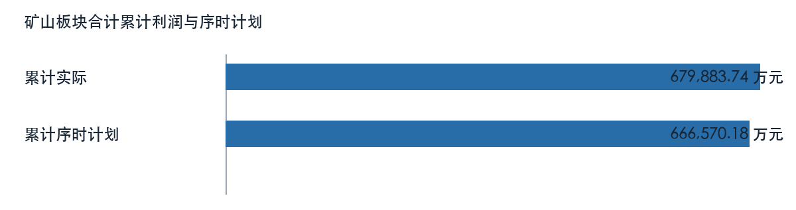
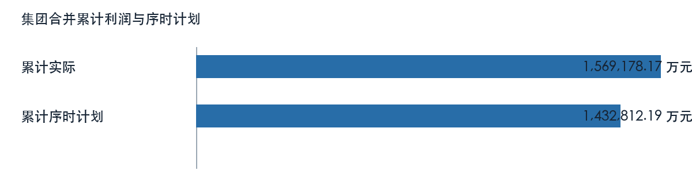
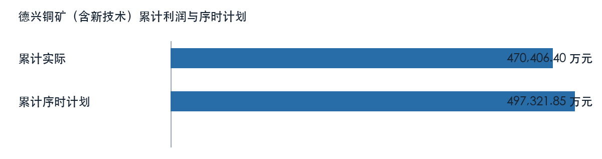
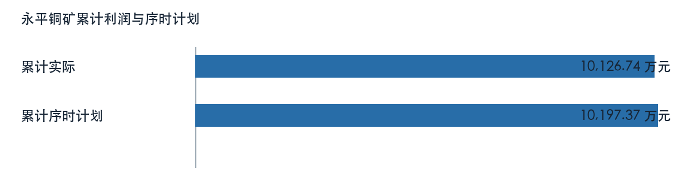
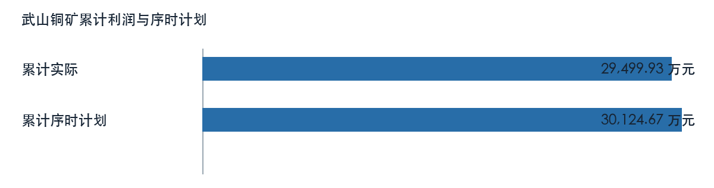
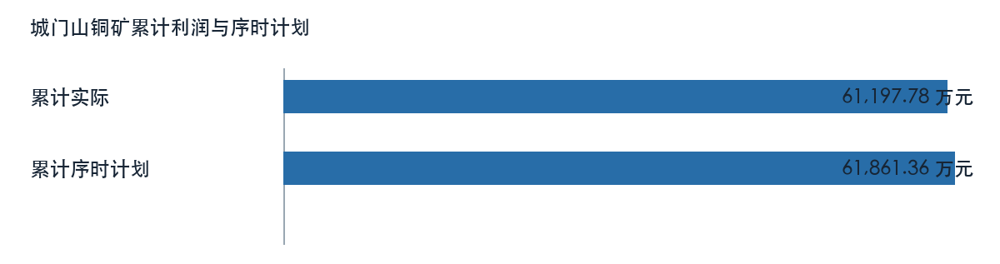
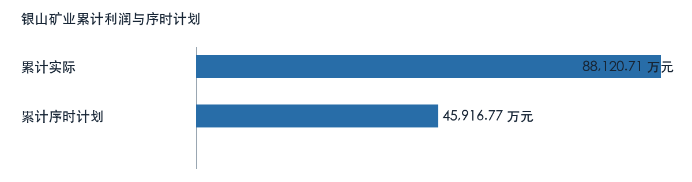
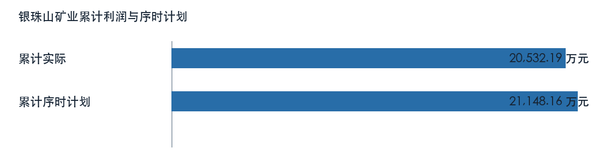

# 第一章 管理层执行摘要

本稿为模拟数据技术工作稿，核心结论来自已冻结的利润快报和专项表。矿山板块合计七月利润为 98776.23 万元，上月为 90798.31 万元，环比增加。一至七月累计为 679883.74 万元，上年同期为 545348.20 万元，同比增加。累计序时计划为 666570.18 万元，实际与计划差额为 13313.56 万元。板块累计与同期相比增加，当月较上月增加，两种时间窗口应分别评价。现有来源不能证明销售、成本或对冲的完整利润桥，也不能形成正式合并经营结论。建议先核对异常单位、专项归属和序时计划版本，再讨论措施。

# 第二章 数据来源与分析范围

本报告仅分析矿山板块合计及配置列示的6个主单位，统计期为二〇二六年一月至七月；七月与六月比较，本年累计与上年同期及表内累计序时计划比较。材料均标记为 MOCK，文件交付日期不替代经营期间。板块合计为工作簿模拟汇总，未取得真实内部抵销规则；所属明细与上级单位含有包含关系，不重复加总。市场文字材料晚于统计期间，不作为七月行情或利润成因证据。

# 第三章 集团整体经营及利润分析

集团合并七月利润为 150430.13 万元，上月为 217229.70 万元，环比减少。一至七月累计为 1569178.17 万元，上年同期为 1064057.67 万元，同比增加。累计序时计划为 1432812.19 万元，集团合并抵销口径未签认，未给出自动差额。

| 利润比较项目 | 金额（万元） |
| --- | ---: |
| 本月 | 150430.13 |
| 上月 | 217229.70 |
| 本年累计 | 1569178.17 |
| 上年同期累计 | 1064057.67 |
| 年度计划 | 2456249.47 |
| 累计序时计划 | 1432812.19 |

来源定位：〔来源：利润计划执行情况表_2026-10-14.xlsx，sheet:Sheet1/cell:F6〕。

集团合并行与矿山板块合计行各自列示。模拟合计未作真实内部抵销，不将所属单位和专项数重复加总。

# 第四章 产业板块与二级单位经营分析

## 德兴铜矿（含新技术）

德兴铜矿（含新技术）七月利润为 66893.48 万元，上月为 62605.00 万元，环比增加。一至七月累计为 470406.40 万元，上年同期为 417616.93 万元，同比增加。累计序时计划为 497321.85 万元，实际与计划差额为 -26915.45 万元。

| 利润比较项目 | 金额（万元） |
| --- | ---: |
| 本月 | 66893.48 |
| 上月 | 62605.00 |
| 本年累计 | 470406.40 |
| 上年同期累计 | 417616.93 |
| 年度计划 | 852551.74 |
| 累计序时计划 | 497321.85 |

来源定位：〔来源：利润计划执行情况表_2026-10-14.xlsx，sheet:Sheet1/cell:F7〕。

### 经营指标与专项线索

| 主体及专项 | 指标 | 来源值 | 单位 |
| --- | --- | ---: | --- |
| 铜精矿含金 | 累计价格 | 1028680.64 | 元/公斤 |
| 铜精矿含金 | 同期价格 | 850504.18 | 元/公斤 |
| 铜精矿含金 | 累计销量 | 2085.33 | 公斤 |
| 铜精矿含金 | 同期销量 | 1976.60 | 公斤 |
| 铜精矿含铜 | 累计价格 | 83365.42 | 元/吨 |
| 铜精矿含铜 | 同期价格 | 64160.38 | 元/吨 |
| 铜精矿含铜 | 累计销量 | 85213.36 | 吨 |
| 铜精矿含铜 | 同期销量 | 85336.39 | 吨 |
| 铜精矿含银 | 累计价格 | 9311.92 | 元/公斤 |
| 铜精矿含银 | 同期价格 | 8222.11 | 元/公斤 |
| 铜精矿含银 | 累计销量 | 19405.62 | 公斤 |
| 铜精矿含银 | 同期销量 | 19012.23 | 公斤 |

取数示例：〔来源：四矿铜精矿产销增减利情况_2026-10-14.xlsx，sheet:Sheet1/cell:H5〕。

以上专项与利润快报可能存在期间、主体或计量差异。财务和业务岗位须核对合同、结算、产销与成本归集后，再解释利润变动；来源表专项影响不重复计入单位利润。

## 永平铜矿

永平铜矿七月利润为 1842.43 万元，上月为 1378.26 万元，环比增加。一至七月累计为 10126.74 万元，上年同期为 8942.95 万元，同比增加。累计序时计划为 10197.37 万元，实际与计划差额为 -70.63 万元。

| 利润比较项目 | 金额（万元） |
| --- | ---: |
| 本月 | 1842.43 |
| 上月 | 1378.26 |
| 本年累计 | 10126.74 |
| 上年同期累计 | 8942.95 |
| 年度计划 | 17481.20 |
| 累计序时计划 | 10197.37 |

来源定位：〔来源：利润计划执行情况表_2026-10-14.xlsx，sheet:Sheet1/cell:F8〕。

### 经营指标与专项线索

| 主体及专项 | 指标 | 来源值 | 单位 |
| --- | --- | ---: | --- |
| 铜精矿含金 | 累计价格 | 1028680.64 | 元/公斤 |
| 铜精矿含金 | 同期价格 | 850504.18 | 元/公斤 |
| 铜精矿含金 | 累计销量 | 9.20 | 公斤 |
| 铜精矿含金 | 同期销量 | 10.03 | 公斤 |
| 铜精矿含铜 | 累计价格 | 83365.42 | 元/吨 |
| 铜精矿含铜 | 同期价格 | 64160.38 | 元/吨 |
| 铜精矿含铜 | 累计销量 | 3708.49 | 吨 |
| 铜精矿含铜 | 同期销量 | 3750.10 | 吨 |
| 铜精矿含银 | 累计价格 | 9311.92 | 元/公斤 |
| 铜精矿含银 | 同期价格 | 8222.11 | 元/公斤 |
| 铜精矿含银 | 累计销量 | 3653.71 | 公斤 |
| 铜精矿含银 | 同期销量 | 4037.15 | 公斤 |

取数示例：〔来源：四矿铜精矿产销增减利情况_2026-10-14.xlsx，sheet:Sheet1/cell:H9〕。

以上专项与利润快报可能存在期间、主体或计量差异。财务和业务岗位须核对合同、结算、产销与成本归集后，再解释利润变动；来源表专项影响不重复计入单位利润。

## 武山铜矿

武山铜矿七月利润为 5118.58 万元，上月为 4162.64 万元，环比增加。一至七月累计为 29499.93 万元，上年同期为 26915.25 万元，同比增加。累计序时计划为 30124.67 万元，实际与计划差额为 -624.74 万元。

| 利润比较项目 | 金额（万元） |
| --- | ---: |
| 本月 | 5118.58 |
| 上月 | 4162.64 |
| 本年累计 | 29499.93 |
| 上年同期累计 | 26915.25 |
| 年度计划 | 51642.30 |
| 累计序时计划 | 30124.67 |

来源定位：〔来源：利润计划执行情况表_2026-10-14.xlsx，sheet:Sheet1/cell:F9〕。

### 经营指标与专项线索

| 主体及专项 | 指标 | 来源值 | 单位 |
| --- | --- | ---: | --- |
| 铜精矿含金 | 累计价格 | 1028680.64 | 元/公斤 |
| 铜精矿含金 | 同期价格 | 850504.18 | 元/公斤 |
| 铜精矿含金 | 累计销量 | 130.37 | 公斤 |
| 铜精矿含金 | 同期销量 | 90.77 | 公斤 |
| 铜精矿含铜 | 累计价格 | 83365.42 | 元/吨 |
| 铜精矿含铜 | 同期价格 | 64160.38 | 元/吨 |
| 铜精矿含铜 | 累计销量 | 10393.16 | 吨 |
| 铜精矿含铜 | 同期销量 | 6962.32 | 吨 |
| 铜精矿含银 | 累计价格 | 9311.92 | 元/公斤 |
| 铜精矿含银 | 同期价格 | 8222.11 | 元/公斤 |
| 铜精矿含银 | 累计销量 | 6578.28 | 公斤 |
| 铜精矿含银 | 同期销量 | 4336.01 | 公斤 |

取数示例：〔来源：四矿铜精矿产销增减利情况_2026-10-14.xlsx，sheet:Sheet1/cell:H13〕。

以上专项与利润快报可能存在期间、主体或计量差异。财务和业务岗位须核对合同、结算、产销与成本归集后，再解释利润变动；来源表专项影响不重复计入单位利润。

## 城门山铜矿

城门山铜矿七月利润为 9749.74 万元，上月为 8259.32 万元，环比增加。一至七月累计为 61197.78 万元，上年同期为 55640.38 万元，同比增加。累计序时计划为 61861.36 万元，实际与计划差额为 -663.58 万元。

| 利润比较项目 | 金额（万元） |
| --- | ---: |
| 本月 | 9749.74 |
| 上月 | 8259.32 |
| 本年累计 | 61197.78 |
| 上年同期累计 | 55640.38 |
| 年度计划 | 106048.04 |
| 累计序时计划 | 61861.36 |

来源定位：〔来源：利润计划执行情况表_2026-10-14.xlsx，sheet:Sheet1/cell:F10〕。

### 经营指标与专项线索

| 主体及专项 | 指标 | 来源值 | 单位 |
| --- | --- | ---: | --- |
| 铜精矿含金 | 累计价格 | 1028680.64 | 元/公斤 |
| 铜精矿含金 | 同期价格 | 850504.18 | 元/公斤 |
| 铜精矿含金 | 累计销量 | 82.60 | 公斤 |
| 铜精矿含金 | 同期销量 | 84.18 | 公斤 |
| 铜精矿含铜 | 累计价格 | 83365.42 | 元/吨 |
| 铜精矿含铜 | 同期价格 | 64160.38 | 元/吨 |
| 铜精矿含铜 | 累计销量 | 6719.13 | 吨 |
| 铜精矿含铜 | 同期销量 | 7417.92 | 吨 |
| 铜精矿含银 | 累计价格 | 9311.92 | 元/公斤 |
| 铜精矿含银 | 同期价格 | 8222.11 | 元/公斤 |
| 铜精矿含银 | 累计销量 | 6206.32 | 公斤 |
| 铜精矿含银 | 同期销量 | 6712.58 | 公斤 |

取数示例：〔来源：四矿铜精矿产销增减利情况_2026-10-14.xlsx，sheet:Sheet1/cell:H17〕。

以上专项与利润快报可能存在期间、主体或计量差异。财务和业务岗位须核对合同、结算、产销与成本归集后，再解释利润变动；来源表专项影响不重复计入单位利润。

## 银山矿业

银山矿业七月利润为 12351.86 万元，上月为 11624.18 万元，环比增加。一至七月累计为 88120.71 万元，上年同期为 33424.35 万元，同比增加。累计序时计划为 45916.77 万元，实际与计划差额为 42203.93 万元。

| 利润比较项目 | 金额（万元） |
| --- | ---: |
| 本月 | 12351.86 |
| 上月 | 11624.18 |
| 本年累计 | 88120.71 |
| 上年同期累计 | 33424.35 |
| 年度计划 | 78714.47 |
| 累计序时计划 | 45916.77 |

来源定位：〔来源：利润计划执行情况表_2026-10-14.xlsx，sheet:Sheet1/cell:F11〕。

### 经营指标与专项线索

| 主体及专项 | 指标 | 来源值 | 单位 |
| --- | --- | ---: | --- |
| 银山矿业 | 吨矿成本 | 297.70 | 元/吨 |
| 银山矿业 | 同期吨矿成本 | 274.91 | 元/吨 |
| 银山矿业 | 人工及折旧 | 20657.97 | 万元 |
| 银山矿业 | 同期人工及折旧 | 13651.25 | 万元 |
| 银山矿业 | 累计价格 | 737.30 | 元/吨 |
| 银山矿业 | 同期价格 | 582.41 | 元/吨 |
| 银山矿业 | 累计销量 | 27.97 | 万吨 |
| 银山矿业 | 同期销量 | 29.61 | 万吨 |

取数示例：〔来源：矿山成本指标完成情况_2026-10-14.xlsx，sheet:Sheet1/cell:C9〕。

以上专项与利润快报可能存在期间、主体或计量差异。财务和业务岗位须核对合同、结算、产销与成本归集后，再解释利润变动；来源表专项影响不重复计入单位利润。

## 银珠山矿业

银珠山矿业七月利润为 2820.14 万元，上月为 2768.92 万元，环比增加。一至七月累计为 20532.19 万元，上年同期为 2808.34 万元，同比增加。累计序时计划为 21148.16 万元，实际与计划差额为 -615.97 万元。

| 利润比较项目 | 金额（万元） |
| --- | ---: |
| 本月 | 2820.14 |
| 上月 | 2768.92 |
| 本年累计 | 20532.19 |
| 上年同期累计 | 2808.34 |
| 年度计划 | 36253.98 |
| 累计序时计划 | 21148.16 |

来源定位：〔来源：利润计划执行情况表_2026-10-14.xlsx，sheet:Sheet1/cell:F12〕。

### 经营指标与专项线索

| 主体及专项 | 指标 | 来源值 | 单位 |
| --- | --- | ---: | --- |
| 银珠山矿业 | 吨矿成本 | 141.25 | 元/吨 |
| 银珠山矿业 | 同期吨矿成本 | 134.55 | 元/吨 |
| 银珠山矿业 | 人工及折旧 | 4511.00 | 万元 |
| 银珠山矿业 | 同期人工及折旧 | 3886.99 | 万元 |
| 银珠山 | 累计价格 | 708.67 | 元/吨 |
| 银珠山 | 同期价格 | 599.24 | 元/吨 |
| 银珠山 | 累计销量 | 2.62 | 万吨 |
| 银珠山 | 同期销量 | 2.08 | 万吨 |

取数示例：〔来源：矿山成本指标完成情况_2026-10-14.xlsx，sheet:Sheet1/cell:C10〕。

以上专项与利润快报可能存在期间、主体或计量差异。财务和业务岗位须核对合同、结算、产销与成本归集后，再解释利润变动；来源表专项影响不重复计入单位利润。

# 第五章 专项来源与独立口径分析

铜精矿和硫精矿的销量、价格及量价影响属于产品专项，七宝山保留独立主体。

| 主体及专项 | 指标 | 来源值 | 单位 |
| --- | --- | ---: | --- |
| 铜精矿含金 | 累计价格 | 1028680.64 | 元/公斤 |
| 铜精矿含金 | 同期价格 | 850504.18 | 元/公斤 |
| 铜精矿含金 | 累计销量 | 130.37 | 公斤 |
| 铜精矿含金 | 同期销量 | 90.77 | 公斤 |
| 铜精矿含金 | 累计价格 | 1028680.64 | 元/公斤 |
| 铜精矿含金 | 同期价格 | 850504.18 | 元/公斤 |
| 铜精矿含金 | 累计销量 | 82.60 | 公斤 |
| 铜精矿含金 | 同期销量 | 84.18 | 公斤 |
| 铜精矿含金 | 累计价格 | 1028680.64 | 元/公斤 |
| 铜精矿含金 | 同期价格 | 850504.18 | 元/公斤 |
| 铜精矿含金 | 累计销量 | 2085.33 | 公斤 |
| 铜精矿含金 | 同期销量 | 1976.60 | 公斤 |
| 铜精矿含金 | 累计价格 | 1028680.64 | 元/公斤 |
| 铜精矿含金 | 同期价格 | 850504.18 | 元/公斤 |
| 铜精矿含金 | 累计销量 | 9.20 | 公斤 |
| 铜精矿含金 | 同期销量 | 10.03 | 公斤 |
| 铜精矿含铜 | 累计价格 | 83365.42 | 元/吨 |
| 铜精矿含铜 | 同期价格 | 64160.38 | 元/吨 |
| 铜精矿含铜 | 累计销量 | 10393.16 | 吨 |
| 铜精矿含铜 | 同期销量 | 6962.32 | 吨 |
| 铜精矿含铜 | 累计价格 | 83365.42 | 元/吨 |
| 铜精矿含铜 | 同期价格 | 64160.38 | 元/吨 |
| 铜精矿含铜 | 累计销量 | 6719.13 | 吨 |
| 铜精矿含铜 | 同期销量 | 7417.92 | 吨 |

取数示例：〔来源：四矿铜精矿产销增减利情况_2026-10-14.xlsx，sheet:Sheet1/cell:H13〕。

财务与业务岗位应提交同口径合同、结算和利润桥，缺口未补齐前只陈述表内方向。

# 第六章 整体经营与共同关注事项

矿山板块合计七月利润为 98776.23 万元，上月为 90798.31 万元，环比增加。一至七月累计为 679883.74 万元，上年同期为 545348.20 万元，同比增加。累计序时计划为 666570.18 万元，实际与计划差额为 13313.56 万元。

累计亏损单位为：无。该名单仅用于逐户复核；板块包含关系及专项影响不再次加总。共同待核事项是月度利润桥、订单及库存、合同计价窗口与成本归集。

# 第七章 市场关联与情景测算

市场摘录的记载时点晚于二〇二六年七月，且部分报价缺原始出处；不用于解释本月经营结果。未来敏感性分析需先确认固定数量、产品规格、合同定价窗口、税制和币种，并核对专项范围，不能把情景金额写成已发生损失。

# 第八章 建议事项与人工确认

## 经营复核顺序

财务先按单位核实当月与累计利润桥、序时计划版本和合并抵销；业务同步补合同、产销、库存、在途及订单。加工费、副产品、原料及产品加工效益先确认归属和是否已包含于利润，再讨论采购协同或经营措施。措施预期收益、责任人和时限尚无签认，维持待测算、待确认状态。

# 第九章 来源索引与计算口径

累计序时差额按本年累计实际减累计序时计划计算，底层值不预先舍入；年度计划不均摊成月度预算。负基数、跨盈亏或负计划先说明盈亏方向，不套用普通完成率。来源定位示例如下：

| 来源 | 可回查定位 |
| --- | --- |
| 第1份业务工作簿 | 〔来源：矿山成本指标完成情况_2026-10-14.xlsx，sheet:Sheet1/cell:C4〕 |
| 第2份业务工作簿 | 〔来源：四矿铜精矿产销增减利情况_2026-10-14.xlsx，sheet:Sheet1/cell:E4〕 |
| 第3份业务工作簿 | 〔来源：利润计划执行情况表_2026-10-14.xlsx，sheet:Sheet1/cell:D6〕 |
| 第4份业务工作簿 | 〔来源：主要单位效益同比分析_2026-10-14.xlsx，sheet:Sheet1/cell:C5〕 |
| 第5份业务工作簿 | 〔来源：硫精矿增减利分析_2026-10-14.xlsx，sheet:Sheet1/cell:C4〕 |

资料标记为 MOCK；集团合并抵销、组织归属、市场同期材料和经营成因仍待业务签认。
