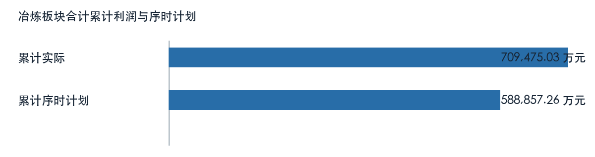
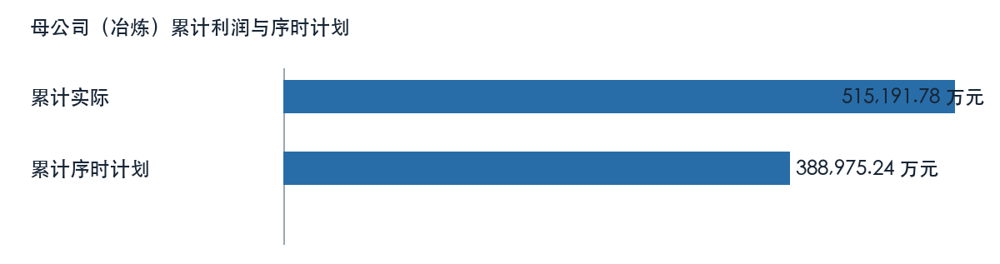
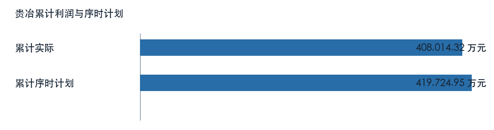
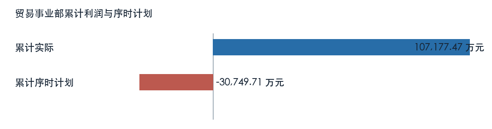
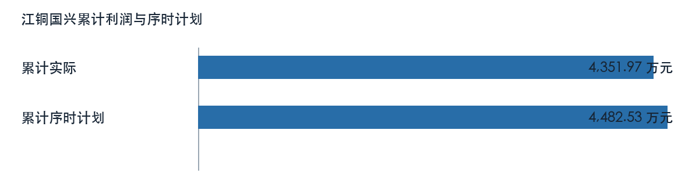
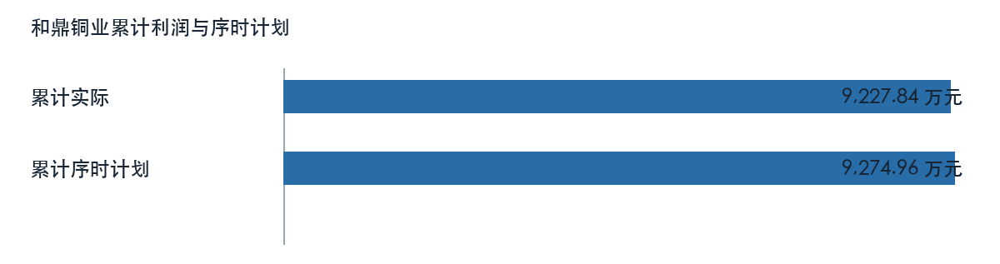

# 第一章 核心结论与管理重点

本稿为模拟数据技术工作稿，核心结论来自已冻结的利润快报和专项表。冶炼板块合计七月利润为 56143.18 万元，上月为 107605.16 万元，环比减少。一至七月累计为 709475.03 万元，上年同期为 445043.86 万元，同比增加。累计序时计划为 588857.26 万元，实际与计划差额为 120617.77 万元。本月与上月差额为 -51461.97 万元，累计与上年同期差额为 264431.17 万元。板块累计与同期相比增加，当月较上月减少，两种时间窗口应分别评价。现有来源不能证明销售、成本或对冲的完整利润桥，也不能形成正式合并经营结论。建议先核对异常单位、专项归属和序时计划版本，再讨论措施。

# 第二章 数据来源与分析范围

本报告仅分析冶炼板块合计及配置列示的10个单位分析行（含下级明细），统计期为二〇二六年一月至七月；七月与六月比较，本年累计与上年同期及表内累计序时计划比较。材料均标记为 MOCK，文件交付日期不替代经营期间。板块合计为工作簿模拟汇总，未取得真实内部抵销规则；所属明细与上级单位含有包含关系，不重复加总。市场文字材料晚于统计期间，不作为七月行情或利润成因证据。

# 第三章 冶炼板块与单位经营分析

## 母公司（冶炼）

母公司（冶炼）七月利润为 48548.48 万元，上月为 79438.30 万元，环比减少。一至七月累计为 515191.78 万元，上年同期为 334870.31 万元，同比增加。累计序时计划为 388975.24 万元，实际与计划差额为 126216.55 万元。本月与上月差额为 -30889.81 万元，累计与上年同期差额为 180321.48 万元。

| 利润比较项目 | 金额（万元） |
| --- | ---: |
| 本月 | 48548.48 |
| 上月 | 79438.30 |
| 本年累计 | 515191.78 |
| 上年同期累计 | 334870.31 |
| 年度计划 | 666814.70 |
| 累计序时计划 | 388975.24 |

来源定位：〔来源：利润计划执行情况表_2026-10-14.xlsx，sheet:Sheet1/cell:F14〕。

### 盈亏节奏与预算进度

该单位累计利润高于表内序时计划；当月与上月、累计与同期分别属于不同时间窗口。利润快报未给出上年同月数，也未提供足以解释本月波动的损益桥，不能以累计同比替代单月同比。

主要单位效益表的“母公司”、TC及硫酸表的“股份母公司”与利润快报的母公司冶炼范围尚未核对，相关专项只在后续专题章独立讨论，不作为本户利润变动的直接原因。

经营原因仍需月度损益桥、产销、订单及成本台账验证，不能从利润差额直接推定。

### 贵冶

贵冶七月利润为 52845.71 万元，上月为 55471.65 万元，环比减少。一至七月累计为 408014.32 万元，上年同期为 380099.73 万元，同比增加。累计序时计划为 419724.95 万元，实际与计划差额为 -11710.63 万元。本月与上月差额为 -2625.94 万元，累计与上年同期差额为 27914.59 万元。

| 利润比较项目 | 金额（万元） |
| --- | ---: |
| 本月 | 52845.71 |
| 上月 | 55471.65 |
| 本年累计 | 408014.32 |
| 上年同期累计 | 380099.73 |
| 年度计划 | 719528.48 |
| 累计序时计划 | 419724.95 |

来源定位：〔来源：利润计划执行情况表_2026-10-14.xlsx，sheet:Sheet1/cell:F15〕。

#### 盈亏节奏与预算进度

该单位累计利润低于表内序时计划；当月与上月、累计与同期分别属于不同时间窗口。利润快报未给出上年同月数，也未提供足以解释本月波动的损益桥，不能以累计同比替代单月同比。

经营原因仍需月度损益桥、产销、订单及成本台账验证，不能从利润差额直接推定。

### 贸易事业部

贸易事业部七月利润为 -4297.22 万元，上月为 23966.65 万元，环比由盈转亏。一至七月累计为 107177.47 万元，上年同期为 -45229.42 万元，同比由亏转盈。累计序时计划为 -30749.71 万元，实际与计划差额为 137927.17 万元。本月与上月差额为 -28263.87 万元，累计与上年同期差额为 152406.89 万元。计划值为零或负时只列算术差额，不套用正目标完成率。

| 利润比较项目 | 金额（万元） |
| --- | ---: |
| 本月 | -4297.22 |
| 上月 | 23966.65 |
| 本年累计 | 107177.47 |
| 上年同期累计 | -45229.42 |
| 年度计划 | -52713.78 |
| 累计序时计划 | -30749.71 |

来源定位：〔来源：利润计划执行情况表_2026-10-14.xlsx，sheet:Sheet1/cell:F16〕。

#### 盈亏节奏与预算进度

该单位累计利润高于表内序时计划；当月与上月、累计与同期分别属于不同时间窗口。利润快报未给出上年同月数，也未提供足以解释本月波动的损益桥，不能以累计同比替代单月同比。

当月出现亏损，需逐项核对收入、成本、费用、结算调整及一次性项目；累计结果不能掩盖当月风险。

经营原因仍需月度损益桥、产销、订单及成本台账验证，不能从利润差额直接推定。

## 江铜国兴

江铜国兴七月利润为 107.26 万元，上月为 107.75 万元，环比减少。一至七月累计为 4351.97 万元，上年同期为 3940.66 万元，同比增加。累计序时计划为 4482.53 万元，实际与计划差额为 -130.56 万元。本月与上月差额为 -0.49 万元，累计与上年同期差额为 411.31 万元。

| 利润比较项目 | 金额（万元） |
| --- | ---: |
| 本月 | 107.26 |
| 上月 | 107.75 |
| 本年累计 | 4351.97 |
| 上年同期累计 | 3940.66 |
| 年度计划 | 7684.34 |
| 累计序时计划 | 4482.53 |

来源定位：〔来源：利润计划执行情况表_2026-10-14.xlsx，sheet:Sheet1/cell:F19〕。

### 盈亏节奏与预算进度

该单位累计利润低于表内序时计划；当月与上月、累计与同期分别属于不同时间窗口。利润快报未给出上年同月数，也未提供足以解释本月波动的损益桥，不能以累计同比替代单月同比。

### 经营指标与专项线索

| 主体及专项 | 指标 | 来源值 | 单位 |
| --- | --- | ---: | --- |
| 江铜国兴 | 累计价格 | 458.13 | 元/吨 |
| 江铜国兴 | 价格影响 | 4313.51 | 万元 |
| 江铜国兴 | 同期价格 | 379.07 | 元/吨 |
| 江铜国兴 | 累计销量 | 54.57 | 万吨 |
| 江铜国兴 | 同期销量 | 48.44 | 万吨 |
| 江铜国兴 | 销量影响 | 971.85 | 万元 |
| 江铜国兴 | 生产经营效益 | 4118.49 | 万元 |
| 江铜国兴 | 同期生产经营效益 | 3861.76 | 万元 |
| 江铜国兴 | 本期加工费 | 15.00 | 美元/吨 |
| 江铜国兴 | 计划加工费 | 35.00 | 美元/吨 |
| 江铜国兴 | 同期加工费 | 68.00 | 美元/吨 |
| 江铜国兴 | 对计划测算影响 | -5234.19 | 万元 |
| 江铜国兴 | 同比测算影响 | -12908.62 | 万元 |

取数示例：〔来源：硫酸增减利分析_2026-10-14.xlsx，sheet:Sheet1/cell:F11〕。

### 硫酸量价：江铜国兴

硫酸销量为 54.57 万吨，比较值为 48.44 万吨，方向为增加。不含税价格为 458.13 元/吨，比较值为 379.07 元/吨，方向为增加。来源定位：〔来源：硫酸增减利分析_2026-10-14.xlsx，sheet:Sheet1/cell:C11〕。

### 效益构成：江铜国兴

累计效益为 4351.97 万元，比较值为 3940.66 万元，方向为增加。生产经营效益为 4118.49 万元，比较值为 3861.76 万元，方向为增加。来源定位：〔来源：主要单位效益同比分析_2026-10-14.xlsx，sheet:Sheet1/cell:C11〕。

### 加工费合同参数：江铜国兴

加工费为 15.00 美元/吨，比较值为 68.00 美元/吨，方向为减少。加工费对计划为 15.00 美元/吨，比较值为 35.00 美元/吨，方向为减少。来源定位：〔来源：TC增减利分析_2026-10-14.xlsx，sheet:Sheet1/cell:C6〕。

以上专项与利润快报可能存在期间、主体或计量差异。财务和业务岗位须核对合同、结算、产销与成本归集后，再解释利润变动；来源表专项影响不重复计入单位利润。

## 恒邦股份

恒邦股份七月利润为 7029.75 万元，上月为 13476.49 万元，环比减少。一至七月累计为 88337.43 万元，上年同期为 81183.86 万元，同比增加。累计序时计划为 90987.56 万元，实际与计划差额为 -2650.12 万元。本月与上月差额为 -6446.73 万元，累计与上年同期差额为 7153.57 万元。

| 利润比较项目 | 金额（万元） |
| --- | ---: |
| 本月 | 7029.75 |
| 上月 | 13476.49 |
| 本年累计 | 88337.43 |
| 上年同期累计 | 81183.86 |
| 年度计划 | 155978.67 |
| 累计序时计划 | 90987.56 |

来源定位：〔来源：利润计划执行情况表_2026-10-14.xlsx，sheet:Sheet1/cell:F20〕。

### 盈亏节奏与预算进度

该单位累计利润低于表内序时计划；当月与上月、累计与同期分别属于不同时间窗口。利润快报未给出上年同月数，也未提供足以解释本月波动的损益桥，不能以累计同比替代单月同比。

### 经营指标与专项线索

| 主体及专项 | 指标 | 来源值 | 单位 |
| --- | --- | ---: | --- |
| 恒邦股份 | 累计价格 | 442.18 | 元/吨 |
| 恒邦股份 | 价格影响 | 10345.78 | 万元 |
| 恒邦股份 | 同期价格 | 327.24 | 元/吨 |
| 恒邦股份 | 累计销量 | 90.02 | 万吨 |
| 恒邦股份 | 同期销量 | 84.48 | 万吨 |
| 恒邦股份 | 销量影响 | 311.91 | 万元 |
| 恒邦股份 | 生产经营效益 | 86942.23 | 万元 |
| 恒邦股份 | 同期生产经营效益 | 75880.43 | 万元 |
| 恒邦股份 | 本期加工费 | 18.00 | 美元/吨 |
| 恒邦股份 | 计划加工费 | 35.00 | 美元/吨 |
| 恒邦股份 | 同期加工费 | 68.00 | 美元/吨 |
| 恒邦股份 | 对计划测算影响 | -5241.38 | 万元 |
| 恒邦股份 | 同比测算影响 | -14173.21 | 万元 |

取数示例：〔来源：硫酸增减利分析_2026-10-14.xlsx，sheet:Sheet1/cell:F9〕。

### 硫酸量价：恒邦股份

硫酸销量为 90.02 万吨，比较值为 84.48 万吨，方向为增加。不含税价格为 442.18 元/吨，比较值为 327.24 元/吨，方向为增加。来源定位：〔来源：硫酸增减利分析_2026-10-14.xlsx，sheet:Sheet1/cell:C9〕。

### 效益构成：恒邦股份

累计效益为 88337.43 万元，比较值为 81183.86 万元，方向为增加。生产经营效益为 86942.23 万元，比较值为 75880.43 万元，方向为增加。来源定位：〔来源：主要单位效益同比分析_2026-10-14.xlsx，sheet:Sheet1/cell:C7〕。

### 加工费合同参数：恒邦股份

加工费为 18.00 美元/吨，比较值为 68.00 美元/吨，方向为减少。加工费对计划为 18.00 美元/吨，比较值为 35.00 美元/吨，方向为减少。来源定位：〔来源：TC增减利分析_2026-10-14.xlsx，sheet:Sheet1/cell:C5〕。

以上专项与利润快报可能存在期间、主体或计量差异。财务和业务岗位须核对合同、结算、产销与成本归集后，再解释利润变动；来源表专项影响不重复计入单位利润。

## 江铜宏源

江铜宏源七月利润为 -3102.60 万元，上月为 7771.71 万元，环比由盈转亏。一至七月累计为 22000.68 万元，上年同期为 792.32 万元，同比增加。累计序时计划为 22660.70 万元，实际与计划差额为 -660.02 万元。本月与上月差额为 -10874.31 万元，累计与上年同期差额为 21208.37 万元。

| 利润比较项目 | 金额（万元） |
| --- | ---: |
| 本月 | -3102.60 |
| 上月 | 7771.71 |
| 本年累计 | 22000.68 |
| 上年同期累计 | 792.32 |
| 年度计划 | 38846.92 |
| 累计序时计划 | 22660.70 |

来源定位：〔来源：利润计划执行情况表_2026-10-14.xlsx，sheet:Sheet1/cell:F21〕。

### 盈亏节奏与预算进度

该单位累计利润低于表内序时计划；当月与上月、累计与同期分别属于不同时间窗口。利润快报未给出上年同月数，也未提供足以解释本月波动的损益桥，不能以累计同比替代单月同比。

当月出现亏损，需逐项核对收入、成本、费用、结算调整及一次性项目；累计结果不能掩盖当月风险。

### 经营指标与专项线索

| 主体及专项 | 指标 | 来源值 | 单位 |
| --- | --- | ---: | --- |
| 江铜宏源 | 生产经营效益 | 20581.06 | 万元 |
| 江铜宏源 | 同期生产经营效益 | 741.46 | 万元 |

取数示例：〔来源：主要单位效益同比分析_2026-10-14.xlsx，sheet:Sheet1/cell:D10〕。

### 效益构成：江铜宏源

累计效益为 22000.68 万元，比较值为 792.32 万元，方向为增加。生产经营效益为 20581.06 万元，比较值为 741.46 万元，方向为增加。来源定位：〔来源：主要单位效益同比分析_2026-10-14.xlsx，sheet:Sheet1/cell:C10〕。

以上专项与利润快报可能存在期间、主体或计量差异。财务和业务岗位须核对合同、结算、产销与成本归集后，再解释利润变动；来源表专项影响不重复计入单位利润。

## 和鼎铜业

和鼎铜业七月利润为 1357.17 万元，上月为 1245.39 万元，环比增加。一至七月累计为 9227.84 万元，上年同期为 8201.78 万元，同比增加。累计序时计划为 9274.96 万元，实际与计划差额为 -47.12 万元。本月与上月差额为 111.78 万元，累计与上年同期差额为 1026.06 万元。

| 利润比较项目 | 金额（万元） |
| --- | ---: |
| 本月 | 1357.17 |
| 上月 | 1245.39 |
| 本年累计 | 9227.84 |
| 上年同期累计 | 8201.78 |
| 年度计划 | 15899.93 |
| 累计序时计划 | 9274.96 |

来源定位：〔来源：利润计划执行情况表_2026-10-14.xlsx，sheet:Sheet1/cell:F22〕。

### 盈亏节奏与预算进度

该单位累计利润低于表内序时计划；当月与上月、累计与同期分别属于不同时间窗口。利润快报未给出上年同月数，也未提供足以解释本月波动的损益桥，不能以累计同比替代单月同比。

### 经营指标与专项线索

| 主体及专项 | 指标 | 来源值 | 单位 |
| --- | --- | ---: | --- |
| 和鼎铜业 | 累计价格 | 478.92 | 元/吨 |
| 和鼎铜业 | 价格影响 | 7789.53 | 万元 |
| 和鼎铜业 | 同期价格 | 380.40 | 元/吨 |
| 和鼎铜业 | 累计销量 | 79.07 | 万吨 |
| 和鼎铜业 | 同期销量 | 70.63 | 万吨 |
| 和鼎铜业 | 销量影响 | 1059.03 | 万元 |
| 和鼎铜业 | 本期加工费 | 16.00 | 美元/吨 |
| 和鼎铜业 | 计划加工费 | 35.00 | 美元/吨 |
| 和鼎铜业 | 同期加工费 | 68.00 | 美元/吨 |
| 和鼎铜业 | 对计划测算影响 | -12727.14 | 万元 |
| 和鼎铜业 | 同比测算影响 | -32298.53 | 万元 |

取数示例：〔来源：硫酸增减利分析_2026-10-14.xlsx，sheet:Sheet1/cell:F10〕。

### 硫酸量价：和鼎铜业

硫酸销量为 79.07 万吨，比较值为 70.63 万吨，方向为增加。不含税价格为 478.92 元/吨，比较值为 380.40 元/吨，方向为增加。来源定位：〔来源：硫酸增减利分析_2026-10-14.xlsx，sheet:Sheet1/cell:C10〕。

### 加工费合同参数：和鼎铜业

加工费为 16.00 美元/吨，比较值为 68.00 美元/吨，方向为减少。加工费对计划为 16.00 美元/吨，比较值为 35.00 美元/吨，方向为减少。来源定位：〔来源：TC增减利分析_2026-10-14.xlsx，sheet:Sheet1/cell:C7〕。

以上专项与利润快报可能存在期间、主体或计量差异。财务和业务岗位须核对合同、结算、产销与成本归集后，再解释利润变动；来源表专项影响不重复计入单位利润。

## 江铜清远

江铜清远七月利润为 117.82 万元，上月为 3823.49 万元，环比减少。一至七月累计为 5631.93 万元，上年同期为 1236.14 万元，同比增加。累计序时计划为 5800.88 万元，实际与计划差额为 -168.96 万元。本月与上月差额为 -3705.67 万元，累计与上年同期差额为 4395.79 万元。

| 利润比较项目 | 金额（万元） |
| --- | ---: |
| 本月 | 117.82 |
| 上月 | 3823.49 |
| 本年累计 | 5631.93 |
| 上年同期累计 | 1236.14 |
| 年度计划 | 9944.37 |
| 累计序时计划 | 5800.88 |

来源定位：〔来源：利润计划执行情况表_2026-10-14.xlsx，sheet:Sheet1/cell:F23〕。

### 盈亏节奏与预算进度

该单位累计利润低于表内序时计划；当月与上月、累计与同期分别属于不同时间窗口。利润快报未给出上年同月数，也未提供足以解释本月波动的损益桥，不能以累计同比替代单月同比。

经营原因仍需月度损益桥、产销、订单及成本台账验证，不能从利润差额直接推定。

## 九江铅锌

九江铅锌七月利润为 2084.58 万元，上月为 1054.28 万元，环比增加。一至七月累计为 52138.19 万元，上年同期为 10267.73 万元，同比增加。累计序时计划为 53702.34 万元，实际与计划差额为 -1564.15 万元。本月与上月差额为 1030.31 万元，累计与上年同期差额为 41870.47 万元。

| 利润比较项目 | 金额（万元） |
| --- | ---: |
| 本月 | 2084.58 |
| 上月 | 1054.28 |
| 本年累计 | 52138.19 |
| 上年同期累计 | 10267.73 |
| 年度计划 | 92061.15 |
| 累计序时计划 | 53702.34 |

来源定位：〔来源：利润计划执行情况表_2026-10-14.xlsx，sheet:Sheet1/cell:F25〕。

### 盈亏节奏与预算进度

该单位累计利润低于表内序时计划；当月与上月、累计与同期分别属于不同时间窗口。利润快报未给出上年同月数，也未提供足以解释本月波动的损益桥，不能以累计同比替代单月同比。

### 经营指标与专项线索

| 主体及专项 | 指标 | 来源值 | 单位 |
| --- | --- | ---: | --- |
| 九江铅锌 | 生产经营效益 | 52564.47 | 万元 |
| 九江铅锌 | 同期生产经营效益 | 9659.09 | 万元 |

取数示例：〔来源：主要单位效益同比分析_2026-10-14.xlsx，sheet:Sheet1/cell:D8〕。

### 效益构成：九江铅锌

累计效益为 52138.19 万元，比较值为 10267.73 万元，方向为增加。生产经营效益为 52564.47 万元，比较值为 9659.09 万元，方向为增加。来源定位：〔来源：主要单位效益同比分析_2026-10-14.xlsx，sheet:Sheet1/cell:C8〕。

以上专项与利润快报可能存在期间、主体或计量差异。财务和业务岗位须核对合同、结算、产销与成本归集后，再解释利润变动；来源表专项影响不重复计入单位利润。

## 金德铅业

金德铅业七月利润为 0.71 万元，上月为 687.77 万元，环比减少。一至七月累计为 12595.20 万元，上年同期为 4551.07 万元，同比增加。累计序时计划为 12973.06 万元，实际与计划差额为 -377.86 万元。本月与上月差额为 -687.05 万元，累计与上年同期差额为 8044.13 万元。

| 利润比较项目 | 金额（万元） |
| --- | ---: |
| 本月 | 0.71 |
| 上月 | 687.77 |
| 本年累计 | 12595.20 |
| 上年同期累计 | 4551.07 |
| 年度计划 | 22239.53 |
| 累计序时计划 | 12973.06 |

来源定位：〔来源：利润计划执行情况表_2026-10-14.xlsx，sheet:Sheet1/cell:F26〕。

### 盈亏节奏与预算进度

该单位累计利润低于表内序时计划；当月与上月、累计与同期分别属于不同时间窗口。利润快报未给出上年同月数，也未提供足以解释本月波动的损益桥，不能以累计同比替代单月同比。

### 经营指标与专项线索

| 主体及专项 | 指标 | 来源值 | 单位 |
| --- | --- | ---: | --- |
| 金德铅业 | 累计价格 | 415.12 | 元/吨 |
| 金德铅业 | 价格影响 | 507.21 | 万元 |
| 金德铅业 | 同期价格 | 331.51 | 元/吨 |
| 金德铅业 | 累计销量 | 6.07 | 万吨 |
| 金德铅业 | 同期销量 | 6.61 | 万吨 |
| 金德铅业 | 销量影响 | -29.21 | 万元 |
| 金德铅业 | 生产经营效益 | 12326.87 | 万元 |
| 金德铅业 | 同期生产经营效益 | 4430.38 | 万元 |

取数示例：〔来源：硫酸增减利分析_2026-10-14.xlsx，sheet:Sheet1/cell:F7〕。

### 硫酸量价：金德铅业

硫酸销量为 6.07 万吨，比较值为 6.61 万吨，方向为减少。不含税价格为 415.12 元/吨，比较值为 331.51 元/吨，方向为增加。来源定位：〔来源：硫酸增减利分析_2026-10-14.xlsx，sheet:Sheet1/cell:C7〕。

### 效益构成：金德铅业

累计效益为 12595.20 万元，比较值为 4551.07 万元，方向为增加。生产经营效益为 12326.87 万元，比较值为 4430.38 万元，方向为增加。来源定位：〔来源：主要单位效益同比分析_2026-10-14.xlsx，sheet:Sheet1/cell:C9〕。

以上专项与利润快报可能存在期间、主体或计量差异。财务和业务岗位须核对合同、结算、产销与成本归集后，再解释利润变动；来源表专项影响不重复计入单位利润。

# 第四章 加工费压力与合同边界

加工费专项按来源表主体与合同参数列示，模拟影响不等同已实现利润；股份母公司与利润快报母公司冶炼的主体范围待确认。

| 主体及专项 | 指标 | 来源值 | 单位 |
| --- | --- | ---: | --- |
| 和鼎铜业 | 本期加工费 | 16.00 | 美元/吨 |
| 和鼎铜业 | 计划加工费 | 35.00 | 美元/吨 |
| 和鼎铜业 | 同期加工费 | 68.00 | 美元/吨 |
| 和鼎铜业 | 对计划测算影响 | -12727.14 | 万元 |
| 和鼎铜业 | 同比测算影响 | -32298.53 | 万元 |
| 恒邦股份 | 本期加工费 | 18.00 | 美元/吨 |
| 恒邦股份 | 计划加工费 | 35.00 | 美元/吨 |
| 恒邦股份 | 同期加工费 | 68.00 | 美元/吨 |
| 恒邦股份 | 对计划测算影响 | -5241.38 | 万元 |
| 恒邦股份 | 同比测算影响 | -14173.21 | 万元 |
| 江铜国兴 | 本期加工费 | 15.00 | 美元/吨 |
| 江铜国兴 | 计划加工费 | 35.00 | 美元/吨 |
| 江铜国兴 | 同期加工费 | 68.00 | 美元/吨 |
| 江铜国兴 | 对计划测算影响 | -5234.19 | 万元 |
| 江铜国兴 | 同比测算影响 | -12908.62 | 万元 |
| 股份母公司 | 本期加工费 | 12.00 | 美元/吨 |
| 股份母公司 | 计划加工费 | 35.00 | 美元/吨 |
| 股份母公司 | 同期加工费 | 68.00 | 美元/吨 |
| 股份母公司 | 对计划测算影响 | -25619.91 | 万元 |
| 股份母公司 | 同比测算影响 | -58582.61 | 万元 |

取数示例：〔来源：TC增减利分析_2026-10-14.xlsx，sheet:Sheet1/cell:G7〕。

财务与业务岗位应提交同口径合同、结算和利润桥，缺口未补齐前只陈述表内方向。

# 第五章 硫酸量价与原料效益

硫酸量价与原料效益按自身产品口径呈现，须核对结算期间与重叠关系；股份母公司专项不直接归因于母公司冶炼利润。

| 主体及专项 | 指标 | 来源值 | 单位 |
| --- | --- | ---: | --- |
| 和鼎铜业 | 累计价格 | 478.92 | 元/吨 |
| 和鼎铜业 | 价格影响 | 7789.53 | 万元 |
| 和鼎铜业 | 同期价格 | 380.40 | 元/吨 |
| 和鼎铜业 | 累计销量 | 79.07 | 万吨 |
| 和鼎铜业 | 同期销量 | 70.63 | 万吨 |
| 和鼎铜业 | 销量影响 | 1059.03 | 万元 |
| 恒邦股份 | 累计价格 | 442.18 | 元/吨 |
| 恒邦股份 | 价格影响 | 10345.78 | 万元 |
| 恒邦股份 | 同期价格 | 327.24 | 元/吨 |
| 恒邦股份 | 累计销量 | 90.02 | 万吨 |
| 恒邦股份 | 同期销量 | 84.48 | 万吨 |
| 恒邦股份 | 销量影响 | 311.91 | 万元 |
| 江铜国兴 | 累计价格 | 458.13 | 元/吨 |
| 江铜国兴 | 价格影响 | 4313.51 | 万元 |
| 江铜国兴 | 同期价格 | 379.07 | 元/吨 |
| 江铜国兴 | 累计销量 | 54.57 | 万吨 |
| 江铜国兴 | 同期销量 | 48.44 | 万吨 |
| 江铜国兴 | 销量影响 | 971.85 | 万元 |
| 股份母公司 | 累计价格 | 474.42 | 元/吨 |
| 股份母公司 | 价格影响 | 14780.28 | 万元 |
| 股份母公司 | 同期价格 | 333.88 | 元/吨 |
| 股份母公司 | 累计销量 | 105.17 | 万吨 |
| 股份母公司 | 同期销量 | 110.62 | 万吨 |
| 股份母公司 | 销量影响 | -252.39 | 万元 |

取数示例：〔来源：硫酸增减利分析_2026-10-14.xlsx，sheet:Sheet1/cell:F10〕。

财务与业务岗位应提交同口径合同、结算和利润桥，缺口未补齐前只陈述表内方向。

# 第六章 利润质量与专项归属

生产经营、期现对冲、暂定价与产品效益须分别核对，专项构成不追加到利润。

| 主体及专项 | 指标 | 来源值 | 单位 |
| --- | --- | ---: | --- |
| 九江铅锌 | 生产经营效益 | 52564.47 | 万元 |
| 九江铅锌 | 同期生产经营效益 | 9659.09 | 万元 |
| 恒邦股份 | 生产经营效益 | 86942.23 | 万元 |
| 恒邦股份 | 同期生产经营效益 | 75880.43 | 万元 |
| 母公司 | 生产经营效益 | 1005348.08 | 万元 |
| 母公司 | 同期生产经营效益 | 804222.60 | 万元 |
| 江铜国兴 | 生产经营效益 | 4118.49 | 万元 |
| 江铜国兴 | 同期生产经营效益 | 3861.76 | 万元 |
| 江铜宏源 | 生产经营效益 | 20581.06 | 万元 |
| 江铜宏源 | 同期生产经营效益 | 741.46 | 万元 |
| 金德铅业 | 生产经营效益 | 12326.87 | 万元 |
| 金德铅业 | 同期生产经营效益 | 4430.38 | 万元 |
| 集团合并 | 生产经营效益 | 1509361.70 | 万元 |
| 集团合并 | 同期生产经营效益 | 1056409.95 | 万元 |

取数示例：〔来源：主要单位效益同比分析_2026-10-14.xlsx，sheet:Sheet1/cell:D8〕。

财务与业务岗位应提交同口径合同、结算和利润桥，缺口未补齐前只陈述表内方向。

# 第七章 管理措施与待确认清单

## 经营复核顺序

财务先按单位核实当月与累计利润桥、序时计划版本和合并抵销；业务同步补合同、产销、库存、在途及订单。加工费、副产品、原料及产品加工效益先确认归属和是否已包含于利润，再讨论采购协同或经营措施。措施预期收益、责任人和时限尚无签认，维持待测算、待确认状态。

# 附录 材料使用与计算口径

累计序时差额按本年累计实际减累计序时计划计算；环比差额按本月减上月计算，累计同比差额按本年累计减上年同期累计计算，底层值不预先舍入；年度计划不均摊成月度预算。负基数、跨盈亏或负计划先说明盈亏方向，不套用普通完成率。来源定位示例如下：

| 来源 | 可回查定位 |
| --- | --- |
| 第1份业务工作簿 | 〔来源：硫酸增减利分析_2026-10-14.xlsx，sheet:Sheet1/cell:C4〕 |
| 第2份业务工作簿 | 〔来源：主要单位效益同比分析_2026-10-14.xlsx，sheet:Sheet1/cell:C5〕 |
| 第3份业务工作簿 | 〔来源：母公司原料效益完成情况_2026-10-14.xlsx，sheet:Sheet1/cell:H4〕 |
| 第4份业务工作簿 | 〔来源：利润计划执行情况表_2026-10-14.xlsx，sheet:Sheet1/cell:D6〕 |
| 第5份业务工作簿 | 〔来源：TC增减利分析_2026-10-14.xlsx，sheet:Sheet1/cell:C4〕 |

资料标记为 MOCK；集团合并抵销、组织归属、市场同期材料和经营成因仍待业务签认。

# 材料与口径追溯

上述来源索引的引用可回到本轮归档原件。原件指纹、来源单元格、配置与图表哈希保存在版本快照；市场摘录不进入七月行情事实。
