# 第一章 核心结论与管理重点

本稿为模拟数据技术工作稿，核心结论来自已冻结的利润快报和专项表。加工板块七月利润为 4591.07 万元，上月为 5207.73 万元，环比减少。一至七月累计为 19646.81 万元，上年同期为 9195.64 万元，同比增加。累计序时计划为 22231.37 万元，实际与计划差额为 -2584.56 万元。本月与上月差额为 -616.67 万元，累计与上年同期差额为 10451.16 万元。板块累计与同期相比增加，当月较上月减少，两种时间窗口应分别评价。现有来源不能证明销售、成本或对冲的完整利润桥，也不能形成正式合并经营结论。建议先核对异常单位、专项归属和序时计划版本，再讨论措施。

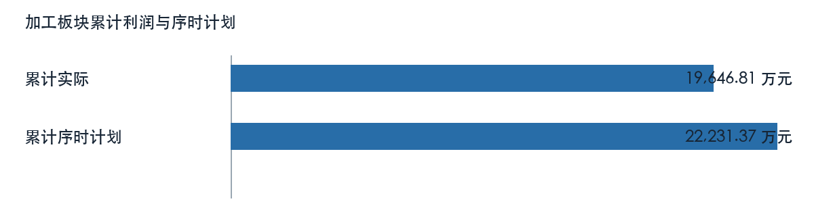

# 第二章 数据来源与分析范围

本报告仅分析加工板块及配置列示的18个单位分析行（含下级明细），统计期为二〇二六年一月至七月；七月与六月比较，本年累计与上年同期及表内累计序时计划比较。材料均标记为 MOCK，文件交付日期不替代经营期间。板块合计为工作簿模拟汇总，未取得真实内部抵销规则；所属明细与上级单位含有包含关系，不重复加总。市场文字材料晚于统计期间，不作为七月行情或利润成因证据。

# 第三章 铜加工板块整体经营与预算执行

## 加工事业部

加工事业部七月利润为 2121.33 万元，上月为 1736.73 万元，环比增加。一至七月累计为 4132.91 万元，上年同期为 11367.53 万元，同比减少。累计序时计划为 5371.52 万元，实际与计划差额为 -1238.61 万元。本月与上月差额为 384.60 万元，累计与上年同期差额为 -7234.62 万元。

| 利润比较项目 | 金额（万元） |
| --- | ---: |
| 本月 | 2121.33 |
| 上月 | 1736.73 |
| 本年累计 | 4132.91 |
| 上年同期累计 | 11367.53 |
| 年度计划 | 9208.32 |
| 累计序时计划 | 5371.52 |

来源定位：〔来源：利润计划执行情况表_2026-10-14.xlsx，sheet:Sheet1/cell:F32〕。

### 盈亏节奏与预算进度

该单位累计利润低于表内序时计划；当月与上月、累计与同期分别属于不同时间窗口。利润快报未给出上年同月数，也未提供足以解释本月波动的损益桥，不能以累计同比替代单月同比。

### 经营指标与专项线索

| 主体及专项 | 指标 | 来源值 | 单位 |
| --- | --- | ---: | --- |
| 加工事业部 | 生产经营效益 | 4334.53 | 万元 |
| 加工事业部 | 同期生产经营效益 | 11288.33 | 万元 |

取数示例：〔来源：主要单位效益同比分析_2026-10-14.xlsx，sheet:Sheet1/cell:D16〕。

### 效益构成：加工事业部

累计效益为 4132.91 万元，比较值为 11367.53 万元，方向为减少。生产经营效益为 4334.53 万元，比较值为 11288.33 万元，方向为减少。来源定位：〔来源：主要单位效益同比分析_2026-10-14.xlsx，sheet:Sheet1/cell:C16〕。

以上专项与利润快报可能存在期间、主体或计量差异。财务和业务岗位须核对合同、结算、产销与成本归集后，再解释利润变动；来源表专项影响不重复计入单位利润。

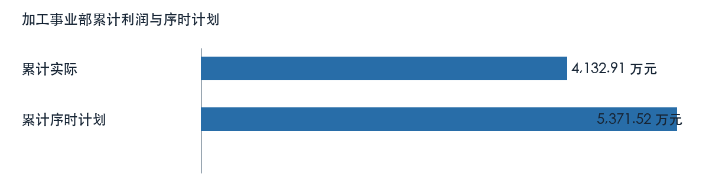

### 铜业铜材

铜业铜材七月利润为 916.96 万元，上月为 1852.03 万元，环比减少。一至七月累计为 3837.21 万元，上年同期为 4872.25 万元，同比减少。累计序时计划为 5243.33 万元，实际与计划差额为 -1406.12 万元。本月与上月差额为 -935.07 万元，累计与上年同期差额为 -1035.04 万元。

| 利润比较项目 | 金额（万元） |
| --- | ---: |
| 本月 | 916.96 |
| 上月 | 1852.03 |
| 本年累计 | 3837.21 |
| 上年同期累计 | 4872.25 |
| 年度计划 | 8988.56 |
| 累计序时计划 | 5243.33 |

来源定位：〔来源：利润计划执行情况表_2026-10-14.xlsx，sheet:Sheet1/cell:F33〕。

#### 盈亏节奏与预算进度

该单位累计利润低于表内序时计划；当月与上月、累计与同期分别属于不同时间窗口。利润快报未给出上年同月数，也未提供足以解释本月波动的损益桥，不能以累计同比替代单月同比。

经营原因仍需月度损益桥、产销、订单及成本台账验证，不能从利润差额直接推定。

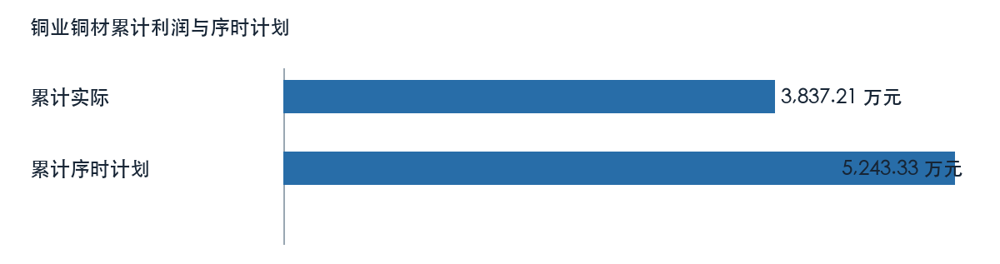

### 集团铜材

集团铜材七月利润为 250.08 万元，上月为 92.90 万元，环比增加。一至七月累计为 543.87 万元，上年同期为 1274.22 万元，同比减少。累计序时计划为 1306.41 万元，实际与计划差额为 -762.54 万元。本月与上月差额为 157.18 万元，累计与上年同期差额为 -730.35 万元。

| 利润比较项目 | 金额（万元） |
| --- | ---: |
| 本月 | 250.08 |
| 上月 | 92.90 |
| 本年累计 | 543.87 |
| 上年同期累计 | 1274.22 |
| 年度计划 | 2239.56 |
| 累计序时计划 | 1306.41 |

来源定位：〔来源：利润计划执行情况表_2026-10-14.xlsx，sheet:Sheet1/cell:F34〕。

#### 盈亏节奏与预算进度

该单位累计利润低于表内序时计划；当月与上月、累计与同期分别属于不同时间窗口。利润快报未给出上年同月数，也未提供足以解释本月波动的损益桥，不能以累计同比替代单月同比。

经营原因仍需月度损益桥、产销、订单及成本台账验证，不能从利润差额直接推定。

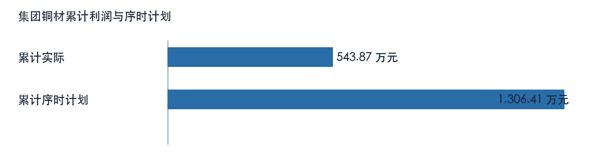

### 江铜龙昌

江铜龙昌七月利润为 80.93 万元，上月为 84.67 万元，环比减少。一至七月累计为 263.97 万元，上年同期为 -385.04 万元，同比由亏转盈。累计序时计划为 271.89 万元，实际与计划差额为 -7.92 万元。本月与上月差额为 -3.74 万元，累计与上年同期差额为 649.01 万元。

| 利润比较项目 | 金额（万元） |
| --- | ---: |
| 本月 | 80.93 |
| 上月 | 84.67 |
| 本年累计 | 263.97 |
| 上年同期累计 | -385.04 |
| 年度计划 | 466.10 |
| 累计序时计划 | 271.89 |

来源定位：〔来源：利润计划执行情况表_2026-10-14.xlsx，sheet:Sheet1/cell:F35〕。

#### 盈亏节奏与预算进度

该单位累计利润低于表内序时计划；当月与上月、累计与同期分别属于不同时间窗口。利润快报未给出上年同月数，也未提供足以解释本月波动的损益桥，不能以累计同比替代单月同比。

经营原因仍需月度损益桥、产销、订单及成本台账验证，不能从利润差额直接推定。

### 江铜台意

江铜台意七月利润为 139.84 万元，上月为 -234.47 万元，环比由亏转盈。一至七月累计为 1503.71 万元，上年同期为 1385.20 万元，同比增加。累计序时计划为 645.88 万元，实际与计划差额为 857.83 万元。本月与上月差额为 374.31 万元，累计与上年同期差额为 118.51 万元。

| 利润比较项目 | 金额（万元） |
| --- | ---: |
| 本月 | 139.84 |
| 上月 | -234.47 |
| 本年累计 | 1503.71 |
| 上年同期累计 | 1385.20 |
| 年度计划 | 1107.22 |
| 累计序时计划 | 645.88 |

来源定位：〔来源：利润计划执行情况表_2026-10-14.xlsx，sheet:Sheet1/cell:F36〕。

#### 盈亏节奏与预算进度

该单位累计利润高于表内序时计划；当月与上月、累计与同期分别属于不同时间窗口。利润快报未给出上年同月数，也未提供足以解释本月波动的损益桥，不能以累计同比替代单月同比。

经营原因仍需月度损益桥、产销、订单及成本台账验证，不能从利润差额直接推定。

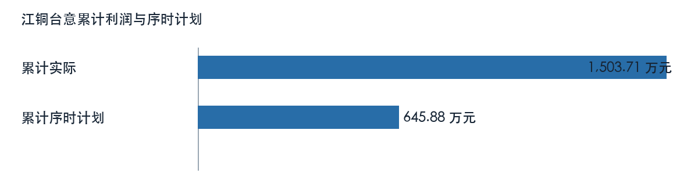

### 华东铜材

华东铜材七月利润为 384.65 万元，上月为 -774.18 万元，环比由亏转盈。一至七月累计为 -5581.10 万元，上年同期为 1699.95 万元，同比由盈转亏。累计序时计划为 -5748.54 万元，实际与计划差额为 167.43 万元。本月与上月差额为 1158.83 万元，累计与上年同期差额为 -7281.05 万元。计划值为零或负时只列算术差额，不套用正目标完成率。

| 利润比较项目 | 金额（万元） |
| --- | ---: |
| 本月 | 384.65 |
| 上月 | -774.18 |
| 本年累计 | -5581.10 |
| 上年同期累计 | 1699.95 |
| 年度计划 | -9854.63 |
| 累计序时计划 | -5748.54 |

来源定位：〔来源：利润计划执行情况表_2026-10-14.xlsx，sheet:Sheet1/cell:F37〕。

#### 盈亏节奏与预算进度

该单位累计利润高于表内序时计划；当月与上月、累计与同期分别属于不同时间窗口。利润快报未给出上年同月数，也未提供足以解释本月波动的损益桥，不能以累计同比替代单月同比。

经营原因仍需月度损益桥、产销、订单及成本台账验证，不能从利润差额直接推定。

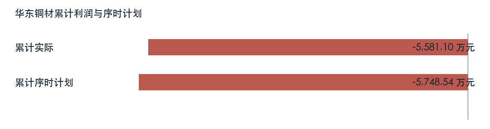

### 华东电工

华东电工七月利润为 -136.43 万元，上月为 244.31 万元，环比由盈转亏。一至七月累计为 138.67 万元，上年同期为 -634.03 万元，同比由亏转盈。累计序时计划为 142.83 万元，实际与计划差额为 -4.16 万元。本月与上月差额为 -380.73 万元，累计与上年同期差额为 772.70 万元。

| 利润比较项目 | 金额（万元） |
| --- | ---: |
| 本月 | -136.43 |
| 上月 | 244.31 |
| 本年累计 | 138.67 |
| 上年同期累计 | -634.03 |
| 年度计划 | 244.85 |
| 累计序时计划 | 142.83 |

来源定位：〔来源：利润计划执行情况表_2026-10-14.xlsx，sheet:Sheet1/cell:F38〕。

#### 盈亏节奏与预算进度

该单位累计利润低于表内序时计划；当月与上月、累计与同期分别属于不同时间窗口。利润快报未给出上年同月数，也未提供足以解释本月波动的损益桥，不能以累计同比替代单月同比。

当月出现亏损，需逐项核对收入、成本、费用、结算调整及一次性项目；累计结果不能掩盖当月风险。

经营原因仍需月度损益桥、产销、订单及成本台账验证，不能从利润差额直接推定。

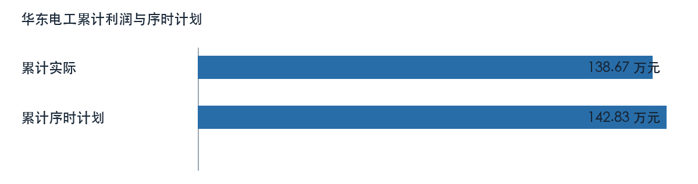

### 江铜嘉磁

江铜嘉磁七月利润为 248.09 万元，上月为 233.31 万元，环比增加。一至七月累计为 1722.39 万元，上年同期为 1575.73 万元，同比增加。累计序时计划为 1749.71 万元，实际与计划差额为 -27.33 万元。本月与上月差额为 14.78 万元，累计与上年同期差额为 146.65 万元。

| 利润比较项目 | 金额（万元） |
| --- | ---: |
| 本月 | 248.09 |
| 上月 | 233.31 |
| 本年累计 | 1722.39 |
| 上年同期累计 | 1575.73 |
| 年度计划 | 2999.51 |
| 累计序时计划 | 1749.71 |

来源定位：〔来源：利润计划执行情况表_2026-10-14.xlsx，sheet:Sheet1/cell:F39〕。

#### 盈亏节奏与预算进度

该单位累计利润低于表内序时计划；当月与上月、累计与同期分别属于不同时间窗口。利润快报未给出上年同月数，也未提供足以解释本月波动的损益桥，不能以累计同比替代单月同比。

经营原因仍需月度损益桥、产销、订单及成本台账验证，不能从利润差额直接推定。

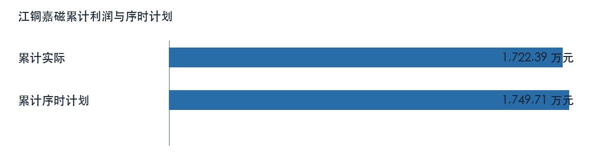

### 江铜川禾

江铜川禾七月利润为 237.20 万元，上月为 238.16 万元，环比减少。一至七月累计为 1704.20 万元，上年同期为 1579.25 万元，同比增加。累计序时计划为 1760.00 万元，实际与计划差额为 -55.81 万元。本月与上月差额为 -0.96 万元，累计与上年同期差额为 124.95 万元。

| 利润比较项目 | 金额（万元） |
| --- | ---: |
| 本月 | 237.20 |
| 上月 | 238.16 |
| 本年累计 | 1704.20 |
| 上年同期累计 | 1579.25 |
| 年度计划 | 3017.15 |
| 累计序时计划 | 1760.00 |

来源定位：〔来源：利润计划执行情况表_2026-10-14.xlsx，sheet:Sheet1/cell:F40〕。

#### 盈亏节奏与预算进度

该单位累计利润低于表内序时计划；当月与上月、累计与同期分别属于不同时间窗口。利润快报未给出上年同月数，也未提供足以解释本月波动的损益桥，不能以累计同比替代单月同比。

经营原因仍需月度损益桥、产销、订单及成本台账验证，不能从利润差额直接推定。

## 江铜铜箔

江铜铜箔七月利润为 1684.49 万元，上月为 2787.58 万元，环比减少。一至七月累计为 11122.39 万元，上年同期为 385.63 万元，同比增加。累计序时计划为 11456.07 万元，实际与计划差额为 -333.67 万元。本月与上月差额为 -1103.09 万元，累计与上年同期差额为 10736.76 万元。

| 利润比较项目 | 金额（万元） |
| --- | ---: |
| 本月 | 1684.49 |
| 上月 | 2787.58 |
| 本年累计 | 11122.39 |
| 上年同期累计 | 385.63 |
| 年度计划 | 19638.97 |
| 累计序时计划 | 11456.07 |

来源定位：〔来源：利润计划执行情况表_2026-10-14.xlsx，sheet:Sheet1/cell:F41〕。

### 盈亏节奏与预算进度

该单位累计利润低于表内序时计划；当月与上月、累计与同期分别属于不同时间窗口。利润快报未给出上年同月数，也未提供足以解释本月波动的损益桥，不能以累计同比替代单月同比。

经营原因仍需月度损益桥、产销、订单及成本台账验证，不能从利润差额直接推定。

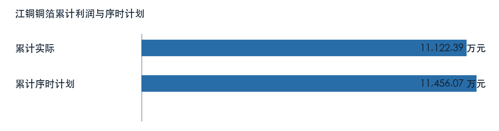

## 铜板带（不含高精）

铜板带（不含高精）七月利润为 9.95 万元，上月为 1.68 万元，环比增加。一至七月累计为 306.17 万元，上年同期为 -2560.50 万元，同比由亏转盈。累计序时计划为 576.61 万元，实际与计划差额为 -270.44 万元。本月与上月差额为 8.27 万元，累计与上年同期差额为 2866.67 万元。

| 利润比较项目 | 金额（万元） |
| --- | ---: |
| 本月 | 9.95 |
| 上月 | 1.68 |
| 本年累计 | 306.17 |
| 上年同期累计 | -2560.50 |
| 年度计划 | 988.47 |
| 累计序时计划 | 576.61 |

来源定位：〔来源：利润计划执行情况表_2026-10-14.xlsx，sheet:Sheet1/cell:F42〕。

### 盈亏节奏与预算进度

该单位累计利润低于表内序时计划；当月与上月、累计与同期分别属于不同时间窗口。利润快报未给出上年同月数，也未提供足以解释本月波动的损益桥，不能以累计同比替代单月同比。

经营原因仍需月度损益桥、产销、订单及成本台账验证，不能从利润差额直接推定。

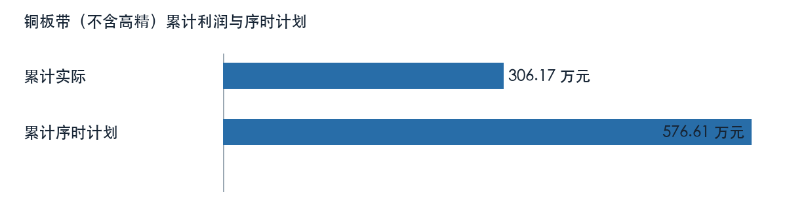

## 高精铜板带

高精铜板带七月利润为 -713.10 万元，上月为 -562.25 万元，环比亏损扩大。一至七月累计为 -3927.58 万元，上年同期为 -3624.22 万元，同比亏损扩大。累计序时计划为 -3086.69 万元，实际与计划差额为 -840.89 万元。本月与上月差额为 -150.84 万元，累计与上年同期差额为 -303.37 万元。计划值为零或负时只列算术差额，不套用正目标完成率。

| 利润比较项目 | 金额（万元） |
| --- | ---: |
| 本月 | -713.10 |
| 上月 | -562.25 |
| 本年累计 | -3927.58 |
| 上年同期累计 | -3624.22 |
| 年度计划 | -5291.47 |
| 累计序时计划 | -3086.69 |

来源定位：〔来源：利润计划执行情况表_2026-10-14.xlsx，sheet:Sheet1/cell:F43〕。

### 盈亏节奏与预算进度

该单位累计利润低于表内序时计划；当月与上月、累计与同期分别属于不同时间窗口。利润快报未给出上年同月数，也未提供足以解释本月波动的损益桥，不能以累计同比替代单月同比。

当月出现亏损，需逐项核对收入、成本、费用、结算调整及一次性项目；累计结果不能掩盖当月风险。

经营原因仍需月度损益桥、产销、订单及成本台账验证，不能从利润差额直接推定。

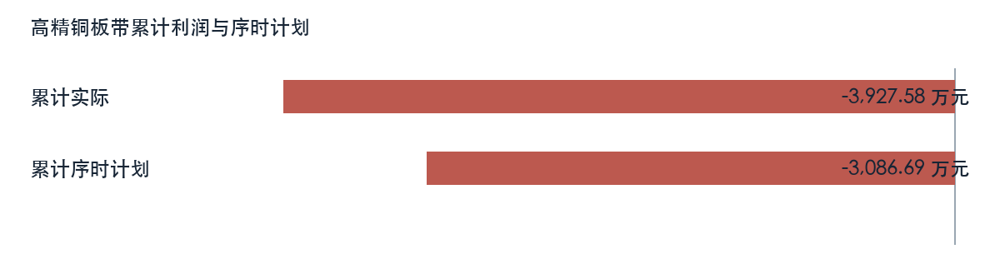

## 江铜华北

江铜华北七月利润为 292.81 万元，上月为 250.55 万元，环比增加。一至七月累计为 1162.16 万元，上年同期为 1054.68 万元，同比增加。累计序时计划为 1505.68 万元，实际与计划差额为 -343.53 万元。本月与上月差额为 42.26 万元，累计与上年同期差额为 107.48 万元。

| 利润比较项目 | 金额（万元） |
| --- | ---: |
| 本月 | 292.81 |
| 上月 | 250.55 |
| 本年累计 | 1162.16 |
| 上年同期累计 | 1054.68 |
| 年度计划 | 2581.17 |
| 累计序时计划 | 1505.68 |

来源定位：〔来源：利润计划执行情况表_2026-10-14.xlsx，sheet:Sheet1/cell:F44〕。

### 盈亏节奏与预算进度

该单位累计利润低于表内序时计划；当月与上月、累计与同期分别属于不同时间窗口。利润快报未给出上年同月数，也未提供足以解释本月波动的损益桥，不能以累计同比替代单月同比。

### 经营指标与专项线索

| 主体及专项 | 指标 | 来源值 | 单位 |
| --- | --- | ---: | --- |
| 江铜华北 | 生产经营效益 | 1134.75 | 万元 |
| 江铜华北 | 同期生产经营效益 | 1053.10 | 万元 |
| 铜杆2.6（江铜华北） | 累计产品效益 | 254.80 | 万元 |
| 铜杆2.6（江铜华北） | 同期产品效益 | 274.34 | 万元 |
| 铜杆2.6（江铜华北） | 单位加工成本 | 655.74 | 元/吨 |
| 铜杆2.6（江铜华北） | 单位加工加价 | 945.87 | 元/吨 |
| 铜杆8.0（江铜华北） | 累计产品效益 | 1815.64 | 万元 |
| 铜杆8.0（江铜华北） | 同期产品效益 | 1039.89 | 万元 |
| 铜杆8.0（江铜华北） | 单位加工成本 | 424.63 | 元/吨 |
| 铜杆8.0（江铜华北） | 单位加工加价 | 631.36 | 元/吨 |

取数示例：〔来源：主要单位效益同比分析_2026-10-14.xlsx，sheet:Sheet1/cell:D12〕。

### 效益构成：江铜华北

累计效益为 1162.16 万元，比较值为 1054.68 万元，方向为增加。生产经营效益为 1134.75 万元，比较值为 1053.10 万元，方向为增加。来源定位：〔来源：主要单位效益同比分析_2026-10-14.xlsx，sheet:Sheet1/cell:C12〕。

### 加工产品效益：铜杆8.0（江铜华北）

累计产品效益为 1815.64 万元，比较值为 1039.89 万元，方向为增加。来源定位：〔来源：铜加工板块加工费效益_2026-10-14.xlsx，sheet:Sheet1/cell:C8〕。

### 加工产品效益：铜杆2.6（江铜华北）

累计产品效益为 254.80 万元，比较值为 274.34 万元，方向为减少。来源定位：〔来源：铜加工板块加工费效益_2026-10-14.xlsx，sheet:Sheet1/cell:C9〕。

以上专项与利润快报可能存在期间、主体或计量差异。财务和业务岗位须核对合同、结算、产销与成本归集后，再解释利润变动；来源表专项影响不重复计入单位利润。

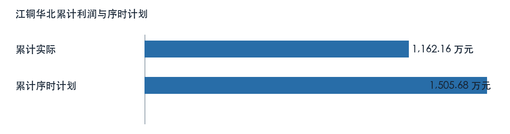

## 纳米克

纳米克七月利润为 83.48 万元，上月为 33.06 万元，环比增加。一至七月累计为 343.84 万元，上年同期为 307.00 万元，同比增加。累计序时计划为 189.08 万元，实际与计划差额为 154.76 万元。本月与上月差额为 50.42 万元，累计与上年同期差额为 36.84 万元。

| 利润比较项目 | 金额（万元） |
| --- | ---: |
| 本月 | 83.48 |
| 上月 | 33.06 |
| 本年累计 | 343.84 |
| 上年同期累计 | 307.00 |
| 年度计划 | 324.14 |
| 累计序时计划 | 189.08 |

来源定位：〔来源：利润计划执行情况表_2026-10-14.xlsx，sheet:Sheet1/cell:F45〕。

### 盈亏节奏与预算进度

该单位累计利润高于表内序时计划；当月与上月、累计与同期分别属于不同时间窗口。利润快报未给出上年同月数，也未提供足以解释本月波动的损益桥，不能以累计同比替代单月同比。

经营原因仍需月度损益桥、产销、订单及成本台账验证，不能从利润差额直接推定。

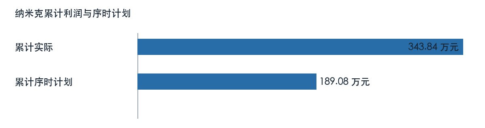

## 江西电缆

江西电缆七月利润为 236.20 万元，上月为 224.56 万元，环比增加。一至七月累计为 1676.96 万元，上年同期为 1484.89 万元，同比增加。累计序时计划为 1764.21 万元，实际与计划差额为 -87.24 万元。本月与上月差额为 11.64 万元，累计与上年同期差额为 192.07 万元。

| 利润比较项目 | 金额（万元） |
| --- | ---: |
| 本月 | 236.20 |
| 上月 | 224.56 |
| 本年累计 | 1676.96 |
| 上年同期累计 | 1484.89 |
| 年度计划 | 3024.36 |
| 累计序时计划 | 1764.21 |

来源定位：〔来源：利润计划执行情况表_2026-10-14.xlsx，sheet:Sheet1/cell:F46〕。

### 盈亏节奏与预算进度

该单位累计利润低于表内序时计划；当月与上月、累计与同期分别属于不同时间窗口。利润快报未给出上年同月数，也未提供足以解释本月波动的损益桥，不能以累计同比替代单月同比。

经营原因仍需月度损益桥、产销、订单及成本台账验证，不能从利润差额直接推定。

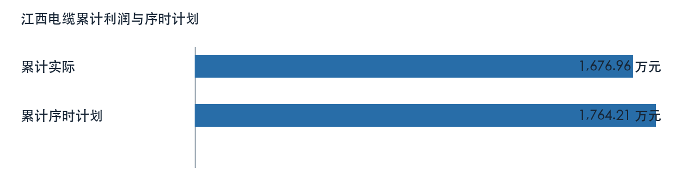

## 广州铜材

广州铜材七月利润为 594.31 万元，上月为 460.49 万元，环比增加。一至七月累计为 2837.87 万元，上年同期为 2601.52 万元，同比增加。累计序时计划为 2682.88 万元，实际与计划差额为 154.99 万元。本月与上月差额为 133.81 万元，累计与上年同期差额为 236.36 万元。

| 利润比较项目 | 金额（万元） |
| --- | ---: |
| 本月 | 594.31 |
| 上月 | 460.49 |
| 本年累计 | 2837.87 |
| 上年同期累计 | 2601.52 |
| 年度计划 | 4599.22 |
| 累计序时计划 | 2682.88 |

来源定位：〔来源：利润计划执行情况表_2026-10-14.xlsx，sheet:Sheet1/cell:F47〕。

### 盈亏节奏与预算进度

该单位累计利润高于表内序时计划；当月与上月、累计与同期分别属于不同时间窗口。利润快报未给出上年同月数，也未提供足以解释本月波动的损益桥，不能以累计同比替代单月同比。

### 经营指标与专项线索

| 主体及专项 | 指标 | 来源值 | 单位 |
| --- | --- | ---: | --- |
| 铜杆2.0（广州铜材） | 累计产品效益 | 1017.27 | 万元 |
| 铜杆2.0（广州铜材） | 同期产品效益 | 1161.95 | 万元 |
| 铜杆2.0（广州铜材） | 单位加工成本 | 849.40 | 元/吨 |
| 铜杆2.0（广州铜材） | 单位加工加价 | 1186.89 | 元/吨 |
| 铜杆2.6（广州铜材） | 累计产品效益 | 1385.64 | 万元 |
| 铜杆2.6（广州铜材） | 同期产品效益 | 2044.98 | 万元 |
| 铜杆2.6（广州铜材） | 单位加工成本 | 727.46 | 元/吨 |
| 铜杆2.6（广州铜材） | 单位加工加价 | 972.63 | 元/吨 |
| 铜杆8.0（广州铜材） | 累计产品效益 | 6494.32 | 万元 |
| 铜杆8.0（广州铜材） | 同期产品效益 | 6197.27 | 万元 |
| 铜杆8.0（广州铜材） | 单位加工成本 | 503.43 | 元/吨 |
| 铜杆8.0（广州铜材） | 单位加工加价 | 727.28 | 元/吨 |

取数示例：〔来源：铜加工板块加工费效益_2026-10-14.xlsx，sheet:Sheet1/cell:I16〕。

### 加工产品效益：铜杆8.0（广州铜材）

累计产品效益为 6494.32 万元，比较值为 6197.27 万元，方向为增加。来源定位：〔来源：铜加工板块加工费效益_2026-10-14.xlsx，sheet:Sheet1/cell:C14〕。

### 加工产品效益：铜杆2.6（广州铜材）

累计产品效益为 1385.64 万元，比较值为 2044.98 万元，方向为减少。来源定位：〔来源：铜加工板块加工费效益_2026-10-14.xlsx，sheet:Sheet1/cell:C15〕。

### 加工产品效益：铜杆2.0（广州铜材）

累计产品效益为 1017.27 万元，比较值为 1161.95 万元，方向为减少。来源定位：〔来源：铜加工板块加工费效益_2026-10-14.xlsx，sheet:Sheet1/cell:C16〕。

以上专项与利润快报可能存在期间、主体或计量差异。财务和业务岗位须核对合同、结算、产销与成本归集后，再解释利润变动；来源表专项影响不重复计入单位利润。

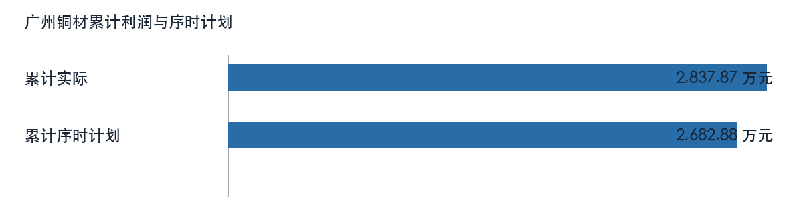

## 广州新材料

广州新材料七月利润为 48.83 万元，上月为 42.20 万元，环比增加。一至七月累计为 338.70 万元，上年同期为 314.00 万元，同比增加。累计序时计划为 -298.72 万元，实际与计划差额为 637.42 万元。本月与上月差额为 6.63 万元，累计与上年同期差额为 24.70 万元。计划值为零或负时只列算术差额，不套用正目标完成率。

| 利润比较项目 | 金额（万元） |
| --- | ---: |
| 本月 | 48.83 |
| 上月 | 42.20 |
| 本年累计 | 338.70 |
| 上年同期累计 | 314.00 |
| 年度计划 | -512.10 |
| 累计序时计划 | -298.72 |

来源定位：〔来源：利润计划执行情况表_2026-10-14.xlsx，sheet:Sheet1/cell:F48〕。

### 盈亏节奏与预算进度

该单位累计利润高于表内序时计划；当月与上月、累计与同期分别属于不同时间窗口。利润快报未给出上年同月数，也未提供足以解释本月波动的损益桥，不能以累计同比替代单月同比。

### 经营指标与专项线索

| 主体及专项 | 指标 | 来源值 | 单位 |
| --- | --- | ---: | --- |
| 深加工线（广州新材料） | 累计产品效益 | 762.74 | 万元 |
| 深加工线（广州新材料） | 同期产品效益 | 788.97 | 万元 |
| 深加工线（广州新材料） | 单位加工成本 | 11044.57 | 元/吨 |
| 深加工线（广州新材料） | 单位加工加价 | 15295.77 | 元/吨 |

取数示例：〔来源：铜加工板块加工费效益_2026-10-14.xlsx，sheet:Sheet1/cell:I24〕。

### 加工产品效益：深加工线（广州新材料）

累计产品效益为 762.74 万元，比较值为 788.97 万元，方向为减少。来源定位：〔来源：铜加工板块加工费效益_2026-10-14.xlsx，sheet:Sheet1/cell:C24〕。

以上专项与利润快报可能存在期间、主体或计量差异。财务和业务岗位须核对合同、结算、产销与成本归集后，再解释利润变动；来源表专项影响不重复计入单位利润。

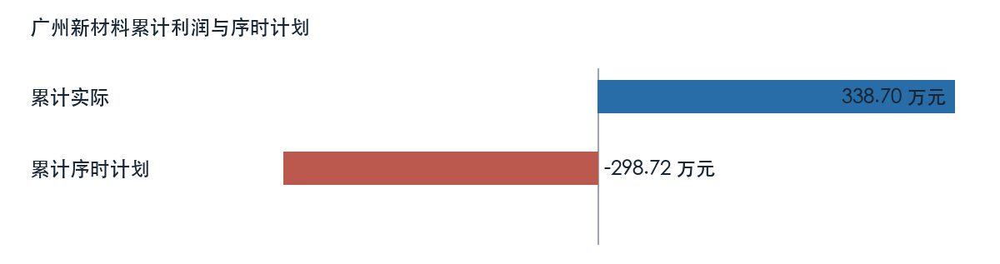

## 江铜光电

江铜光电七月利润为 232.76 万元，上月为 233.13 万元，环比减少。一至七月累计为 1653.38 万元，上年同期为 -2134.89 万元，同比由亏转盈。累计序时计划为 2070.74 万元，实际与计划差额为 -417.35 万元。本月与上月差额为 -0.37 万元，累计与上年同期差额为 3788.27 万元。

| 利润比较项目 | 金额（万元） |
| --- | ---: |
| 本月 | 232.76 |
| 上月 | 233.13 |
| 本年累计 | 1653.38 |
| 上年同期累计 | -2134.89 |
| 年度计划 | 3549.83 |
| 累计序时计划 | 2070.74 |

来源定位：〔来源：利润计划执行情况表_2026-10-14.xlsx，sheet:Sheet1/cell:F49〕。

### 盈亏节奏与预算进度

该单位累计利润低于表内序时计划；当月与上月、累计与同期分别属于不同时间窗口。利润快报未给出上年同月数，也未提供足以解释本月波动的损益桥，不能以累计同比替代单月同比。

经营原因仍需月度损益桥、产销、订单及成本台账验证，不能从利润差额直接推定。

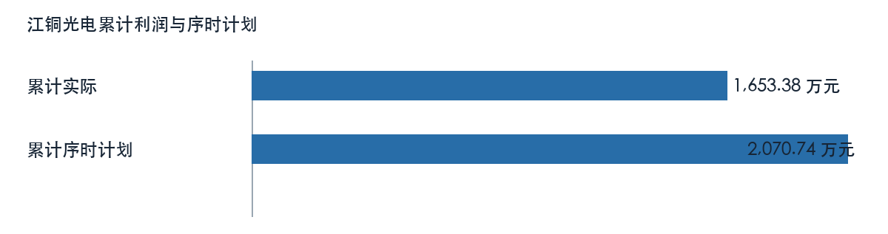

# 第四章 加工费效益与产品结构

加工产品按销量、单位加价、单位成本和效益观察；产品专项不等同单位会计净利润，负毛差不能直接推断停产决策。

## 铜管

| 主体及专项 | 指标 | 来源值 | 单位 |
| --- | --- | ---: | --- |
| 光管 | 累计产品效益 | 1366.99 | 万元 |
| 光管 | 同期产品效益 | 986.47 | 万元 |
| 光管 | 单位加工成本 | 4815.37 | 元/吨 |
| 光管 | 单位加工加价 | 6063.43 | 元/吨 |
| 内螺纹管 | 累计产品效益 | 3450.86 | 万元 |
| 内螺纹管 | 同期产品效益 | 3637.49 | 万元 |
| 内螺纹管 | 单位加工成本 | 5922.93 | 元/吨 |
| 内螺纹管 | 单位加工加价 | 7943.56 | 元/吨 |

取数示例：〔来源：铜加工板块加工费效益_2026-10-14.xlsx，sheet:Sheet1/cell:I5〕。

## 江铜华北铜杆

| 主体及专项 | 指标 | 来源值 | 单位 |
| --- | --- | ---: | --- |
| 铜杆8.0（江铜华北） | 累计产品效益 | 1815.64 | 万元 |
| 铜杆8.0（江铜华北） | 同期产品效益 | 1039.89 | 万元 |
| 铜杆8.0（江铜华北） | 单位加工成本 | 424.63 | 元/吨 |
| 铜杆8.0（江铜华北） | 单位加工加价 | 631.36 | 元/吨 |
| 铜杆2.6（江铜华北） | 累计产品效益 | 254.80 | 万元 |
| 铜杆2.6（江铜华北） | 同期产品效益 | 274.34 | 万元 |
| 铜杆2.6（江铜华北） | 单位加工成本 | 655.74 | 元/吨 |
| 铜杆2.6（江铜华北） | 单位加工加价 | 945.87 | 元/吨 |

取数示例：〔来源：铜加工板块加工费效益_2026-10-14.xlsx，sheet:Sheet1/cell:I8〕。

## 华东铜材铜杆

| 主体及专项 | 指标 | 来源值 | 单位 |
| --- | --- | ---: | --- |
| 铜杆8.0（华东铜材） | 累计产品效益 | -514.72 | 万元 |
| 铜杆8.0（华东铜材） | 同期产品效益 | -709.53 | 万元 |
| 铜杆8.0（华东铜材） | 单位加工成本 | 665.14 | 元/吨 |
| 铜杆8.0（华东铜材） | 单位加工加价 | 607.53 | 元/吨 |

取数示例：〔来源：铜加工板块加工费效益_2026-10-14.xlsx，sheet:Sheet1/cell:I10〕。

## 铜业铜材铜杆

| 主体及专项 | 指标 | 来源值 | 单位 |
| --- | --- | ---: | --- |
| 铜杆8.0（铜业铜材） | 累计产品效益 | 2838.38 | 万元 |
| 铜杆8.0（铜业铜材） | 同期产品效益 | 2461.94 | 万元 |
| 铜杆8.0（铜业铜材） | 单位加工成本 | 457.41 | 元/吨 |
| 铜杆8.0（铜业铜材） | 单位加工加价 | 623.25 | 元/吨 |
| 铜杆3.0（铜业铜材） | 累计产品效益 | 556.09 | 万元 |
| 铜杆3.0（铜业铜材） | 同期产品效益 | 331.31 | 万元 |
| 铜杆3.0（铜业铜材） | 单位加工成本 | 661.85 | 元/吨 |
| 铜杆3.0（铜业铜材） | 单位加工加价 | 934.76 | 元/吨 |
| 铜杆2.6（铜业铜材） | 累计产品效益 | 339.78 | 万元 |
| 铜杆2.6（铜业铜材） | 同期产品效益 | 387.55 | 万元 |
| 铜杆2.6（铜业铜材） | 单位加工成本 | 774.21 | 元/吨 |
| 铜杆2.6（铜业铜材） | 单位加工加价 | 1052.14 | 元/吨 |

取数示例：〔来源：铜加工板块加工费效益_2026-10-14.xlsx，sheet:Sheet1/cell:I11〕。

## 广州铜材铜杆

| 主体及专项 | 指标 | 来源值 | 单位 |
| --- | --- | ---: | --- |
| 铜杆8.0（广州铜材） | 累计产品效益 | 6494.32 | 万元 |
| 铜杆8.0（广州铜材） | 同期产品效益 | 6197.27 | 万元 |
| 铜杆8.0（广州铜材） | 单位加工成本 | 503.43 | 元/吨 |
| 铜杆8.0（广州铜材） | 单位加工加价 | 727.28 | 元/吨 |
| 铜杆2.6（广州铜材） | 累计产品效益 | 1385.64 | 万元 |
| 铜杆2.6（广州铜材） | 同期产品效益 | 2044.98 | 万元 |
| 铜杆2.6（广州铜材） | 单位加工成本 | 727.46 | 元/吨 |
| 铜杆2.6（广州铜材） | 单位加工加价 | 972.63 | 元/吨 |
| 铜杆2.0（广州铜材） | 累计产品效益 | 1017.27 | 万元 |
| 铜杆2.0（广州铜材） | 同期产品效益 | 1161.95 | 万元 |
| 铜杆2.0（广州铜材） | 单位加工成本 | 849.40 | 元/吨 |
| 铜杆2.0（广州铜材） | 单位加工加价 | 1186.89 | 元/吨 |

取数示例：〔来源：铜加工板块加工费效益_2026-10-14.xlsx，sheet:Sheet1/cell:I14〕。

## 集团铜材线材

| 主体及专项 | 指标 | 来源值 | 单位 |
| --- | --- | ---: | --- |
| 裸铜线（集团铜材） | 累计产品效益 | 606.10 | 万元 |
| 裸铜线（集团铜材） | 同期产品效益 | 859.30 | 万元 |
| 裸铜线（集团铜材） | 单位加工成本 | 3248.28 | 元/吨 |
| 裸铜线（集团铜材） | 单位加工加价 | 4398.57 | 元/吨 |
| 镀锡线（集团铜材） | 累计产品效益 | 617.13 | 万元 |
| 镀锡线（集团铜材） | 同期产品效益 | 1133.28 | 万元 |
| 镀锡线（集团铜材） | 单位加工成本 | 4952.67 | 元/吨 |
| 镀锡线（集团铜材） | 单位加工加价 | 7403.96 | 元/吨 |

取数示例：〔来源：铜加工板块加工费效益_2026-10-14.xlsx，sheet:Sheet1/cell:I18〕。

## 台意漆包线

| 主体及专项 | 指标 | 来源值 | 单位 |
| --- | --- | ---: | --- |
| 漆包线（台意） | 累计产品效益 | 2592.04 | 万元 |
| 漆包线（台意） | 同期产品效益 | 2014.63 | 万元 |
| 漆包线（台意） | 单位加工成本 | 7911.53 | 元/吨 |
| 漆包线（台意） | 单位加工加价 | 10346.46 | 元/吨 |

取数示例：〔来源：铜加工板块加工费效益_2026-10-14.xlsx，sheet:Sheet1/cell:I20〕。

## 华东电工线材

| 主体及专项 | 指标 | 来源值 | 单位 |
| --- | --- | ---: | --- |
| 漆包圆线（华东电工） | 累计产品效益 | 1308.49 | 万元 |
| 漆包圆线（华东电工） | 同期产品效益 | 1270.55 | 万元 |
| 漆包圆线（华东电工） | 单位加工成本 | 7009.59 | 元/吨 |
| 漆包圆线（华东电工） | 单位加工加价 | 9104.12 | 元/吨 |
| 漆包扁线（华东电工） | 累计产品效益 | 625.65 | 万元 |
| 漆包扁线（华东电工） | 同期产品效益 | 516.70 | 万元 |
| 漆包扁线（华东电工） | 单位加工成本 | 8395.28 | 元/吨 |
| 漆包扁线（华东电工） | 单位加工加价 | 10970.97 | 元/吨 |
| 裸铜线（华东电工） | 累计产品效益 | 1109.70 | 万元 |
| 裸铜线（华东电工） | 同期产品效益 | 860.44 | 万元 |
| 裸铜线（华东电工） | 单位加工成本 | 3291.67 | 元/吨 |
| 裸铜线（华东电工） | 单位加工加价 | 4627.53 | 元/吨 |

取数示例：〔来源：铜加工板块加工费效益_2026-10-14.xlsx，sheet:Sheet1/cell:I21〕。

## 广州新材料深加工线

| 主体及专项 | 指标 | 来源值 | 单位 |
| --- | --- | ---: | --- |
| 深加工线（广州新材料） | 累计产品效益 | 762.74 | 万元 |
| 深加工线（广州新材料） | 同期产品效益 | 788.97 | 万元 |
| 深加工线（广州新材料） | 单位加工成本 | 11044.57 | 元/吨 |
| 深加工线（广州新材料） | 单位加工加价 | 15295.77 | 元/吨 |

取数示例：〔来源：铜加工板块加工费效益_2026-10-14.xlsx，sheet:Sheet1/cell:I24〕。

## 标准铜箔

| 主体及专项 | 指标 | 来源值 | 单位 |
| --- | --- | ---: | --- |
| 标箔 | 累计产品效益 | 10320.31 | 万元 |
| 标箔 | 同期产品效益 | 6811.79 | 万元 |
| 标箔 | 单位加工成本 | 20873.06 | 元/吨 |
| 标箔 | 单位加工加价 | 25804.58 | 元/吨 |

取数示例：〔来源：铜加工板块加工费效益_2026-10-14.xlsx，sheet:Sheet1/cell:I26〕。

## 锂电铜箔

| 主体及专项 | 指标 | 来源值 | 单位 |
| --- | --- | ---: | --- |
| 锂电 | 累计产品效益 | -3756.10 | 万元 |
| 锂电 | 同期产品效益 | -2519.16 | 万元 |
| 锂电 | 单位加工成本 | 20598.62 | 元/吨 |
| 锂电 | 单位加工加价 | 17561.20 | 元/吨 |

取数示例：〔来源：铜加工板块加工费效益_2026-10-14.xlsx，sheet:Sheet1/cell:I27〕。

## 青铜板带

| 主体及专项 | 指标 | 来源值 | 单位 |
| --- | --- | ---: | --- |
| 青铜 | 累计产品效益 | 1315.02 | 万元 |
| 青铜 | 同期产品效益 | 880.42 | 万元 |
| 青铜 | 单位加工成本 | 9501.37 | 元/吨 |
| 青铜 | 单位加工加价 | 12158.79 | 元/吨 |

取数示例：〔来源：铜加工板块加工费效益_2026-10-14.xlsx，sheet:Sheet1/cell:I29〕。

## 紫铜板带

| 主体及专项 | 指标 | 来源值 | 单位 |
| --- | --- | ---: | --- |
| 紫铜 | 累计产品效益 | 2543.49 | 万元 |
| 紫铜 | 同期产品效益 | 3993.42 | 万元 |
| 紫铜 | 单位加工成本 | 6720.26 | 元/吨 |
| 紫铜 | 单位加工加价 | 8399.31 | 元/吨 |

取数示例：〔来源：铜加工板块加工费效益_2026-10-14.xlsx，sheet:Sheet1/cell:I30〕。

## 高铜板带

| 主体及专项 | 指标 | 来源值 | 单位 |
| --- | --- | ---: | --- |
| 高铜 | 累计产品效益 | -803.05 | 万元 |
| 高铜 | 同期产品效益 | -1575.29 | 万元 |
| 高铜 | 单位加工成本 | 14919.33 | 元/吨 |
| 高铜 | 单位加工加价 | 13899.68 | 元/吨 |

取数示例：〔来源：铜加工板块加工费效益_2026-10-14.xlsx，sheet:Sheet1/cell:I31〕。

产品归属、订单价格、良率及全成本与可避免成本须逐项核对；不能把产品效益重复加入板块利润。

# 第五章 利润质量与效益拆分

生产经营、期现对冲、暂定价与产品效益须分别核对，专项构成不追加到利润。

| 主体及专项 | 指标 | 来源值 | 单位 |
| --- | --- | ---: | --- |
| 加工事业部 | 生产经营效益 | 4334.53 | 万元 |
| 加工事业部 | 同期生产经营效益 | 11288.33 | 万元 |
| 江铜华北 | 生产经营效益 | 1134.75 | 万元 |
| 江铜华北 | 同期生产经营效益 | 1053.10 | 万元 |
| 集团合并 | 生产经营效益 | 1509361.70 | 万元 |
| 集团合并 | 同期生产经营效益 | 1056409.95 | 万元 |
| 光管 | 累计产品效益 | 1366.99 | 万元 |
| 光管 | 同期产品效益 | 986.47 | 万元 |
| 光管 | 单位加工成本 | 4815.37 | 元/吨 |
| 光管 | 单位加工加价 | 6063.43 | 元/吨 |
| 内螺纹管 | 累计产品效益 | 3450.86 | 万元 |
| 内螺纹管 | 同期产品效益 | 3637.49 | 万元 |
| 内螺纹管 | 单位加工成本 | 5922.93 | 元/吨 |
| 内螺纹管 | 单位加工加价 | 7943.56 | 元/吨 |
| 标箔 | 累计产品效益 | 10320.31 | 万元 |
| 标箔 | 同期产品效益 | 6811.79 | 万元 |
| 标箔 | 单位加工成本 | 20873.06 | 元/吨 |
| 标箔 | 单位加工加价 | 25804.58 | 元/吨 |
| 深加工线（广州新材料） | 累计产品效益 | 762.74 | 万元 |
| 深加工线（广州新材料） | 同期产品效益 | 788.97 | 万元 |
| 深加工线（广州新材料） | 单位加工成本 | 11044.57 | 元/吨 |
| 深加工线（广州新材料） | 单位加工加价 | 15295.77 | 元/吨 |
| 漆包圆线（华东电工） | 累计产品效益 | 1308.49 | 万元 |
| 漆包圆线（华东电工） | 同期产品效益 | 1270.55 | 万元 |

取数示例：〔来源：主要单位效益同比分析_2026-10-14.xlsx，sheet:Sheet1/cell:D16〕。

财务与业务岗位应提交同口径合同、结算和利润桥，缺口未补齐前只陈述表内方向。

# 第六章 共同经营特征与风险

加工板块七月利润为 4591.07 万元，上月为 5207.73 万元，环比减少。一至七月累计为 19646.81 万元，上年同期为 9195.64 万元，同比增加。累计序时计划为 22231.37 万元，实际与计划差额为 -2584.56 万元。本月与上月差额为 -616.67 万元，累计与上年同期差额为 10451.16 万元。

累计亏损单位为：华东铜材、高精铜板带。该名单仅用于逐户复核；板块包含关系及专项影响不再次加总。共同待核事项是月度利润桥、订单及库存、合同计价窗口与成本归集。

# 第七章 市场关联与情景边界

市场摘录的记载时点晚于二〇二六年七月，且部分报价缺原始出处；不用于解释本月经营结果。未来敏感性分析需先确认固定数量、产品规格、合同定价窗口、税制和币种，并核对专项范围，不能把情景金额写成已发生损失。

# 第八章 管理建议与待确认清单

## 经营复核顺序

财务先按单位核实当月与累计利润桥、序时计划版本和合并抵销；业务同步补合同、产销、库存、在途及订单。加工费、副产品、原料及产品加工效益先确认归属和是否已包含于利润，再讨论采购协同或经营措施。措施预期收益、责任人和时限尚无签认，维持待测算、待确认状态。

# 附录 材料使用与计算口径

累计序时差额按本年累计实际减累计序时计划计算；环比差额按本月减上月计算，累计同比差额按本年累计减上年同期累计计算，底层值不预先舍入；年度计划不均摊成月度预算。负基数、跨盈亏或负计划先说明盈亏方向，不套用普通完成率。来源定位示例如下：

| 来源 | 可回查定位 |
| --- | --- |
| 第1份业务工作簿 | 〔来源：利润计划执行情况表_2026-10-14.xlsx，sheet:Sheet1/cell:D6〕 |
| 第2份业务工作簿 | 〔来源：主要单位效益同比分析_2026-10-14.xlsx，sheet:Sheet1/cell:C5〕 |
| 第3份业务工作簿 | 〔来源：铜加工板块加工费效益_2026-10-14.xlsx，sheet:Sheet1/cell:C5〕 |

资料标记为 MOCK；集团合并抵销、组织归属、市场同期材料和经营成因仍待业务签认。

# 材料与口径追溯

上述来源索引的引用可回到本轮归档原件。原件指纹、来源单元格、配置与图表哈希保存在版本快照；市场摘录不进入七月行情事实。
